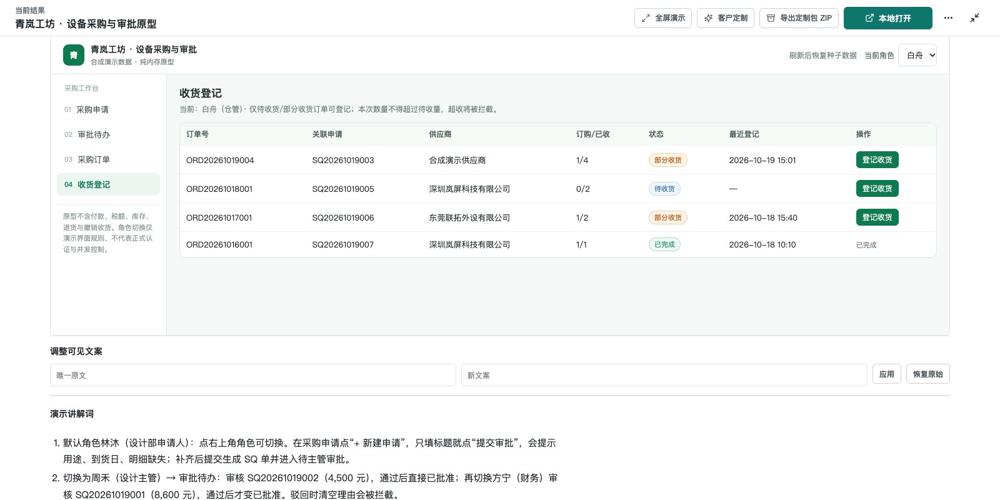

# Hermes PRD Workbench

[](https://github.com/YuxForge/hermes-prd-workbench/actions/workflows/check.yml)
[](https://yuxforge.github.io/hermes-prd-workbench/)
[](https://github.com/YuxForge/hermes-prd-workbench/releases)
[](LICENSE)

> **Turn messy requirement notes into reviewable, traceable PRDs, interactive prototypes, test plans, and technical specifications.**
> Upload source material, expose conflicting business rules, preserve human decisions, and generate downstream engineering drafts with Hermes Agent.

[Live Showcase (No registration)](https://yuxforge.github.io/hermes-prd-workbench/) · [Watch 60-Second Walkthrough](docs/examples/procurement/walkthrough.mp4) · [Download Deliverables Package](docs/examples/procurement/deliverables.zip) · [Read Case Study](docs/examples/procurement/README.md)

`Self-hosted` · `Immutable Agent Results` · `Separate Working Draft` · `Sandboxed HTML Preview` · `Real Synthetic Execution`

[中文说明](README.zh-CN.md) · [Quick start](#quick-start) · [Documentation](docs/README.md) · [Roadmap](https://github.com/YuxForge/hermes-prd-workbench/issues?q=is%3Aissue+is%3Aopen+label%3Aroadmap) · [Discussions](https://github.com/YuxForge/hermes-prd-workbench/discussions) · [Security](SECURITY.md)

[](https://yuxforge.github.io/hermes-prd-workbench/)

Hermes PRD Workbench is an Apache-2.0 self-hosted workspace for product and engineering teams. Upload source material once, preserve the original Agent result, refine a separate working draft, and continue from the same context into reviews and downstream deliverables.

Version **0.4.0-beta.2** is a fresh-install preview for a single instance on a local or trusted network. It has been validated on macOS arm64 and Windows 11 WSL2 with Docker Desktop Linux containers. Linux amd64 and native Windows deployments have not yet been declared supported.

## A concrete example: resolve a purchasing-rule conflict

One meeting note says manager approval is enough up to CNY 5,000; a follow-up says anything below CNY 10,000 needs no finance review. **A CNY 8,600 workstation takes a different approval route depending on which note a developer follows.**

In this fully synthetic case, a real Hermes review identified eight blocking questions. A maintainer then recorded explicit fictional business decisions, generated a four-module PRD, and saved a separate working draft before producing a clickable prototype and engineering handoff drafts. The package includes the review and decisions, PRD files, HTML Demo, test-case XLSX, technical specification, and an assumption-based effort-estimate XLSX.

Read the [input materials, results, remaining questions, and verification record](docs/examples/procurement/README.md). The recording is an edited replay of real browser interactions; 60 seconds is the video length, not model generation time. All materials are synthetic, model outputs need human review, and the static prototype is not a production procurement system. The walkthrough and generated business documents are in Chinese.

## What it produces

| Mode | Deliverable |
| --- | --- |
| Review | Findings, questions, recommendations, and recorded decisions |
| Generate | Multi-file PRD package plus an editable current draft |
| Demo | Self-contained single-file HTML demonstration |
| POC | Static HTML/CSS/JS prototype package and ZIP |
| Estimate | Explicit-assumption effort estimate and XLSX export |
| Test case | Multi-file test plan and XLSX export |
| Technical specification | Architecture, data model, API, and Markdown package |

The original generated result stays immutable. User edits and review decisions are stored separately. Failed work is rerun manually, with no silent result repair or automatic retry.

## Quick start

Requirements: Docker Engine or Docker Desktop with Compose v2, plus Python 3.10+. On Windows, run every command inside the WSL2 Linux filesystem and enable Docker Desktop WSL2 integration.

```bash
git clone https://github.com/YuxForge/hermes-prd-workbench.git
cd hermes-prd-workbench
./workbench setup
./workbench config
./workbench start
./workbench doctor
```

`setup` asks for a tool-capable Chat Completions endpoint, model name, model API key, and initial administrator credentials. Secret input is hidden and stored under `.runtime/secrets`; non-secret configuration is stored in `.env`. Neither location is committed.

Open [http://127.0.0.1:8180](http://127.0.0.1:8180) after `doctor` succeeds. Stop the stack with `./workbench stop`; this preserves the database, uploads, and Hermes state volumes.

See the [self-hosting guide](docs/deployment/self-hosting.md) for upgrades, backup/restore, CORS troubleshooting, and deployment boundaries.

## Product views

All screenshots below use synthetic acceptance data.

| Generated deliverable | Mobile workflow |
| --- | --- |
|  |  |

| Static POC generation | Sandboxed HTML preview |
| --- | --- |
|  |  |

Generated HTML is displayed in an iframe with `sandbox="allow-scripts"` and no `allow-same-origin`, including new-window wrappers. Generated JavaScript is never executed in Node VM or Happy DOM. Raw downloads remain separate artifacts.

## Architecture and boundaries

```text
Browser ──HTTP──> Nginx/Web ──> Spring MVC control plane ──> MySQL
                                  │
                                  └──> dedicated Hermes Agent runtime
                                           │
                                           └──> operator-selected model endpoint
```

Hermes makes business conclusions, priorities, and document-organization decisions. The Java control plane validates run/mode, basic JSON and size limits, and minimum artifact structure. Model credentials never enter the browser, and product tools cannot access arbitrary host files, terminals, browsers, networking, memory, delegation, or skill mutation.

The default deployment does not require Nacos, Redis, MinIO, a queue, or a public SaaS control plane. Browser telemetry is disabled by default. Uploaded material is sent to the model service selected by the operator, subject to that provider's data policy.

## Documentation

- [Product boundaries](docs/product.md)
- [Architecture](docs/architecture/overview.md)
- [API and result contracts](docs/architecture/contracts.md)
- [Self-hosting and recovery](docs/deployment/self-hosting.md)
- [Development setup](docs/development/getting-started.md)
- [Test and acceptance cases](docs/testing/test-cases.md)
- [Release decisions and residual risks](docs/maintainers/security-release-decision.md)

## Contributing and support

Questions, setup reports, and ideas belong in [GitHub Discussions](https://github.com/YuxForge/hermes-prd-workbench/discussions). Reproducible defects belong in [Issues](https://github.com/YuxForge/hermes-prd-workbench/issues). Please use synthetic materials and never attach credentials, customer documents, complete prompts, or private model responses.

See [CONTRIBUTING.md](CONTRIBUTING.md), the [Code of Conduct](CODE_OF_CONDUCT.md), and the [security policy](SECURITY.md). Private vulnerability reporting is enabled on GitHub.

## License

Hermes PRD Workbench is licensed under [Apache-2.0](LICENSE). Third-party components retain their own licenses; Hermes Agent is MIT. See [NOTICE](NOTICE) and the [third-party inventory](docs/maintainers/third-party.md).
