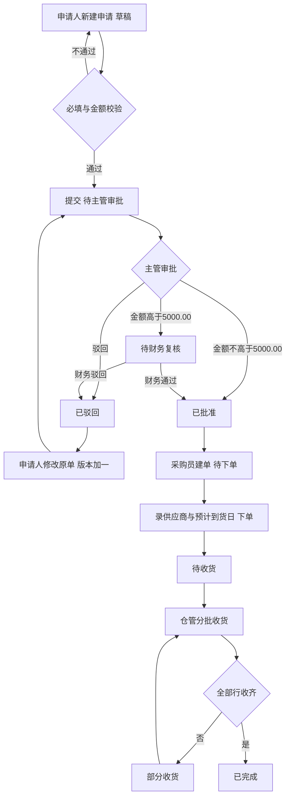
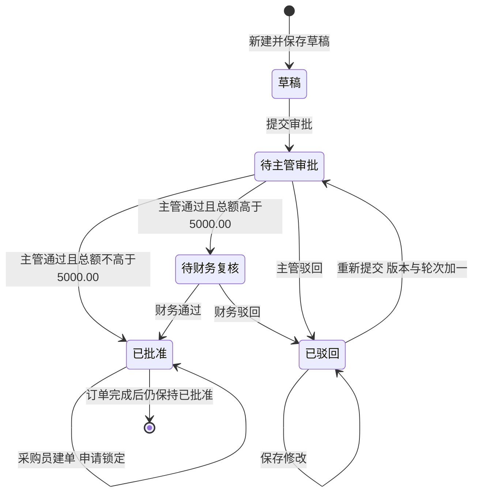
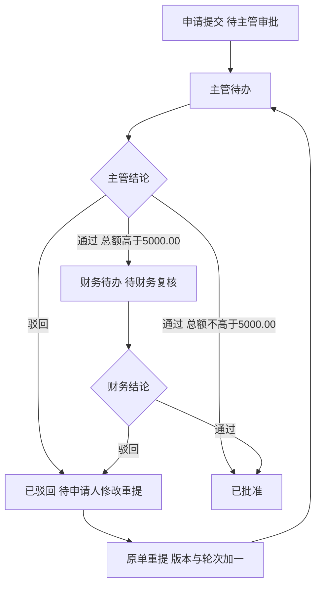
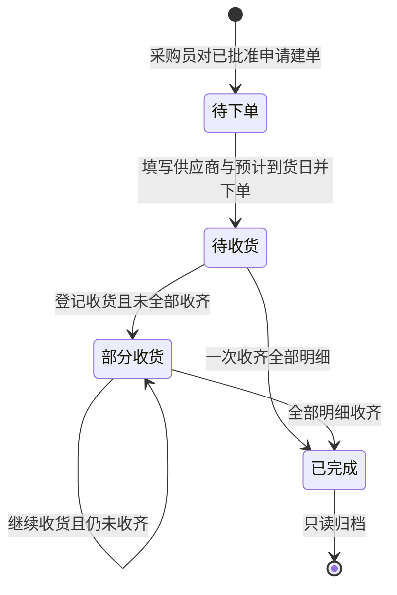
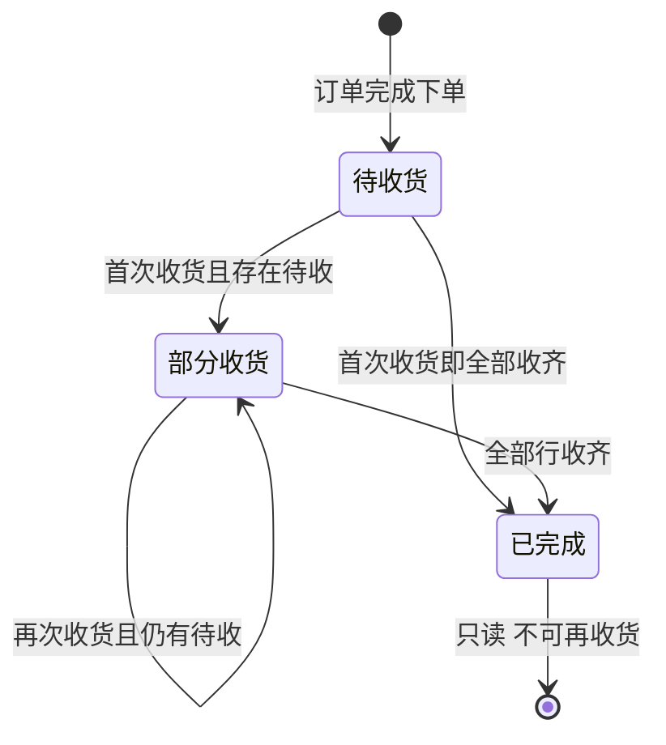

# 1 设备采购与审批（一期）PRD 文档包

> 按 04 人工确认单 D01–D08 统一了 5,000 元阈值、五状态、固定代审与驳回原单重提等冲突，生成覆盖采购申请、审批待办、采购订单、收货登记四个模块的标准文档包。每模块含页面清单、字段矩阵、闭合 Mermaid、BR 规则与可判定 AC；AC01–AC09 全部落到具体模块。未新增第五模块，未改变一期边界，材料空白处均标为假设或待确认。

---

<!-- file: 00-overview.md -->

# 2 总览：目标、范围与决策

## 2.1 文档定位

本包定义「青岚工坊」一期桌面端设备采购工作台。业务链路是：申请人建单并提交 → 主管按金额决定批准或转财务 → 采购员对已批准申请建单并下单 → 仓管按行分批收货 → 全部收齐订单完成。一期只解决「这笔采购走到哪一步、谁批的、收了多少」，不解决资产与付款。

读者为前端、后端、测试与需求评审人。文档中的编号（BR-/AC-）是跨文档引用锚点，测试用例与技术方案应直接引用，不另起口径。

## 2.2 目标

| 编号 | 目标 | 可验证口径 |
| --- | --- | --- |
| G1 | 单据全程可追溯 | 任一申请可查申请人、每轮审批人（含代审）、订单、每笔收货的操作人/时间/动作/备注，无断点 |
| G2 | 审批金额口径唯一 | 以分为单位计算总额；≤5,000.00 元主管单级，>5,000.00 元财务二级；5,000.00 与 5,000.01 结果不同 |
| G3 | 职责分离可验证 | 申请人、主管、财务、采购员、仓管的数据范围与动作边界由服务端判定，越权返回 403 且不产生数据变更 |
| G4 | 关键异常可复现 | 重复审批、重复建单、超收、审批中编辑、刷新重置均有确定表现，不出现「既批准又驳回」 |

## 2.3 一期范围

| 模块 | key | 覆盖能力 | 本期不做 |
| --- | --- | --- | --- |
| 采购申请 | `purchase-request` | 草稿保存、编辑、必填与金额校验、提交、驳回后原单重提（版本+1）、详情与审计时间线、列表搜索/筛选/分页、财务本人高额申请提交拦截 | 删除、撤回、附件、预算占用、资产台账、历史数据迁移 |
| 审批待办 | `approval-todo` | 主管待办（本部门+固定代审）、财务待办（跨部门）、通过/驳回、驳回理由、审批记录与轮次、重复审批 409 | 转办、加签、批量审批、审批流配置、消息通知、已办列表 |
| 采购订单 | `purchase-order` | 已批准申请建单（一申请一订单）、明细快照只读、录供应商与预计到货日下单、状态随收货推进 | 多供应商拆单、订单修改/取消、合同与发票、价格库 |
| 收货登记 | `receiving` | 待收货订单、按行登记本次收货、分批累计、超收拦截、收货记录只读 | 退货、收货撤销、质检、入库上架、库存台账 |

四个模块均为核心模块，缺一不可；不设第五个一级模块，角色维护只以预置数据提供。

## 2.4 非目标

- 付款、报销、发票、资产折旧、财务总账或 ERP 对接。
- 邮件、短信、IM 通知；供应商系统对接；企业通讯录、SSO、组织架构同步。
- 审批阈值配置中心、税额拆分、多币种与汇率；一期固定 5,000.00 元人民币阈值。
- 角色与权限维护界面；系统管理员仅以预置数据存在。
- 消息队列、分布式锁、独立幂等表等并发基础设施。
- 历史表格数据迁移；审计导出、自动清理与归档。
- 移动端、多端同步、离线使用。

## 2.5 角色

| 角色 | 角色代码 | 演示人员 | 一期职责 | 数据范围 |
| --- | --- | --- | --- | --- |
| 申请人 | APPLICANT | 林沐（设计部）、陈星（研发部） | 新建、保存草稿、编辑、提交、查看本人单据与驳回理由 | 仅本人申请 |
| 部门主管 | DEPT_APPROVER | 周禾（设计部）、许原（研发部） | 主管级通过/驳回；仅本部门；固定代审对方部门 | 本部门待办、授权代审单、本部门单据只读（见 Q5） |
| 财务复核员 | FIN_APPROVER | 方宁 | 对 >5,000.00 元申请做二级复核，跨部门 | 全部「待财务复核」单据 |
| 采购员 | BUYER | 苏青 | 对已批准申请建单、录供应商与预计到货日下单 | 已批准申请、全部订单 |
| 仓管 | WAREHOUSE | 白舟 | 登记实际收货、查看收货记录 | 待收货/部分收货订单及收货记录 |
| 系统管理员 | ADMIN | 预置账号 | 维护角色与人员（本期无界面） | 全部（运维用途，不参与业务审批） |

## 2.6 关键决策（D01–D08）

| 编号 | 决策 | 对实现的硬约束 | 影响模块 |
| --- | --- | --- | --- |
| D01 | 金额按明细合计判断；数量 1–999 整数，单价 0.00–999999.99；≤5,000.00 主管通过即批准，>5,000.00 需财务复核；5,000.00 免财务，5,000.01 与 8,600.00 需财务 | 阈值固定，不做配置；禁止浮点误差改变路由 | 申请、审批 |
| D02 | 财务复核在「审批待办」内以角色筛选；状态为草稿/待主管审批/待财务复核/已批准/已驳回；两级驳回均到已驳回；财务可跨部门；任何审批不能由申请人执行 | 五状态不可合并；财务待办是同一模块的视图 | 申请、审批 |
| D03 | 周禾与许原固定互审并写审计；普通主管无跨部门权；方宁高额申请禁止提交；申请人只看自己；采购员/仓管跨部门只读履职单据且不可互代 | 代审是固定授权，不是通用代理关系 | 全部 |
| D04 | 驳回后原单重提，单号不变，版本与审批轮次递增，上一轮记录只读，新一轮走完整审批链；审批中不可修改或撤回；订单只对应已批准版本；已建单申请不可再编辑 | 版本与轮次必须落库并展示 | 申请、审批、订单 |
| D05 | 一申请最多一订单；订单状态待下单/待收货/部分收货/已完成；建单→待下单，下单→待收货，部分到货→部分收货，全部收齐→已完成；申请保持已批准 | 订单状态只由下单与收货驱动 | 订单、收货 |
| D06 | 正式系统用事务内状态/版本条件更新防重复审批，申请关联唯一约束防重复建单，收货写入再校验待收量，冲突返回 409；不引入 MQ/分布式锁 | 409 必须可被前端识别并提示刷新 | 审批、订单、收货 |
| D07 | 保存草稿生成唯一单号；标题 1–100、用途 1–500、物品名称 1–100、规格≤100、单位台/个/件；驳回理由 1–200；期望到货日不早于当天；供应商 1–100、预计到货日不早于下单日；收货数量为正整数且不超剩余 | 字段长度与边界即为验收口径 | 全部 |
| D08 | 验收覆盖 AC01–AC09；PRD/测试/技术方案引用同一编号；工作量仅开发与研发自测 | AC 编号不得重排或拆分 | 全部 |

## 2.7 假设

| 编号 | 假设 | 理由与影响 |
| --- | --- | --- |
| A01 | 单号规则：申请 `SQ-YYYYMMDD-NNNN`、订单 `DD-YYYYMMDD-NNNN`、收货 `SH-YYYYMMDD-NNNN`，按日四位流水，保存成功时生成，不回收 | 材料只要求唯一；规则需可开发，待 Q2 确认 |
| A02 | 时区 Asia/Shanghai，时间展示 `yyyy-MM-dd HH:mm`；「当天」以服务端日期为准 | 期望到货日与预计到货日校验依赖当天定义 |
| A03 | 金额以分为整数存储计算；行金额=数量×单价（分），总额=各行金额之和；展示千分位两位小数 | D01 禁止浮点误差；单价两位小数乘整数不会产生半分 |
| A04 | 申请明细最多 50 行，提交时至少 1 行 | 材料未定上限，按演示与性能设定 |
| A05 | 方宁归属财务部，一期无财务部主管；其本人低额申请提交流程未定义，按 Q1 处理 | D03 只规定高额禁止提交，不能外推 |
| A06 | 主管可只读查看本部门全部申请，审批动作仅限「待主管审批」 | 材料只写待办范围，历史可见性待 Q5 确认 |
| A07 | 采购员与仓管可跨部门查看履职所需单据，但只能执行本角色动作 | D03 明确不可互代 |
| A08 | 列表按创建时间倒序、10 条/页；搜索匹配单号或标题，去首尾空格、不区分大小写；筛选条件在返回列表时保留 | D07 列表规范 |

## 2.8 术语

| 术语 | 定义 |
| --- | --- |
| 申请 | 一次设备采购需求的主单，含标题、部门、用途、期望到货日与明细 |
| 申请版本 | 申请内容的版本号，初始 1；驳回后修改重提 +1；订单绑定审批通过的版本 |
| 审批轮次 | 与版本号同号的审批回合；每轮审批记录独立只读，轮次号即版本号 |
| 代审 | D03 授权的跨部门主管审批，必须记录实际操作人与被代审部门 |
| 行金额 | 数量 × 单价，以分计算，展示两位小数 |
| 申请总额 | 全部明细行金额之和，是金额路由的唯一依据 |
| 待收数量 | 订单行订购数量 − 该行累计已收数量，最小为 0 |
| 部分收货 | 订单至少一行有收货且仍有待收数量 |
| 快照 | 建单时固化的申请版本明细，后续申请变化不影响已建订单 |
| 409 冲突 | 状态或版本已被他人改变，本次写入被拒绝，需刷新后重试 |
| 种子数据 | 静态原型内置的合成单据，刷新即恢复 |

## 2.9 验收索引

| 编号 | 场景 | 主责模块 | 详见 |
| --- | --- | --- | --- |
| AC01 | 草稿保存与必填/边界校验 | 采购申请 | `modules/purchase-request.md` |
| AC02 | 5,000.00 元主管单级审批 | 审批待办 | `modules/approval-todo.md` |
| AC03 | 5,000.01 元与 8,600.00 元财务二级审批 | 审批待办 | `modules/approval-todo.md` |
| AC04 | 自审拦截与固定代审 | 审批待办 | `modules/approval-todo.md` |
| AC05 | 驳回后原单重提（单号不变、版本+1） | 采购申请 | `modules/purchase-request.md` |
| AC06 | 一申请一订单与重复建单拦截 | 采购订单 | `modules/purchase-order.md` |
| AC07 | 分两次收货、累计进度与超收拦截 | 收货登记 | `modules/receiving.md` |
| AC08 | 数据范围隔离与历史只读 | 采购申请 | `modules/purchase-request.md` |
| AC09 | 静态原型刷新回到种子数据 | 原型边界 | `04-nfr.md` |

## 2.10 交付与核对

本包为模型辅助草案，发布前由人核对；不构成采购合规审查结论，也不代表可直接生产部署。原型不连接后端、不调用外部网络、不含账号密钥、不执行真实交易。`open-questions.md` 中 6 个问题需业务方书面确认后，方可进入技术方案与测试设计。

---

<!-- file: 01-ia.md -->

# 3 信息架构与导航

## 3.1 设计原则

- 桌面优先，基准 1366×768；左侧固定一级导航 4 项，主区为「列表 → 详情」结构，页面宽度自适应但不做移动端布局。
- 单据以单号为唯一入口：列表、详情、时间线、关联单据中出现的单号均可点击。
- 全局只保留一套状态词汇（见 `02-global.md`），不在页面另造「审核中」「部分到货」等同义词。
- 角色切换仅用于原型演示，不改变服务端授权模型；正式系统中角色由登录身份决定。

## 3.2 三级菜单树

| 一级 | 模块 key | 二级页面 | 三级动作/视图 | 路由 |
| --- | --- | --- | --- | --- |
| 采购申请 | `purchase-request` | 申请列表 | 列表、搜索、状态筛选、分页、新建 | `#/requests` |
| 采购申请 | `purchase-request` | 申请编辑 | 新建、编辑草稿、修改已驳回单、提交 | `#/requests/new`、`#/requests/:id/edit` |
| 采购申请 | `purchase-request` | 申请详情 | 基本信息、物品明细、审批记录、审计时间线、关联订单 | `#/requests/:id` |
| 审批待办 | `approval-todo` | 主管待办 | 本部门待办、代审待办、进入审批 | `#/approvals/supervisor` |
| 审批待办 | `approval-todo` | 财务待办 | 跨部门待财务复核、进入审批 | `#/approvals/finance` |
| 审批待办 | `approval-todo` | 审批详情 | 申请只读快照、历史轮次、通过/驳回 | `#/approvals/:id` |
| 采购订单 | `purchase-order` | 订单列表 | 列表、搜索、状态筛选、创建订单 | `#/orders` |
| 采购订单 | `purchase-order` | 建单与下单 | 生成订单（待下单）、录入供应商与预计到货日下单 | `#/orders/new?requestId=:id`、`#/orders/:id/place` |
| 采购订单 | `purchase-order` | 订单详情 | 订单信息、明细快照、收货进度、收货记录入口 | `#/orders/:id` |
| 收货登记 | `receiving` | 待收货订单 | 待收货/部分收货订单、进入登记 | `#/receiving` |
| 收货登记 | `receiving` | 收货登记 | 按行填本次数量、提交收货 | `#/receiving/:orderId/new` |
| 收货登记 | `receiving` | 收货记录 | 收货单头、明细、只读历史 | `#/receiving/records/:recordId` |

菜单 key 与 `data/catalog.json` 完全一致，不新增第五个一级入口；`open-questions.md`、审计时间线均不作为独立菜单。

## 3.3 页面清单与角色可见性

| 页面 | 路由 | 可见角色 | 主操作 | 操作结果 |
| --- | --- | --- | --- | --- |
| 申请列表 | `#/requests` | 申请人（本人） | 搜索、筛选、分页、新建 | 列表按创建时间倒序；空结果显示「暂无匹配单据」 |
| 申请编辑 | `#/requests/new`、`#/requests/:id/edit` | 申请人（本人，草稿或已驳回） | 保存草稿、提交 | 生成单号或版本+1；提交后进入待主管审批 |
| 申请详情 | `#/requests/:id` | 申请人本人、本部门主管、财务（限待复核）、采购员/仓管（限已批准） | 查看、编辑、提交 | 按状态与角色显示可用动作，其余只读 |
| 主管待办 | `#/approvals/supervisor` | 部门主管 | 审批、查看详情 | 通过后按金额转已批准或待财务复核 |
| 财务待办 | `#/approvals/finance` | 财务复核员 | 审批、查看详情 | 通过→已批准；驳回→已驳回 |
| 审批详情 | `#/approvals/:id` | 当前待办处理人 | 通过、驳回 | 写审批记录，关闭当前待办 |
| 订单列表 | `#/orders` | 采购员、仓管（只读）、财务（只读） | 搜索、筛选、创建订单 | 进入订单详情或建单页 |
| 建单与下单 | `#/orders/new`、`#/orders/:id/place` | 采购员 | 生成订单、下单 | 待下单→待收货，回填供应商与预计到货日 |
| 订单详情 | `#/orders/:id` | 采购员、仓管、财务、申请人（限本人单据已建单） | 查看、下单、去收货 | 展示明细快照与按数量汇总的收货进度 |
| 待收货订单 | `#/receiving` | 仓管 | 搜索、进入登记 | 仅显示待收货/部分收货 |
| 收货登记 | `#/receiving/:orderId/new` | 仓管 | 提交本次收货 | 生成收货单，累计进度更新，可能推进订单状态 |
| 收货记录 | `#/receiving/records/:recordId` | 仓管、采购员、财务 | 查看 | 只读；历史记录不可修改 |

## 3.4 主导航行为

- 四个一级项固定顺序：采购申请、审批待办、采购订单、收货登记；不因角色隐藏整个模块，只隐藏无权限的页面与动作。
- 「审批待办」显示角标：主管为主管待办数，财务为待财务复核数，其他角色不显示角标。
- 当前菜单高亮与 URL 路由一致；浏览器前进/后退恢复列表筛选与页码。
- 角色切换器仅出现在原型顶栏，切换后回到该角色默认首页并重置内存数据视图，不写入任何「已代办」状态。

## 3.5 核心业务流

## 3.6 页面跳转与返回规则

| 起点 | 动作 | 目标 | 返回行为 |
| --- | --- | --- | --- |
| 申请列表 | 点单号 | 申请详情 | 返回保留搜索、状态筛选与页码 |
| 申请详情 | 编辑/修改重提 | 申请编辑 | 保存后回详情并刷新时间线 |
| 申请编辑 | 提交成功 | 申请详情 | 顶部提示「已提交，等待主管审批」 |
| 审批详情 | 通过/驳回 | 来源待办列表 | 提示结果并回到列表，该单从待办移除 |
| 申请详情 | 关联订单号 | 订单详情 | 返回申请详情 |
| 订单详情 | 去收货 | 收货登记 | 提交后回订单详情并刷新进度 |
| 订单详情 | 收货记录 | 收货记录详情 | 返回订单详情 |

## 3.7 空态、加载与异常页面

- 列表无数据：「暂无匹配单据」，附「清除筛选」；确实无单据时附主操作按钮（新建申请/创建订单）。
- 待办为空：「当前没有待处理的审批」，不显示审批按钮。
- 加载中：列表显示骨架屏，详情显示占位块，按钮禁用，禁止重复提交。
- 无权限：整页提示「无权查看该单据」并提供返回列表；不泄露单据标题、金额等字段。
- 不存在或已删除：提示「单据不存在或已被移除」；一期无删除能力，此页仅用于错误路由。
- 409：不跳页，在操作区提示「单据状态已变更，请刷新后重试」，并提供刷新按钮。

## 3.8 原型映射

后续 DEMO 必须按本表四个一级入口实现，角色切换器置于顶栏，数据仅存内存。页面可合并为单页内的视图切换，但入口名称、路由语义、状态与动作必须与本表一致；不得新增「统计看板」「供应商管理」等入口。

---

<!-- file: 02-global.md -->

# 4 全局规则：状态、列表、表单与精度

本文件只写跨模块通用规则。模块特有规则在各自 `modules/<key>.md` 中定义，不在此重复。

## 4.1 状态与标签

统一状态词表如下，页面、筛选器、接口返回值必须使用同一套中文值，禁止出现「审批中」「已下单」「部分到货」等别名。

| 单据 | 状态 | 含义 | 可用动作 | 标签样式 |
| --- | --- | --- | --- | --- |
| 申请 | 草稿 | 已保存未提交，可编辑 | 编辑、提交 | 中性灰 |
| 申请 | 待主管审批 | 等待本部门或代审主管 | 主管通过/驳回；申请人只读 | 警示橙 |
| 申请 | 待财务复核 | 主管已通过且金额 >5,000.00 | 财务通过/驳回；申请人只读 | 警示橙 |
| 申请 | 已批准 | 审批完成，可建单 | 采购员建单；申请人只读 | 成功绿 |
| 申请 | 已驳回 | 任一级驳回，等待申请人修改 | 申请人修改重提 | 失败红 |
| 订单 | 待下单 | 已建单未填供应商，不进入收货 | 采购员下单 | 中性灰 |
| 订单 | 待收货 | 已下单，尚无线索收货 | 仓管登记收货 | 进行蓝 |
| 订单 | 部分收货 | 至少一行已收且仍有待收 | 仓管继续收货 | 警示橙 |
| 订单 | 已完成 | 全部行收齐 | 只读 | 成功绿 |
| 收货 | 未收 | 订单行累计收货为 0 | 无（行级展示） | 中性灰 |
| 收货 | 部分收货 | 订单行 0 < 累计收货 < 订购数量 | 无（行级展示） | 警示橙 |
| 收货 | 已完成 | 订单行累计收货 = 订购数量 | 无（行级展示） | 成功绿 |

- 状态只能由服务端按动作迁移，前端不得本地推断或预置下一状态。
- 状态标签同时展示文字，不只靠颜色区分。
- 同一单据的申请状态与订单状态独立展示；申请在订单全生命周期内保持「已批准」。

## 4.2 列表通用规范

| 项 | 规则 |
| --- | --- |
| 搜索 | 单个关键词输入，匹配单号或标题；去首尾空格，不区分大小写；输入即筛选或回车触发，均需在 300ms 内给出结果 |
| 筛选 | 状态下拉，含「全部」；申请列表另可按「我提交的」默认范围；筛选与搜索可叠加 |
| 排序 | 固定按创建时间倒序，不提供自定义排序 |
| 分页 | 每页 10 条，显示总数与页码；不足 10 条不显示分页器；筛选后页码回到第 1 页 |
| 空态 | 「暂无匹配单据」+ 清除筛选；无任何数据时追加主操作按钮 |
| 加载 | 骨架屏，禁止出现空白闪烁；超过 3 秒显示「加载较慢，请稍候」 |
| 失败 | 列表区显示「加载失败，请重试」+ 重试按钮，保留筛选条件 |
| 列 | 金额右对齐并千分位；时间 `yyyy-MM-dd HH:mm`；空值显示「—」；单号与标题为可点击主列 |
| 返回 | 从详情返回列表时恢复搜索词、状态筛选与页码 |

## 4.3 表单通用规范

- 必填项在标签前加红色星号，并在页面底部说明「带 * 为必填」。
- 校验时机：失焦校验单字段，提交时全量校验并聚焦第一个错误项；错误文案显示在字段下方，不用弹窗逐条报错。
- 输入保留用户原值（除首尾空格），校验失败不清空表单。
- 提交按钮在请求期间禁用并显示加载态；服务端仍需条件更新防重复，前端禁用不作为并发保障。
- 离开未保存表单时提示「有未保存的修改，确定离开？」；保存成功后不再提示。
- 只读态不渲染输入框，直接展示文本；只读字段不得通过前端篡改，服务端忽略客户端传入的只读字段。
- 金额输入只允许数字与最多两位小数，不接受千分位输入、负数、科学计数法；粘贴内容需清洗。

## 4.4 编码与精度

| 对象 | 规则 |
| --- | --- |
| 申请单号 | `SQ-YYYYMMDD-NNNN`，保存草稿成功时生成，全局唯一，驳回重提不变 |
| 订单号 | `DD-YYYYMMDD-NNNN`，建单成功时生成；一个申请最多一个订单号 |
| 收货单号 | `SH-YYYYMMDD-NNNN`，收货提交成功时生成；每次收货一张 |
| 流水 | 按日四位补零，从 0001 起，不回收、不复用；并发下由服务端序列保证唯一 |
| 金额 | 以「分」为整数存储与计算；行金额 = 数量 × 单价（分）；总额 = 各行金额之和；不做四舍五入到元 |
| 展示 | `¥5,000.00`；负数不出现（单价可为 0）；合计为 0 时显示 `¥0.00` |
| 数量 | 整数 1–999；收货数量正整数；不展示小数点 |
| 收货进度 | 按数量汇总：累计已收 / 订购总数，展示整数百分比并附「已收 2 / 共 4」；进度不按金额计算 |
| 日期 | `yyyy-MM-dd`；日期时间 `yyyy-MM-dd HH:mm`；服务端时区 Asia/Shanghai |

## 4.5 通用动作语义

| 动作 | 语义 | 是否可重复 | 失败表现 |
| --- | --- | --- | --- |
| 保存草稿 | 新建或更新草稿内容，不进入审批 | 可多次 | 校验失败定位字段 |
| 提交 | 草稿/已驳回 → 待主管审批，生成审批轮次 | 否，重复提交返回 409 | 提示状态已变更 |
| 通过 | 当前层级审批同意，按金额路由 | 否，重复审批 409 | 提示刷新 |
| 驳回 | 当前层级拒绝，理由必填 | 否 | 理由缺失则 422 |
| 建单 | 已批准申请生成唯一订单，状态待下单 | 否，唯一约束冲突返回 409 | 提示「该申请已生成订单」 |
| 下单 | 待下单 → 待收货，写供应商与预计到货日 | 否 | 非待下单状态返回 409 |
| 登记收货 | 生成收货单并累加已收数量 | 每次为独立业务事件，非幂等重试 | 超收 409/422，状态冲突 409 |

一期不提供删除、撤回、取消、退货、撤销收货、订单修改。任何页面不得出现这些按钮或「敬请期待」占位。

## 4.6 错误码与文案

| HTTP | 场景 | 页面文案 | 处理 |
| --- | --- | --- | --- |
| 400 | 参数格式错误 | 「请求参数有误，请检查后重试」 | 保留表单 |
| 401 | 未登录/会话失效 | 「登录已失效，请重新登录」 | 跳登录（原型不涉及） |
| 403 | 越权访问或越权动作 | 「无权执行该操作」 | 不展示单据敏感字段，回列表 |
| 404 | 单据不存在 | 「单据不存在或已被移除」 | 提供返回列表 |
| 409 | 状态/版本冲突、重复建单、超收 | 「单据状态已变更，请刷新后重试」或「该申请已生成订单」 | 不跳页，提供刷新 |
| 422 | 业务校验失败（字段、金额、理由） | 字段级文案 | 聚焦错误字段 |
| 500 | 服务异常 | 「操作失败，请稍后重试」 | 保留输入，记录 traceId（不展示给用户） |

409 与 422 必须区分：前者是并发/状态冲突需刷新，后者是输入不合法可原地修改。

## 4.7 审计与时间线（通用）

- 每次状态变化、字段版本变化、建单、下单、收货都产生一条审计记录，追加写入，不更新、不删除。
- 审计字段：操作人、角色、操作时间、动作、备注/理由、审批轮次、是否代审、被代审部门（代审时）。
- 时间线按时间正序展示在申请详情与订单详情；只读，无编辑/删除入口。
- 可见性继承单据权限：能看到单据的人能看到其时间线；一期不提供导出、清理、归档。
- 时间线文案示例：「2026-10-20 10:12 周禾（设计部主管）审批通过，轮次 1」「2026-10-21 09:30 许原（研发部主管，代审设计部）审批通过，轮次 1」。

## 4.8 权限与演示边界

- 所有动作在服务端按「角色 + 动作 + 数据域 + 单据状态」四要素判定，前端隐藏按钮仅为体验优化。
- 客户端不得上传角色、部门、审批人身份用于授权判断；以登录会话为准。
- 原型顶栏角色切换只改变本地视图，不写审计、不代表真实授权；刷新即回到种子数据与默认角色。
- 静态原型的数据仅存在内存，不持久化，不宣称证明并发安全。

## 4.9 文案与展示规范

- 金额一律 `¥` + 千分位 + 两位小数；数量不带单位后缀，单位单独一列。
- 单号使用等宽字体，可复制；复制不触发跳转。
- 长文本（用途、驳回理由）在列表折叠为单行省略，详情完整展示并保留换行。
- 时间使用 24 小时制；不展示秒，审计需要精确到分。
- 按钮文案统一：保存草稿、提交审批、通过、驳回、生成订单、确认下单、提交收货。

## 4.10 浏览器与分辨率

支持 Chrome/Edge 最近两个大版本，最小 1280×720，推荐 1366×768 及以上；不支持 IE 与移动端浏览器。页面在 1280 宽下不得出现横向滚动条（明细表可局部横向滚动）。

---

<!-- file: 03-permissions.md -->

# 5 角色、权限与数据范围

## 5.1 授权模型

权限判定 = 角色（role）+ 动作（action）+ 数据域（scope）+ 单据状态（state）。四者全部满足才允许执行；任一不满足返回 403（越权）或 409（状态冲突）。角色由预置账号给定，一期不提供角色维护界面，也不接入企业通讯录。

| 角色 | 代码 | 数据域代码 | 数据域定义 |
| --- | --- | --- | --- |
| 申请人 | APPLICANT | `SELF` | applicant_id = 当前用户 |
| 部门主管 | DEPT_APPROVER | `DEPT_PENDING` | 本部门且状态为待主管审批 |
| 部门主管 | DEPT_APPROVER | `PROXY_PENDING` | D03 固定授权代审单，状态为待主管审批 |
| 部门主管 | DEPT_APPROVER | `DEPT_READ` | 本部门全部申请只读（假设 A06，待 Q5 确认） |
| 财务复核员 | FIN_APPROVER | `FIN_PENDING` | 全部部门且状态为待财务复核 |
| 采购员 | BUYER | `APPROVED_READ` | 全部部门已批准申请（只读），用于建单 |
| 采购员 | BUYER | `ORDER_ALL` | 全部订单与收货记录（只读收货记录） |
| 仓管 | WAREHOUSE | `RECEIVABLE` | 待收货、部分收货订单及其申请摘要 |
| 仓管 | WAREHOUSE | `RECORD_READ` | 全部收货记录（只读） |
| 系统管理员 | ADMIN | `ALL` | 全部数据，仅运维；不参与业务审批动作 |

## 5.2 角色 × 动作 × 数据域矩阵

图例：✓ 允许；— 不允许；条件 = 见括注说明。

| 动作 | 申请人 | 部门主管 | 财务复核员 | 采购员 | 仓管 | 管理员 | 数据域与判定 |
| --- | --- | --- | --- | --- | --- | --- | --- |
| 新建申请 | ✓ | ✓ | 条件（仅草稿） | — | — | — | `SELF`；部门取当前用户部门 |
| 保存草稿 | ✓ | ✓ | 条件（仅草稿） | — | — | — | 仅本人且状态为草稿 |
| 编辑草稿 | ✓ | ✓ | 条件（仅草稿） | — | — | — | 仅本人；状态必须为草稿 |
| 提交申请 | ✓ | ✓ | 条件（>5,000.00 禁止） | — | — | — | 仅本人；金额 >5,000.00 的财务本人申请拦截 |
| 修改已驳回单 | ✓ | ✓ | — | 条件（仅本人低额单据，见 Q1） | — | — | 仅本人且状态为已驳回；重提版本+1 |
| 撤回/删除 | — | — | — | — | — | — | 一期不提供 |
| 查看申请 | ✓（本人） | ✓（本部门只读） | ✓（仅待财务复核） | ✓（仅已批准） | ✓（仅已建单） | ✓ | 按数据域裁剪；越权 403 |
| 查看申请审计时间线 | ✓（本人） | ✓（本部门） | ✓（待复核单） | ✓（已批准单） | ✓（已建单） | ✓ | 继承单据可见性，只读 |
| 主管通过 | — | ✓ | — | — | — | — | `DEPT_PENDING` + 非本人 + 状态待主管审批 |
| 主管驳回 | — | ✓ | — | — | — | — | 同上；驳回理由必填 1–200 字 |
| 代审通过/驳回 | — | ✓（仅 D03 授权） | — | — | — | — | `PROXY_PENDING`；写代审标记与被代审部门 |
| 财务通过 | — | — | ✓ | — | — | — | `FIN_PENDING` + 非本人 + 金额 >5,000.00 |
| 财务驳回 | — | — | ✓ | — | — | — | 同上；理由必填 |
| 查看待办 | — | ✓ | ✓ | — | — | — | 主管看本部门+代审；财务看跨部门待复核 |
| 跨部门查看申请 | — | — | ✓（待复核单） | ✓（已批准单） | ✓（已建单） | ✓ | 仅履职所需字段，不含草稿 |
| 建单 | — | — | — | ✓ | — | — | 申请已批准且无订单；生成待下单订单 |
| 下单 | — | — | — | ✓ | — | — | 订单待下单；须填供应商与预计到货日 |
| 修改/取消订单 | — | — | — | — | — | — | 一期不提供 |
| 登记收货 | — | — | — | — | ✓ | — | 订单待收货/部分收货；数量不超待收 |
| 撤销收货/退货 | — | — | — | — | — | — | 一期不提供 |
| 查看收货记录 | ✓（本人单据） | ✓（本部门） | ✓ | ✓ | ✓ | ✓ | 按订单可见性；只读 |
| 维护角色/人员 | — | — | — | — | — | ✓ | 本期无界面，仅预置数据 |

## 5.3 代审授权矩阵

| 申请人 | 申请人部门 | 直属主管 | 代审人 | 授权来源 | 审计要求 |
| --- | --- | --- | --- | --- | --- |
| 周禾 | 设计部 | 周禾本人 | 许原（研发部主管） | D03 固定演示授权 | 记录「代审」、实际操作人许原、被代审部门设计部 |
| 许原 | 研发部 | 许原本人 | 周禾（设计部主管） | D03 固定演示授权 | 记录「代审」、实际操作人周禾、被代审部门研发部 |
| 林沐 | 设计部 | 周禾 | 无 | — | 正常主管审批 |
| 陈星 | 研发部 | 许原 | 无 | — | 正常主管审批 |
| 其他人员 | 任意 | 本部门主管 | 无 | — | 不得跨部门审批 |

- 代审仅对上述两人的本人申请生效，不构成通用代理关系，不得用于其他人员或其他部门。
- 主管查看代审单时，详情页必须显示「代审设计部 / 代审研发部」标识，避免误以为是本部门单据。
- 代审单不计入被代审部门主管的待办，只出现在代审人待办中。

## 5.4 越权与边界判定

| 场景 | 期望结果 | 判定层 |
| --- | --- | --- |
| 申请人查看他人申请 | 403，不返回标题与金额 | 服务端数据域 |
| 设计部主管查看研发部非代审申请 | 403 | 服务端数据域 |
| 主管审批本人申请 | 403/拦截，且该单不出现在其待办 | 服务端 + 待办查询 |
| 财务审批 ≤5,000.00 的申请 | 409/422，该单不会进入财务待办 | 状态机 |
| 财务审批本人的 >5,000.00 申请 | 提交阶段已拦截，无此单据 | 提交校验 |
| 采购员修改申请明细或单价 | 403；订单明细为快照只读 | 服务端 |
| 采购员代替仓管登记收货 | 403 | 角色动作 |
| 仓管代替采购员下单 | 403 | 角色动作 |
| 采购员对未批准申请建单 | 409 | 状态条件 |
| 同一申请第二次建单 | 409「该申请已生成订单」 | 唯一约束 |
| 仓管对未下单订单收货 | 409 | 状态条件 |
| 收货数量超过剩余待收 | 422/409，整笔收货不落库 | 数量校验 |

## 5.5 服务端落地要求

1. 每个写接口先校验会话身份与角色，再加载单据并校验数据域，最后以「状态 + 版本号」为条件更新；不得先更新后校验。
2. 审批更新条件：`status = 待主管审批/待财务复核 AND version = 请求版本`，影响行数为 0 时返回 409。
3. 建单以申请 ID 的唯一约束兜底，捕获冲突返回 409，不产生第二张订单。
4. 收货在事务内重算该行待收数量，校验通过后写收货明细并累加已收，再按全部行判断订单状态。
5. 审计记录与业务变更同事务写入，失败一起回滚；审计不可由客户端写入或修改。
6. 403 响应不得包含单据详情；日志记录 actor、action、scope、target_id、traceId。

## 5.6 原型角色切换边界

- 原型提供角色切换（林沐、陈星、周禾、许原、方宁、苏青、白舟），仅用于观察不同视图。
- 切换角色不改变单据数据、不写审计、不产生审批记录；刷新后回到默认角色与种子数据。
- 原型中的按钮隐藏只是演示，不构成授权实现；验收时不得以「按钮不可见」代替 403 校验。

---

<!-- file: 04-nfr.md -->

# 6 非功能需求与原型边界

产品级口径，不写 DDL、不指定中间件。所有指标以一期单组织、三部门、十万级单据量为上限估算。

## 6.1 性能

| 编号 | 指标 | 口径 |
| --- | --- | --- |
| NFR-01 | 列表响应 | 单页 10 条，在 2,000 条申请/订单规模下，服务端 P95 ≤ 800ms，页面可交互 ≤ 1.5s |
| NFR-02 | 详情响应 | 申请详情含明细、审批记录、时间线，P95 ≤ 1s |
| NFR-03 | 写入响应 | 保存草稿、提交、审批、下单、收货 P95 ≤ 1s，不含网络抖动 |
| NFR-04 | 首屏 | 桌面端首屏可操作 ≤ 2s（内网，冷缓存 ≤ 3s） |
| NFR-05 | 搜索 | 单号/标题模糊搜索在 2,000 条内 ≤ 800ms；超出规模需加索引，不得全表扫描 |
| NFR-06 | 并发 | 支持 30 个并发在线用户、5 个并发审批操作无错误；本期不承诺更高并发 |

## 6.2 并发与幂等

- 重复审批：以状态 + 版本号条件更新，只有第一个请求成功；后续请求影响行数为 0，返回 409 与「单据状态已变更，请刷新后重试」。禁止「先查后改」两次独立事务。
- 重复建单：申请与订单一对一唯一约束兜底；并发点击「生成订单」只能成功一次，另一次返回 409「该申请已生成订单」。
- 重复收货：每次收货是独立业务事件，不做请求级幂等键；但写入时必须重新读取该行待收数量并在事务内校验，超收整笔回滚。重复点击由按钮禁用 + 409 状态校验共同防护。
- 提交重复：草稿提交后状态变为待主管审批，第二次提交因状态不匹配返回 409。
- 本期不引入消息队列、分布式锁、独立幂等表；上述能力由数据库条件更新与唯一约束实现。
- 静态原型只演示单浏览器交互，不宣称证明并发安全；并发结论以正式系统实现与测试为准。

## 6.3 数据一致性

| 规则 | 说明 |
| --- | --- |
| 金额 | 全部以分存储；行金额=数量×单价（分），总额=行金额之和；禁止用浮点数做阈值判断 |
| 阈值路由 | 仅以申请总额与 5,000.00 元比较；等于 5,000.00 走单级，5,000.01 走二级 |
| 累计收货 | 订单行累计已收 = 该行全部收货明细数量之和；订单状态由该值推导，不手工维护 |
| 订单完成 | 全部订单行累计已收 = 订购数量时才置为已完成；任一行未齐即部分收货 |
| 快照 | 订单明细建单时复制申请版本内容，之后申请不可编辑，二者不会漂移；若发生数据修复，以订单快照为准 |
| 申请状态 | 建单与收货不改变申请状态，申请保持已批准 |
| 审计 | 业务变更与审计同事务；审计只追加，不更新不删除 |

## 6.4 审计与留痕

- 必须记录：提交、主管通过/驳回、财务通过/驳回、代审、建单、下单、每次收货。
- 每条记录含操作人、角色、时间（服务端）、动作、备注/理由、审批轮次、代审标记与被代审部门、单据号。
- 审批轮次与版本号一致；历史轮次只读，不因重提被覆盖。
- 一期不做审计导出、自动清理、归档；保留期限随业务数据，不设自动删除任务。
- 审计时间线对单据可见者只读开放，不提供独立审计菜单。

## 6.5 安全

- 所有接口服务端鉴权，前端隐藏按钮不构成授权；不接受客户端传入角色、部门、审批人。
- 越权返回 403 且不泄露单据字段；错误信息不回传 SQL、堆栈、内部路径。
- 演示与原型不含真实姓名、电话、地址、邮箱、账号密钥；所有人员与单据为合成数据。
- 原型不连接后端、不调用外部网络、不执行真实交易；无 Cookie 存储业务数据。
- 金额与数量在服务端再次校验，不信任前端计算结果。

## 6.6 可用性与兼容

- 可用性目标 99.5%（工作时间），单次故障恢复 ≤ 30 分钟；本期不做多活。
- 支持 Chrome/Edge 最近两个大版本；最小分辨率 1280×720；不支持 IE、Safari 旧版与移动端。
- 页面刷新后正式系统保持登录与当前单据；原型刷新回到种子数据（AC09）。
- 浏览器前进/后退不产生重复提交；表单页后退需提示未保存修改。

## 6.7 可观测性

- 写操作记录结构化日志：actor、action、target_type、target_id、result、traceId、耗时。
- 409/422/403 分别计数，便于定位并发冲突与越权尝试。
- 关键链路（提交→审批→建单→收货）可按申请单号串联查询。

## 6.8 原型边界与 AC09

静态原型（后续 DEMO 交付）必须满足：

1. 单文件 HTML，CSS/JS 内联，无 CDN、无 fetch、无后端接口。
2. 四个一级入口与 `01-ia.md` 一致，顶栏可切换预置角色。
3. 数据仅存内存，初始化加载固定种子数据：至少覆盖草稿、待主管审批（4,500.00）、待财务复核（8,600.00）、已批准未建单、待下单、待收货/部分收货、已完成、已驳回各态。
4. 刷新页面明确回到种子数据，不保留本次演示中的新增或审批结果。
5. 页面显著位置标注「演示原型：数据为合成数据，刷新重置，不代表真实授权与并发安全」。

### 6.8.1 AC-nfr-01（对应 AC09）原型刷新重置

- 前置：打开原型，默认角色为申请人林沐，种子数据含 4,500.00 元待主管审批单与 8,600.00 元待财务复核单。
- 操作：新建一张申请并保存草稿 → 切换到主管周禾通过 4,500.00 元单 → 按 F5 刷新页面。
- 期望界面：刷新后回到默认角色与种子数据；新建的草稿不存在，4,500.00 元单恢复为待主管审批，审批时间线不含刚才的操作。
- 期望数据：内存中无持久化写入，浏览器 localStorage/sessionStorage 不保存业务单据；页面显示演示边界提示。
- 反例：若刷新后仍保留审批结果，或草稿残留，则 AC09 不通过。

## 6.9 验收与环境

- 验收在 Chrome 最新版、1366×768 下执行 AC01–AC09；每个 AC 需记录实际界面截图与关键数据。
- 并发相关结论（AC04 的重复审批、AC06 的重复建单、AC07 的超收）以正式系统接口测试为准，静态原型仅演示交互结果。
- 原型验收只证明可点击走通，不证明权限、并发、数据持久化正确。

---

<!-- file: modules/purchase-request.md -->

# 7 采购申请

申请人完成「建单 → 保存草稿 → 提交」的模块，也是全链路的数据起点。申请只由申请人本人创建与修改；主管、财务、采购员、仓管按权限只读查看。

## 7.1 页面清单

| 页面 | 入口 | 主操作 | 结果 |
| --- | --- | --- | --- |
| 申请列表 | 左侧导航「采购申请」 | 搜索单号/标题、状态筛选、分页、新建申请 | 列表按创建时间倒序，10 条/页；无结果显示「暂无匹配单据」 |
| 申请编辑 | 列表「新建申请」；草稿/已驳回单详情「编辑」或「修改并重新提交」 | 保存草稿、提交审批 | 新建保存后生成 `SQ-` 单号并留在详情；提交后状态转待主管审批 |
| 申请详情 | 列表点单号、提交成功跳转 | 查看基本信息、物品明细、审批记录、审计时间线、关联订单 | 只读展示；按状态与角色显示「编辑」「提交」「重新提交」 |
| 驳回提示区 | 已驳回单详情顶部 | 查看驳回层级、理由、轮次 | 常驻直至重新提交；重提后折叠进历史时间线 |

页面不提供删除、撤回、复制新单、附件上传、打印导出。

## 7.2 字段矩阵

### 7.2.1 申请主表

| 字段名 | 控件类型 | 必填 | 校验 | 默认值/联动 |
| --- | --- | --- | --- | --- |
| 申请单号 | 只读文本 | 是（系统生成） | 全局唯一；格式 `SQ-YYYYMMDD-NNNN`；驳回重提不变 | 首次保存草稿时生成；未保存前显示「保存后生成」 |
| 标题 | 单行文本 | 是 | 去首尾空格后 1–100 字；不得为纯空格 | 空 |
| 所属部门 | 只读文本 | 是 | 取当前用户部门，申请人不可修改 | 登录人部门（林沐=设计部，陈星=研发部） |
| 申请人 | 只读文本 | 是 | 当前登录用户，不可修改 | 登录人 |
| 用途 | 多行文本 | 是 | 去首尾空格后 1–500 字；保留换行 | 空 |
| 期望到货日 | 日期选择 | 是 | 不早于当天（服务端日期）；等于当天合法 | 空；不得早于今天 |
| 物品明细 | 子表 | 是 | 至少 1 行、最多 50 行；每行按行校验 | 默认 1 行空明细 |
| 申请总额 | 只读金额 | 是（计算） | = Σ 行金额，以分求和；展示 `¥4,500.00` | 随明细实时计算；提交时服务端重算 |
| 当前状态 | 状态标签 | 是 | 草稿/待主管审批/待财务复核/已批准/已驳回 | 新建为草稿 |
| 版本号 | 只读整数 | 是 | 初始 1；每次驳回后重新提交 +1 | 1 |
| 审批轮次 | 只读整数 | 是 | 与版本号同号；历史轮次只读 | 1 |
| 创建时间 | 只读时间 | 是 | 服务端时间 `yyyy-MM-dd HH:mm` | 保存草稿时写入 |
| 更新时间 | 只读时间 | 是 | 任何保存或状态变化刷新 | 系统 |
| 关联订单号 | 只读链接 | 否 | 已建单显示 `DD-` 单号并可跳转；未建单显示「—」 | 建单后回填，不可手工编辑 |

### 7.2.2 物品明细（行级）

| 字段名 | 控件类型 | 必填 | 校验 | 默认值/联动 |
| --- | --- | --- | --- | --- |
| 行号 | 只读序号 | 是 | 1–n，按展示顺序固化，保存后不重排 | 自动 |
| 物品名称 | 单行文本 | 是 | 去首尾空格后 1–100 字 | 空 |
| 规格 | 单行文本 | 否 | ≤100 字；可空 | 空 |
| 数量 | 整数输入 | 是 | 整数 1–999；禁止 0、负数、小数、字母 | 1 |
| 单位 | 下拉单选 | 是 | 仅台/个/件 | 台 |
| 单价（元） | 金额输入 | 是 | 0.00–999999.99；最多两位小数；允许 0，禁止负数与千分位 | 空 |
| 行金额（元） | 只读金额 | 是（计算） | 数量 × 单价，按分计算，两位小数 | 随数量/单价实时计算 |

### 7.2.3 列表与筛选

| 字段名 | 控件类型 | 必填 | 校验 | 默认值/联动 |
| --- | --- | --- | --- | --- |
| 关键词 | 搜索框 | 否 | 匹配单号或标题；去首尾空格、不区分大小写 | 空 |
| 状态 | 下拉单选 | 否 | 全部/草稿/待主管审批/待财务复核/已批准/已驳回 | 全部 |
| 页码 | 分页器 | 否 | 每页 10 条；筛选变化回到第 1 页 | 1 |

列表列：申请单号、标题、部门、申请人、申请总额、状态、版本号、创建时间、操作。金额右对齐，状态用统一样式。

### 7.2.4 审计条目（详情时间线）

| 字段名 | 控件类型 | 必填 | 校验 | 默认值/联动 |
| --- | --- | --- | --- | --- |
| 操作时间 | 只读时间 | 是 | 服务端时间，精确到分 | 系统 |
| 操作人 | 只读文本 | 是 | 姓名 + 角色；代审追加「代审<部门>」 | 系统 |
| 动作 | 只读文本 | 是 | 保存草稿/提交/主管通过/主管驳回/财务通过/财务驳回/建单/下单/收货 | 系统 |
| 备注/理由 | 只读文本 | 否 | 驳回理由必显；其余可为空，空显示「—」 | 系统 |
| 审批轮次 | 只读整数 | 否 | 审批类记录必显；非审批动作显示「—」 | 系统 |

时间线只读，无编辑、删除、导出入口；按时间正序，最新一条在底部并自动定位。

## 7.3 状态机

补充约束：不存在「待主管审批 → 草稿」「待财务复核 → 草稿」「已批准 → 已驳回」的迁移；任何状态都不能删除单据。

## 7.4 业务规则

**BR-purchase-request-01 金额计算与精度**
行金额 = 数量 × 单价，全部换算为分后以整数相乘；申请总额 = 各行金额之和。页面实时展示，提交时服务端按同一规则重算并以服务端结果为准；禁止用浮点数累加决定审批路由。单价最多两位小数，因此行金额天然为整分，不做额外四舍五入。

**BR-purchase-request-02 数量与单价边界**
数量必须为 1–999 的整数，单价必须在 0.00–999999.99 元之间且最多两位小数。数量为 0、负数、小数，单价为负、超过上限或三位小数时，行级报错并阻止保存与提交。单价 0 合法（如赠品演示），不得因此跳过财务规则。

**BR-purchase-request-03 必填与长度**
标题 1–100 字、用途 1–500 字、物品名称 1–100 字、规格 0–100 字、单位限台/个/件、期望到货日必填。长度按去首尾空格后的字符数计；纯空格视为未填。明细至少 1 行、最多 50 行。

**BR-purchase-request-04 期望到货日**
不得早于当天；等于当天合法。当天以服务端日期（Asia/Shanghai）为准，前端日期控件的最小可选值同步为今天。一期不设上限，不校验与审批时长的关系。

**BR-purchase-request-05 保存草稿**
新建保存成功即生成唯一申请单号，状态为草稿，版本号 1，审批轮次 1；草稿可反复保存，单号与创建时间不变。保存草稿不做「至少一行明细完整」的全量校验，但已填字段需通过格式校验；未填必填项允许暂存，提交时统一拦截。

**BR-purchase-request-06 提交**
仅草稿或已驳回单可提交。提交时执行全量校验（主表 + 每行明细 + 金额），全部通过后：草稿 → 待主管审批；已驳回 → 待主管审批且版本号 +1、审批轮次 +1。提交后生成/更新待办，申请人不可再编辑或撤回。

**BR-purchase-request-07 审批中与已批准的编辑锁**
待主管审批、待财务复核、已批准三种状态均不可编辑、不可撤回、不可删除。接口层对编辑请求返回 409；页面隐藏编辑按钮并展示「审批中不可修改」。已批准且已建单的申请永久锁定，订单明细以建单时快照为准。

**BR-purchase-request-08 驳回与重提**
两级审批驳回均使申请进入已驳回，驳回理由必填 1–200 字并在详情顶部展示。申请人可保存修改（仍为已驳回），或点「修改并重新提交」：单号不变，版本号与审批轮次各 +1，上一轮审批记录与时间线只读保留，新一轮从主管审批重新开始（即使上一轮已到财务，也不延续层级）。已建单申请不存在可重提场景。

**BR-purchase-request-09 单号唯一与不回收**
申请单号在首次保存草稿时生成，格式 `SQ-YYYYMMDD-NNNN`，当日四位流水，全局唯一，删除与驳回均不回收。生成失败（并发冲突）时服务端重试，页面不得显示两个相同单号。

**BR-purchase-request-10 数据范围**
申请人仅能查看、编辑、提交本人单据；访问他人单据返回 403 且不返回标题、金额等字段。主管可只读本部门单据，财务仅可看待财务复核单，采购员/仓管仅可看已批准或已建单单据（详见 `03-permissions.md`）。列表查询在服务端按数据域过滤，不依赖前端筛选。

**BR-purchase-request-11 财务本人高额申请拦截**
申请人为财务复核员且总额 >5,000.00 元时，提交按钮置灰并提示「缺少非本人财务复核员，请联系管理员安排人员」；允许保存草稿（A05、D03）。≤5,000.00 元的财务本人申请按 Q1 默认处理：允许保存草稿，提交时提示「缺少本部门主管，请联系管理员安排人员」。

**BR-purchase-request-12 审计与版本留痕**
保存草稿、提交、各级审批、建单、下单、收货均写入审计；审批记录按轮次归档，重提不覆盖历史。审计字段含操作人、角色、时间、动作、理由、轮次、代审标记。审计只追加，不提供编辑与删除。

**BR-purchase-request-13 一期不做的动作**
不提供删除、撤回、作废、复制新单、批量提交、附件、预算校验、资产分类。页面不得出现上述按钮或「即将上线」占位，避免验收歧义。

## 7.5 校验与错误文案

| 触发场景 | 文案 | 层级 |
| --- | --- | --- |
| 标题为空或超长 | 「请输入 1–100 字的标题」 | 字段 |
| 用途为空或超长 | 「请输入 1–500 字的用途」 | 字段 |
| 期望到货日早于今天 | 「期望到货日不能早于今天」 | 字段 |
| 明细为空 | 「请至少添加一条物品明细」 | 明细区 |
| 明细超过 50 行 | 「最多添加 50 条明细」 | 明细区 |
| 物品名称为空 | 「请输入物品名称（1–100 字）」 | 行字段 |
| 数量为 0/负数/小数 | 「数量必须为 1–999 的整数」 | 行字段 |
| 单价为负或超上限 | 「单价须在 0.00–999999.99 元之间」 | 行字段 |
| 单价超过两位小数 | 「单价最多保留两位小数」 | 行字段 |
| 审批中尝试编辑 | 「审批中的单据不可修改」 | 页面提示 + 409 |
| 财务本人高额提交 | 「缺少非本人财务复核员，请联系管理员安排人员」 | 提交拦截 |
| 重复提交 | 「单据状态已变更，请刷新后重试」 | 409 提示 |

## 7.6 验收标准

### 7.6.1 AC-purchase-request-01（对应 AC01）草稿保存与必填/边界校验

- 前置：以林沐（设计部申请人）登录，进入「采购申请 → 新建申请」。
- 操作 1：标题留空、用途留空、期望到货日选昨天，填一行「显示器 / 2 台 / 1800.00」，点「保存草稿」。
- 期望 1：标题、用途、日期三处行内报错，不生成单据，不产生审计记录。
- 操作 2：填写标题「设计部显示器采购」、用途「两台 27 寸显示器用于新工位」、期望到货日选今天，添加两行：显示器 2 台 × 1,800.00、扩展坞 2 个 × 450.00，保存草稿。
- 期望 2：保存成功，生成形如 `SQ-20261019-0001` 的单号，状态草稿，版本 1，申请总额显示 `¥4,500.00`，明细行金额分别为 `¥3,600.00`、`¥900.00`。
- 操作 3：把数量改为 0，单价改为 -1，再改为 1,800.001，分别失焦。
- 期望 3：三次均被阻止，提示「数量必须为 1–999 的整数」「单价须在 0.00–999999.99 元之间」「单价最多保留两位小数」；总额不因非法值变化。
- 操作 4：标题输入 101 字后保存。
- 期望 4：提示「请输入 1–100 字的标题」，不落库。
- 数据断言：草稿在列表可见，单号唯一，刷新后仍为草稿（正式系统）；审计时间线仅一条「保存草稿」，无提交记录。

### 7.6.2 AC-purchase-request-05（对应 AC05）驳回后原单重提

- 前置：存在林沐的 4,500.00 元申请，状态待主管审批；周禾（设计部主管）驳回，理由「请补充显示器尺寸与安装位置」。
- 操作 1：林沐打开该单详情。
- 期望 1：状态显示已驳回，顶部展示驳回人周禾、轮次 1、理由全文；「编辑」「修改并重新提交」可用；单号未变。
- 操作 2：修改用途并新增一行「显示器支架 2 个 × 150.00」，点「修改并重新提交」。
- 期望 2：单号保持 `SQ-` 原号；版本号 1→2，审批轮次 1→2；状态回到待主管审批；总额更新为 `¥4,800.00`；明细行金额随数量单价重算。
- 期望 3：时间线保留轮次 1 的提交与驳回记录，标记为只读；新增轮次 2 的提交记录；旧理由不可编辑、不可删除。
- 操作 4：周禾再次驳回，林沐再次重提。
- 期望 4：版本号与轮次变为 3，单号仍不变；历史两轮记录完整保留且顺序正确。
- 数据断言：同一申请仅一条主记录，版本号递增而非新建单据；审批记录按轮次分组，轮次号不跳号、不重复。

### 7.6.3 AC-purchase-request-08（对应 AC08）数据范围隔离与历史只读

- 前置：种子数据含林沐的申请、陈星的申请、周禾本人的申请；林沐与陈星分属设计部与研发部。
- 操作 1：林沐在申请列表搜索陈星的单号，并直接访问其详情 URL。
- 期望 1：列表无结果（服务端已过滤）；直接访问返回 403 页面「无权查看该单据」，不显示标题、金额、部门。
- 操作 2：周禾进入申请列表。
- 期望 2：仅见设计部单据（含林沐与周禾本人），不见研发部陈星单据；可只读打开详情，但本人申请不显示「通过/驳回」；代审单显示「代审研发部」标识。
- 操作 3：苏青（采购员）进入申请列表。
- 期望 3：仅见已批准申请，草稿、待审批、已驳回均不可见；打开已批准单为只读，无编辑与审批按钮。
- 操作 4：在林沐的已驳回单详情查看轮次 1 时间线，尝试寻找编辑/删除入口。
- 期望 4：时间线无任何编辑、删除、导出按钮；驳回理由与操作人、时间、轮次完整展示。
- 数据断言：越权请求返回 403 且审计不新增业务记录；主管审批他人部门非代审单返回 403。

### 7.6.4 AC-purchase-request-04（补充）财务本人高额申请提交拦截

- 前置：以方宁（财务复核员）登录，新建申请，明细为设计工作站 1 台 × 8,600.00，状态草稿。
- 操作：点「提交审批」。
- 期望：提交被拦截，页面提示「缺少非本人财务复核员，请联系管理员安排人员」；单据仍为草稿，版本号不变，不生成待办，不写审批记录。
- 数据断言：该单不出现在任何主管或财务待办中；草稿可保存、可编辑，但无法提交。

## 7.7 与其他模块的契约

| 方向 | 契约 |
| --- | --- |
| → 审批待办 | 提交成功后生成当前轮次待办：≤5,000.00 进入主管待办，>5,000.00 在主管通过后进入财务待办；待办携带申请号、版本、轮次、总额、部门、申请人 |
| → 采购订单 | 仅「已批准」且无订单的申请可被建单；建单读取当前已批准版本的明细快照；建单后回填关联订单号 |
| ← 采购订单 | 订单状态与收货进度在申请详情只读展示，不改变申请状态 |
| ← 收货登记 | 按数量汇总的收货进度（累计已收/订购总数）在申请详情展示；不改变申请状态 |
| 共用 | 状态词表、金额精度、审计字段、错误码遵循 `02-global.md`；权限遵循 `03-permissions.md` |

## 7.8 边界说明

本模块不处理审批动作本身（在审批待办），不处理订单与收货（在对应模块），不提供资产入账与付款。申请详情只做聚合展示，所有写操作回到各自模块完成。

---

<!-- file: modules/approval-todo.md -->

# 8 审批待办

审批待办是四个模块中唯一的审批入口，承载主管级与财务级两层审批。财务复核不单独建模块，而是本模块内按角色切换的待办视图（D02）。审批只改变申请状态与审批记录，不修改申请明细。

## 8.1 页面清单

| 页面 | 入口 | 主操作 | 结果 |
| --- | --- | --- | --- |
| 主管待办 | 左侧导航「审批待办」默认页（主管角色） | 查看本部门与代审待办、进入审批 | 仅列待主管审批单；审批后从列表移除 |
| 财务待办 | 同模块二级页签「财务复核」（财务角色默认） | 查看跨部门待财务复核、进入审批 | 仅列待财务复核单；审批后移除 |
| 审批详情 | 待办列表点单号 | 通过、驳回、查看历史轮次 | 写审批记录、关闭当前待办、按金额推进状态 |
| 审批结果反馈 | 提交审批后 | 查看结果提示 | 回待办列表并刷新角标 |

待办页不提供批量审批、转办、加签、撤回、审批意见模板。

## 8.2 字段矩阵

### 8.2.1 待办列表

| 字段名 | 控件类型 | 必填 | 校验 | 默认值/联动 |
| --- | --- | --- | --- | --- |
| 申请单号 | 只读链接 | 是 | `SQ-` 开头，点击进审批详情 | 服务端返回 |
| 标题 | 只读文本 | 是 | 超长单行省略，悬浮显示全文 | 服务端返回 |
| 所属部门 | 只读文本 | 是 | 设计部/研发部/财务部 | 服务端返回 |
| 申请人 | 只读文本 | 是 | 姓名 | 服务端返回 |
| 申请总额 | 只读金额 | 是 | 千分位两位小数；是路由依据，不可编辑 | 服务端计算值 |
| 待办类型 | 只读标签 | 是 | 主管审批/财务复核 | 按当前页签 |
| 是否代审 | 只读标签 | 是 | 是/否；是时显示被代审部门 | 按 D03 授权判定 |
| 审批轮次 | 只读整数 | 是 | 等于当前申请版本号 | 服务端返回 |
| 提交时间 | 只读时间 | 是 | 当前轮次提交时间，升序排列 | 服务端返回 |
| 操作 | 按钮 | 是 | 「审批」进入详情 | 无权限时不渲染 |

列表按提交时间升序（先到先审），10 条/页分页。角标数 = 当前角色可见待办总数。

### 8.2.2 审批详情（申请只读快照）

| 字段名 | 控件类型 | 必填 | 校验 | 默认值/联动 |
| --- | --- | --- | --- | --- |
| 申请单号 | 只读文本 | 是 | 与待办一致 | 服务端返回 |
| 标题 | 只读文本 | 是 | 完整展示 | 服务端返回 |
| 所属部门 | 只读文本 | 是 | 代审时高亮「代审<部门>」 | 服务端返回 |
| 申请人 | 只读文本 | 是 | 姓名 + 部门 | 服务端返回 |
| 用途 | 只读多行文本 | 是 | 保留换行 | 服务端返回 |
| 期望到货日 | 只读日期 | 是 | `yyyy-MM-dd` | 服务端返回 |
| 物品明细 | 只读子表 | 是 | 行号/名称/规格/数量/单位/单价/行金额 | 服务端返回当前版本快照 |
| 申请总额 | 只读金额 | 是 | 服务端重算，作为路由唯一依据 | 服务端返回 |
| 版本号/审批轮次 | 只读整数 | 是 | 二者同号 | 服务端返回 |
| 历史审批记录 | 只读时间线 | 否 | 按轮次分组，历史轮次折叠只读 | 服务端返回 |

### 8.2.3 审批表单

| 字段名 | 控件类型 | 必填 | 校验 | 默认值/联动 |
| --- | --- | --- | --- | --- |
| 审批结论 | 单选（通过/驳回） | 是 | 二选一，无默认值，必须显式选择 | 空 |
| 驳回理由 | 多行文本 | 条件必填 | 选择驳回时 1–200 字；选择通过时禁用并清空 | 空 |
| 审批人 | 只读文本 | 是 | 当前登录人；代审时显示「实际操作人 + 代审部门」 | 登录人 |
| 审批层级 | 只读标签 | 是 | 主管审批/财务复核 | 按待办类型 |
| 审批时间 | 只读时间 | 是 | 服务端时间，提交后回填 | 提交时生成 |

审批表单不允许修改申请任何字段；页面不提供「修改后通过」。

## 8.3 审批流转

待办只在「当前轮次 + 当前层级」存在；申请状态离开待审批/待复核即关闭，历史轮次不重新生成待办。

## 8.4 业务规则

**BR-approval-todo-01 待办生成**
申请首次提交或驳回后重新提交成功时，按申请人所属部门生成一条主管待办，键为「申请 ID + 轮次 + 主管审批」，同一键只允许一条。主管通过且总额 >5,000.00 元时，同轮次生成财务待办，键为「申请 ID + 轮次 + 财务复核」。待办携带申请快照摘要，不复制可编辑明细。

**BR-approval-todo-02 金额阈值路由**
以服务端重算的申请总额（分）判断：≤5,000.00 元，主管通过即置已批准，不生成财务待办；>5,000.00 元，主管通过后置待财务复核并生成财务待办。5,000.00 元本身免财务；5,000.01 元与 8,600.00 元必须财务复核。阈值固定，不读取配置、不按部门或品类浮动、不拆分税额。

**BR-approval-todo-03 自审禁止**
任何审批动作都不得由申请人本人执行。待办查询排除 applicant_id = 当前用户；即使直接访问审批 URL 或调用接口，也返回 403「不能审批本人申请」。该规则同时约束主管级与财务级。

**BR-approval-todo-04 固定代审**
仅两条代审授权：周禾的本人申请由许原审批，许原的本人申请由周禾审批（D03）。代审单只出现在代审人待办，不出现在申请人自己的待办；审批记录必须写入 `on_behalf_of_dept` 与代审标记，页面显示「代审设计部/代审研发部」。该授权不扩展到其他人员、其他部门或其他主管，不构成通用代理。

**BR-approval-todo-05 驳回**
驳回必须选择「驳回」并填写 1–200 字理由；通过时理由清空且不落库。主管驳回或财务驳回均直接置申请为已驳回，关闭当前待办，不生成下一级待办。驳回理由在申请人详情顶部展示，并写入当前轮次时间线。

**BR-approval-todo-06 重复审批与并发**
审批更新以「单据状态 + 版本号 + 待办状态」为条件，在同一事务内完成：影响行数为 1 才写审批记录并关闭待办；为 0 时返回 409「单据状态已变更，请刷新后重试」，不写任何审批记录。两名审批人同时操作时，只能有一人成功，结果只能是批准或驳回之一，不存在两者并存。

**BR-approval-todo-07 财务跨部门**
财务待办覆盖全部部门的待财务复核单，不按部门过滤；财务可打开任意待复核单的只读快照与历史轮次。财务不得查看草稿、待主管审批、已批准或已驳回单据（历史可见性按 Q3 待定）。财务本人的申请不会进入待复核（提交阶段已按 BR-purchase-request-11 拦截）。

**BR-approval-todo-08 历史轮次只读**
审批详情展示该申请全部轮次的审批记录，当前轮次置顶并高亮；历史轮次仅展示结论、理由、操作人、时间、是否代审，不提供任何操作按钮。重提后新一轮从主管审批重新开始，不继承上一轮财务结论。

**BR-approval-todo-09 已结束单据不可再审批**
申请处于草稿、已批准、已驳回，或待办已关闭时，审批接口返回 409，页面不显示审批表单。已批准后即使订单未建、收货未完成，也不可追加审批或撤销批准。

**BR-approval-todo-10 待办排序与计数**
待办按提交时间升序，角标为当前角色可见待办数；审批成功后角标 -1，列表移除该单。待办数为 0 时显示「当前没有待处理的审批」，不显示空表格。

**BR-approval-todo-11 一期不做的审批能力**
不提供转办、加签、会签、批量审批、审批撤回、意见模板、超时提醒、代理有效期配置、审批流可视化配置。页面不得出现相关按钮或占位。

## 8.5 校验与错误文案

| 场景 | 文案 | HTTP |
| --- | --- | --- |
| 未选择结论就提交 | 「请选择通过或驳回」 | 422 |
| 驳回理由为空 | 「驳回时必须填写理由」 | 422 |
| 驳回理由超过 200 字 | 「驳回理由不能超过 200 字」 | 422 |
| 审批本人申请 | 「不能审批本人申请」 | 403 |
| 非本部门非代审单 | 「无权审批该单据」 | 403 |
| 单据已被他人处理 | 「单据状态已变更，请刷新后重试」 | 409 |
| 对已批准单再次审批 | 「该单据已完成审批」 | 409 |
| 待办已关闭仍提交 | 「该待办已处理，请刷新列表」 | 409 |

## 8.6 验收标准

### 8.6.1 AC-approval-todo-02（对应 AC02）5,000.00 元主管单级审批

- 前置：林沐提交一张总额恰为 `¥5,000.00` 的申请（如 2 台 × 2,500.00），状态待主管审批；财务方宁待办中无该单。
- 操作 1：周禾登录，打开「审批待办 → 主管待办」。
- 期望 1：列表出现该单，显示总额 `¥5,000.00`、轮次 1、待办类型主管审批、是否代审「否」；财务待办不出现该单。
- 操作 2：进入审批详情，选择「通过」并提交。
- 期望 2：提示「审批通过」；申请状态变为已批准；该单从主管待办移除，角标 -1；财务待办仍无该单；不生成财务审批记录。
- 操作 3：林沐查看申请详情。
- 期望 3：状态已批准，时间线显示「周禾 主管审批 通过 轮次 1」，无财务节点；采购员可在申请列表看到该单并可建单。
- 数据断言：审批记录仅 1 条，层级为主管审批，金额未因浮点计算变为 5,000.0001 或 4,999.99；状态迁移为待主管审批 → 已批准，未经过待财务复核。

### 8.6.2 AC-approval-todo-03（对应 AC03）5,000.01 元与 8,600.00 元财务二级审批

- 前置：两张待主管审批单：A 总额 `¥5,000.01`（1 件 × 5,000.01，设计部林沐），B 总额 `¥8,600.00`（设计工作站 1 台，研发部陈星）。
- 操作 1：周禾通过 A，许原通过 B。
- 期望 1：两单均变为待财务复核，不直接批准；方宁的财务待办同时出现两张跨部门单据，显示部门与总额。
- 操作 2：方宁打开 A，选择「通过」提交。
- 期望 2：A 变为已批准；财务待办移除 A；A 时间线显示轮次 1 的主管通过与财务通过两条记录。
- 操作 3：方宁打开 B，选择「驳回」，理由填「请补充工作站配置清单」，提交。
- 期望 3：B 变为已驳回；驳回理由在 B 的申请人详情顶部展示；B 不进入已批准，采购员列表不可见。
- 操作 4：B 重提后，方宁在财务待办中不填理由直接驳回。
- 期望 4：提交被阻止，提示「驳回时必须填写理由」，状态不变。
- 数据断言：5,000.00 元单不进入财务待办，5,000.01 元与 8,600.00 元必须进入；财务记录层级为财务复核，轮次与申请版本一致；A、B 的审批记录均不覆盖主管轮次。

### 8.6.3 AC-approval-todo-04（对应 AC04）自审拦截与固定代审

- 前置：周禾本人提交 3,200.00 元申请；许原本人提交 2,100.00 元申请；陈星（研发部）提交 1,500.00 元申请。三单均为待主管审批。
- 操作 1：周禾查看主管待办。
- 期望 1：不出现周禾本人的 3,200.00 元单；不出现陈星的 1,500.00 元单（研发部，非本部门且非代审）；出现许原的 2,100.00 元单，并标记「代审研发部」。
- 操作 2：周禾直接访问本人 3,200.00 元单的审批 URL 并尝试通过。
- 期望 2：页面提示「不能审批本人申请」，接口返回 403，状态仍为待主管审批，不写审批记录。
- 操作 3：许原查看主管待办并打开周禾的 3,200.00 元单。
- 期望 3：该单标记「代审设计部」；通过后变为已批准（≤5,000.00 元主管单级，不进入财务）；时间线记录操作人许原、角色研发部主管、代审设计部。
- 操作 4：周禾审批许原的 2,100.00 元单。
- 期望 4：可正常通过并变为已批准，审计记录代审标记；该单不出现在许原本人待办中。
- 数据断言：代审仅对周禾↔许原生效；周禾审批陈星单返回 403；代审记录同时保存实际操作人与被代审部门，不能只记被代审部门。

### 8.6.4 AC-approval-todo-05（补充）重复审批只成功一次

- 前置：一张 4,500.00 元待主管审批单；两个浏览器会话同时打开审批详情。
- 操作：会话 1 点「通过」，会话 2 立即点「驳回」并填理由。
- 期望：仅一个请求成功；另一个返回 409「单据状态已变更，请刷新后重试」，页面不显示成功提示，刷新后看到最终状态与唯一一条审批记录。
- 数据断言：审批记录恰好 1 条；申请状态只能是已批准或已驳回之一，不存在同时存在通过与驳回记录；待办只关闭一次。

## 8.7 与其他模块的契约

| 方向 | 契约 |
| --- | --- |
| ← 采购申请 | 提交/重提生成待办；审批读取申请当前版本快照与总额；审批不改明细 |
| → 采购申请 | 通过/驳回写回状态、版本不变、轮次不变；驳回理由进入申请人详情；审计追加 |
| → 采购订单 | 仅已批准申请可建单；审批完成时间作为可建单的前置条件之一 |
| 共用 | 状态词、错误码、审计字段遵循 `02-global.md`；动作与数据域遵循 `03-permissions.md`；并发口径遵循 `04-nfr.md` |

## 8.8 边界说明

审批模块不负责修改申请内容、不负责建单与收货、不提供审批流配置。财务复核在权限上是独立角色，在产品上仍是「审批待办」的一个视图，不新增一级菜单。

---

<!-- file: modules/purchase-order.md -->

# 9 采购订单

采购员对「已批准」申请建单并下单的模块。一个申请最多一个订单，订单明细是申请已批准版本的只读快照；订单状态由下单与收货驱动，采购员不能手工改状态。

## 9.1 页面清单

| 页面 | 入口 | 主操作 | 结果 |
| --- | --- | --- | --- |
| 订单列表 | 左侧导航「采购订单」 | 搜索单号/申请号、状态筛选、分页、创建订单 | 列表按创建时间倒序；空态「暂无匹配单据」 |
| 建单 | 订单列表「创建订单」/ 已批准申请详情「生成订单」 | 选择已批准申请、确认明细快照、生成订单 | 生成 `DD-` 单号，状态待下单，明细锁定 |
| 下单 | 待下单订单详情「去下单」 | 填写供应商、预计到货日、确认下单 | 状态待收货，记录下单人与时间 |
| 订单详情 | 列表点订单号 | 查看订单信息、明细快照、收货进度、收货记录 | 只读为主；按状态显示「去下单」「去收货」 |

页面不提供订单修改、取消、删除、复制、拆单、换供应商、改明细。

## 9.2 字段矩阵

### 9.2.1 订单主表

| 字段名 | 控件类型 | 必填 | 校验 | 默认值/联动 |
| --- | --- | --- | --- | --- |
| 订单号 | 只读文本 | 是（系统生成） | 全局唯一，格式 `DD-YYYYMMDD-NNNN` | 建单成功时生成 |
| 申请单号 | 只读链接 | 是 | 必须对应已批准申请；点击回申请详情 | 建单时带入，不可改 |
| 申请版本 | 只读整数 | 是 | 记录建单时审批通过的版本号 | 建单时写入，不随申请变化 |
| 所属部门 | 只读文本 | 是 | 来自申请 | 建单时带入 |
| 申请人 | 只读文本 | 是 | 来自申请 | 建单时带入 |
| 供应商 | 单行文本 | 是（下单时） | 去首尾空格后 1–100 字；自由文本，不做主数据校验 | 建单时为空，下单时必填 |
| 预计到货日 | 日期选择 | 是（下单时） | 不早于下单日（服务端当天）；等于当天合法 | 建单时为空，下单时必填 |
| 订单状态 | 只读标签 | 是 | 待下单/待收货/部分收货/已完成 | 建单为待下单 |
| 下单人 | 只读文本 | 否 | 下单成功后写入，不可改 | 待下单时「—」 |
| 下单时间 | 只读时间 | 否 | 服务端时间，精确到分 | 待下单时「—」 |
| 创建时间 | 只读时间 | 是 | 建单时间 | 系统 |
| 收货进度 | 只读文本 | 是 | 「已收 X / 共 Y」+ 百分比（按数量） | 随收货更新 |
| 关联收货单 | 只读列表 | 否 | 收货单号链接，按时间倒序 | 无收货时「—」 |

### 9.2.2 订单明细（快照，全部只读）

| 字段名 | 控件类型 | 必填 | 校验 | 默认值/联动 |
| --- | --- | --- | --- | --- |
| 行号 | 只读序号 | 是 | 1–n，与申请版本行号一致 | 建单时固化 |
| 物品名称 | 只读文本 | 是 | 建单时复制，不可编辑 | 来自申请快照 |
| 规格 | 只读文本 | 否 | 建单时复制，可空 | 来自申请快照 |
| 数量 | 只读整数 | 是 | 1–999，等于申请快照数量 | 来自申请快照 |
| 单位 | 只读文本 | 是 | 台/个/件 | 来自申请快照 |
| 单价（元） | 只读金额 | 是 | 两位小数，等于申请快照单价 | 来自申请快照 |
| 行金额（元） | 只读金额 | 是 | 数量 × 单价 | 计算 |
| 累计已收 | 只读整数 | 是 | 0 ≤ 已收 ≤ 数量；由收货记录汇总 | 初始 0 |
| 待收数量 | 只读整数 | 是 | 数量 − 累计已收，最小 0 | 初始等于数量 |
| 行收货状态 | 只读标签 | 是 | 未收/部分收货/已完成 | 由累计已收推导 |

### 9.2.3 列表与筛选

| 字段名 | 控件类型 | 必填 | 校验 | 默认值/联动 |
| --- | --- | --- | --- | --- |
| 关键词 | 搜索框 | 否 | 匹配订单号或申请单号，去空格、不区分大小写 | 空 |
| 状态 | 下拉单选 | 否 | 全部/待下单/待收货/部分收货/已完成 | 全部 |
| 页码 | 分页器 | 否 | 10 条/页；筛选变化回第 1 页 | 1 |

列表列：订单号、申请单号、部门、供应商、订单状态、收货进度、预计到货日、创建时间、操作。

### 9.2.4 下单表单

| 字段名 | 控件类型 | 必填 | 校验 | 默认值/联动 |
| --- | --- | --- | --- | --- |
| 供应商 | 单行文本 | 是 | 1–100 字，禁止纯空格 | 空 |
| 预计到货日 | 日期选择 | 是 | ≥ 下单当天；不设上限 | 空，最小可选今天 |
| 确认提示 | 只读文本 | 是 | 「下单后不可修改供应商与到货日，明细不可变更」 | 固定文案 |

## 9.3 状态机

订单状态不接受手工设置；建单后不可回退到待下单，已完成不可再收货。

## 9.4 业务规则

**BR-purchase-order-01 一申请一订单**
一个申请最多生成一个订单，以申请 ID 唯一约束兜底。建单成功后再次点击「生成订单」或重复调用接口，返回 409「该申请已生成订单」，不得生成第二张订单，也不得覆盖已有订单。

**BR-purchase-order-02 建单条件**
仅当申请状态为已批准、且当前无关联订单时允许建单；申请人、草稿、待审批、待财务复核、已驳回单均不可建单（403/409）。建单由采购员执行，采购员不可修改申请。建单动作写入审计，记录操作人、时间、申请号与版本。

**BR-purchase-order-03 明细快照**
建单时复制该申请当前已批准版本的全部明细（名称、规格、数量、单位、单价、行金额）与版本号，形成订单明细快照；此后订单明细永久只读，申请任何变化都不影响订单。快照行数、行号、金额必须与申请版本逐行一致，不允许采购员增删行或改价、改量。

**BR-purchase-order-04 下单**
仅待下单订单可下单。供应商为必填自由文本 1–100 字；预计到货日不得早于下单当天（服务端日期）。下单成功：状态待下单 → 待收货，写入下单人、下单时间、供应商、预计到货日，写审计，并进入仓管待收货列表。下单不可重复，二次提交返回 409。

**BR-purchase-order-05 状态由收货驱动**
待收货 → 部分收货 → 已完成只能由收货登记触发：任一行累计已收 > 0 且存在待收数量时为部分收货；全部行累计已收 = 订购数量时为已完成。系统不提供手工改状态、强制完成、批量完成。

**BR-purchase-order-06 不可修改与不可取消**
订单创建后不提供修改供应商、到货日、明细、数量的功能；不提供取消、删除、关闭、退货。若供应商填错，一期只能线下处理，系统不提供更正入口（属于已知限制，见 Q6 相关讨论）。

**BR-purchase-order-07 收货进度**
进度按数量汇总：累计已收 = 全部行已收数量之和，订购总数 = 全部行数量之和，百分比 = 累计/总数（向下取整到整数百分比），同时展示「已收 X / 共 Y」。行级同时展示未收/部分收货/已完成。进度不按金额计算，不四舍五入到整单。

**BR-purchase-order-08 申请状态保持**
建单、下单、收货、完成均不改变申请状态，申请始终保持已批准；申请详情只读展示关联订单号、订单状态与收货进度。申请不可因订单完成而变为「已完成」。

**BR-purchase-order-09 数据范围**
采购员可查看全部已批准申请与全部订单，可对自己可见订单执行建单/下单；仓管可查看待收货/部分收货订单与收货记录；财务可只读查看订单；申请人可只读查看本人单据关联的订单。跨角色不得代替执行动作。

**BR-purchase-order-10 单号与审计**
订单号 `DD-YYYYMMDD-NNNN`，建单成功时生成，唯一且不回收。建单与下单各产生一条审计，记录操作人、时间、动作、申请号/订单号；审计只追加。

**BR-purchase-order-11 一期不做**
不做多供应商拆单、部分下单、订单变更单、合同与发票、价格库、采购比价、到货提醒、订单导出。页面不出现相关按钮。

## 9.5 校验与错误文案

| 场景 | 文案 | HTTP |
| --- | --- | --- |
| 对未批准申请建单 | 「仅已批准的申请可以生成订单」 | 409 |
| 重复建单 | 「该申请已生成订单」 | 409 |
| 非采购员建单 | 「无权执行该操作」 | 403 |
| 供应商为空 | 「请输入供应商名称（1–100 字）」 | 422 |
| 预计到货日早于今天 | 「预计到货日不能早于下单日」 | 422 |
| 对非待下单订单下单 | 「订单状态已变更，请刷新后重试」 | 409 |
| 修改订单明细 | 「订单明细为申请快照，不可修改」 | 403 |
| 取消/删除订单 | 无此接口与入口 | — |

## 9.6 验收标准

### 9.6.1 AC-purchase-order-01（对应 AC06）一申请一订单与重复建单拦截

- 前置：存在林沐的 4,500.00 元已批准申请，尚未建单；苏青以采购员登录。
- 操作 1：在已批准申请上点「生成订单」。
- 期望 1：生成 `DD-20261019-0001` 形式订单号，状态待下单，明细为 2 行（显示器 2×1,800.00、扩展坞 2×450.00），供应商与预计到货日为空，收货进度「已收 0 / 共 4」。
- 操作 2：返回列表再次对该申请点「生成订单」，或直接重复提交建单请求。
- 期望 2：第二次被拒绝，提示「该申请已生成订单」，不生成新订单号；订单列表该申请仅一条订单。
- 操作 3：对一张待主管审批的申请尝试建单。
- 期望 3：入口不可用或提示「仅已批准的申请可以生成订单」，不产生订单。
- 数据断言：订单表按申请唯一；申请详情关联订单号回填且可跳转；重复请求不产生第二条审计「建单」记录。

### 9.6.2 AC-purchase-order-02（补充）下单校验与状态推进

- 前置：AC06 生成的待下单订单；当天为 2026-10-19。
- 操作 1：进入下单页，供应商留空、预计到货日选 2026-10-18，提交。
- 期望 1：供应商与日期分别报错「请输入供应商名称（1–100 字）」「预计到货日不能早于下单日」，订单仍为待下单，不进入仓管待收货列表。
- 操作 2：供应商填「青岚办公设备商行」，预计到货日选 2026-10-19（当天），提交。
- 期望 2：下单成功，状态变待收货，记录下单人苏青与下单时间；订单详情显示供应商与预计到货日；仓管待收货列表出现该单。
- 操作 3：再次提交下单请求。
- 期望 3：返回 409「订单状态已变更，请刷新后重试」，供应商与到货日不被覆盖，不产生第二条下单审计。
- 数据断言：待下单订单不出现在收货待办；下单后订单明细数量、单价、行金额与申请快照完全一致。

### 9.6.3 AC-purchase-order-03（补充）明细快照只读

- 前置：订单已由 4,500.00 元申请建单，申请处于已批准。
- 操作 1：在订单详情查看明细，尝试寻找编辑数量、单价、增删行的入口。
- 期望 1：明细全部只读，无编辑/删除/新增行按钮；页面提示「明细来源于批准的申请，不可修改」。
- 操作 2：通过接口提交修改数量或单价的请求。
- 期望 2：返回 403 或 409，订单明细不变，审计不记录修改。
- 操作 3：对比订单明细与申请版本明细。
- 期望 3：行号、名称、规格、数量、单位、单价、行金额逐行一致；订单记录申请版本号。
- 数据断言：订单总额等于申请总额 `¥4,500.00`；后续即使申请数据被修复，订单仍以快照为准。

## 9.7 与其他模块的契约

| 方向 | 契约 |
| --- | --- |
| ← 采购申请 | 仅已批准且无订单可建单；读取申请版本与明细快照；回填关联订单号 |
| ← 审批待办 | 审批完成是建单前置条件；审批人、时间进入订单审计链 |
| → 收货登记 | 待收货/部分收货订单进入仓管待收货列表；订单明细与待收数量为收货校验依据 |
| ← 收货登记 | 收货成功回写行累计已收与订单状态；订单详情展示收货记录与进度 |
| 共用 | 状态词、金额精度、错误码遵循 `02-global.md`；权限遵循 `03-permissions.md`；并发口径遵循 `04-nfr.md` |

## 9.8 边界说明

订单模块不生成付款、发票、合同，不做供应商主数据与比价；不修改申请内容；不直接登记收货。订单完成仅代表数量收齐，不代表验收合格或付款完成。

---

<!-- file: modules/receiving.md -->

# 10 收货登记

仓管对已下单订单按明细登记实际到货数量的模块。支持多次收货、按行累计、超收拦截；收货记录只读，订单状态由累计数量推导。

## 10.1 页面清单

| 页面 | 入口 | 主操作 | 结果 |
| --- | --- | --- | --- |
| 待收货订单 | 左侧导航「收货登记」 | 搜索订单号/申请号、查看进度、进入登记 | 仅列待收货/部分收货订单；空态「暂无待收货订单」 |
| 收货登记 | 待收货订单「登记收货」/ 订单详情「去收货」 | 按行填写本次数量、提交收货 | 生成 `SH-` 收货单，累计与订单状态更新 |
| 收货记录 | 订单详情「收货记录」或收货成功页 | 查看收货单头与明细 | 只读，无编辑删除 |
| 收货结果反馈 | 提交成功后 | 查看本次收货摘要与新进度 | 回订单详情并刷新进度 |

页面不提供退货、撤销收货、修改历史记录、超收、质检、入库上架。

## 10.2 字段矩阵

### 10.2.1 待收货订单列表

| 字段名 | 控件类型 | 必填 | 校验 | 默认值/联动 |
| --- | --- | --- | --- | --- |
| 订单号 | 只读链接 | 是 | `DD-` 开头，点击进订单详情 | 服务端返回 |
| 申请单号 | 只读链接 | 是 | `SQ-` 开头 | 服务端返回 |
| 所属部门 | 只读文本 | 是 | 来自申请 | 服务端返回 |
| 供应商 | 只读文本 | 是 | 下单时填写值 | 服务端返回 |
| 订单状态 | 只读标签 | 是 | 待收货/部分收货 | 服务端返回 |
| 收货进度 | 只读文本 | 是 | 「已收 X / 共 Y」+ 百分比 | 服务端汇总 |
| 预计到货日 | 只读日期 | 是 | `yyyy-MM-dd` | 服务端返回 |
| 操作 | 按钮 | 是 | 「登记收货」 | 仅仓管可见 |

排序按预计到货日升序、同日期按创建时间升序；10 条/页。待下单订单不出现。

### 10.2.2 收货登记（表头 + 明细）

| 字段名 | 控件类型 | 必填 | 校验 | 默认值/联动 |
| --- | --- | --- | --- | --- |
| 收货单号 | 只读文本 | 是（系统生成） | 提交成功后生成 `SH-YYYYMMDD-NNNN`；提交前显示「提交后生成」 | 提交成功后回填 |
| 订单号 | 只读链接 | 是 | 必须为待收货/部分收货订单 | 带入 |
| 供应商 | 只读文本 | 是 | 展示订单供应商 | 带入 |
| 登记人 | 只读文本 | 是 | 当前登录仓管 | 登录人 |
| 登记时间 | 只读时间 | 是 | 服务端时间，精确到分 | 提交时生成 |
| 备注 | 多行文本 | 否 | ≤200 字；不计入验收断言 | 空 |
| 明细-行号 | 只读序号 | 是 | 与订单明细一致 | 带入 |
| 明细-物品名称 | 只读文本 | 是 | 订单快照 | 带入 |
| 明细-规格 | 只读文本 | 否 | 订单快照，可空 | 带入 |
| 明细-单位 | 只读文本 | 是 | 台/个/件 | 带入 |
| 明细-订购数量 | 只读整数 | 是 | 订单快照数量 | 带入 |
| 明细-累计已收 | 只读整数 | 是 | 本次登记前的累计值 | 带入 |
| 明细-待收数量 | 只读整数 | 是 | 订购数量 − 累计已收 | 带入并随输入联动展示 |
| 明细-本次收货数量 | 整数输入 | 是 | 整数 0–待收数量；默认 0；至少一行 >0；禁止负数、小数、超收 | 0 |
| 明细-收货后状态 | 只读标签 | 是 | 未收/部分收货/已完成，按本次输入实时预览 | 联动 |

### 10.2.3 收货记录（只读）

| 字段名 | 控件类型 | 必填 | 校验 | 默认值/联动 |
| --- | --- | --- | --- | --- |
| 收货单号 | 只读文本 | 是 | `SH-` 唯一编号 | 服务端返回 |
| 订单号 | 只读链接 | 是 | 关联订单 | 服务端返回 |
| 登记人 | 只读文本 | 是 | 姓名 + 仓管角色 | 服务端返回 |
| 登记时间 | 只读时间 | 是 | 服务端时间 | 服务端返回 |
| 备注 | 只读文本 | 否 | 原样展示，空显示「—」 | 服务端返回 |
| 明细-本次数量 | 只读整数 | 是 | 仅展示 >0 的行或全部行（全 0 行不显示） | 服务端返回 |

## 10.3 状态机

行级状态：累计已收 0 为未收；0 < 累计 < 订购数量为部分收货；累计 = 订购数量为已完成。订单状态由全部行状态汇总：全部完成 → 已完成；否则只要有任一行已收 → 部分收货。

## 10.4 业务规则

**BR-receiving-01 可收货范围**
仅「待收货」「部分收货」订单可登记收货；待下单、已完成订单不出现收货入口，强行调用返回 409。仓管只能对可见订单操作，采购员、财务、申请人不得登记收货。

**BR-receiving-02 数量校验**
本次收货数量必须为整数，最小 0，最大等于该行当前待收数量；负数、小数、字母、超过待收均阻止提交。允许整单全部填 0 但不允许提交，提示「请至少填写一行收货数量」。超收不是「截断到待收」，而是整笔拒绝。

**BR-receiving-03 事务与累计一致**
提交时在事务内重新读取该订单各行待收数量，逐行校验后再写入收货单与明细，并累加行已收数量；任一行校验失败整笔回滚，不产生部分收货记录。累计已收必须恒等于该行全部收货明细数量之和，订单进度由该值实时汇总，不单独维护可漂移的冗余字段。

**BR-receiving-04 状态推进**
写入成功后重算全部行：全部行累计已收 = 订购数量 → 订单已完成；存在任一行累计已收 >0 且未全部收齐 → 部分收货；否则保持待收货（理论上不会发生，因至少一行 >0）。状态推进与收货写入同事务，不允许先提示成功再异步改状态。

**BR-receiving-05 分次收货**
同一订单可多次收货，每次生成独立收货单号；收货明细按行记录本次数量。第一次收 1 台显示器 + 1 个扩展坞，第二次收剩余 1 台 + 1 个，两次后 4 件全部收齐。每次收货不要求每行都填，未填行视为 0。

**BR-receiving-06 历史只读**
收货记录一经提交不可修改、不可删除、不可撤销；列表与详情只读。订单详情按时间倒序展示全部收货单，申请详情展示按数量汇总的累计进度（不展开每次明细）。一期不提供导出。

**BR-receiving-07 并发与重复提交**
两名仓管同时提交同一订单时，只有一人的写入成功；后提交者因待收数量已变化返回 409 或 422，页面提示「单据状态已变更，请刷新后重试」，不产生负待收或超收。重复点击由按钮禁用与事务内二次校验共同防护，不做请求级幂等键。

**BR-receiving-08 无退货与撤销**
不提供退货、收货撤销、数量更正、红冲。填错数量只能由业务方线下处理，系统保留原始记录；不得通过再次收货「补负数」冲抵。

**BR-receiving-09 不影响申请与订单明细**
收货只更新行累计已收、行状态与订单状态，不修改订单明细的数量、单价、金额，不改变申请状态（申请保持已批准），不生成资产或库存记录。

**BR-receiving-10 单号与审计**
收货单号 `SH-YYYYMMDD-NNNN`，提交成功时生成，唯一且不回收。每次收货写一条审计：操作人、时间、动作「收货」、收货单号、订单号、本次各行数量摘要；审计只追加，不可编辑。

**BR-receiving-11 一期不做**
不做质检、不合格品、入库上架、库存台账、序列号/批次、到货预约、超期提醒、自动关闭、收货导出。页面不出现相关按钮或占位。

## 10.5 校验与错误文案

| 场景 | 文案 | HTTP |
| --- | --- | --- |
| 本次数量为负或小数 | 「收货数量必须为不小于 0 的整数」 | 422 |
| 本次数量超过待收 | 「本次收货数量不能超过待收数量（剩余 X）」 | 422 |
| 全部行填 0 | 「请至少填写一行收货数量」 | 422 |
| 待下单订单收货 | 「订单尚未下单，不能收货」 | 409 |
| 已完成订单收货 | 「订单已完成，不能再次收货」 | 409 |
| 并发导致待收变化 | 「单据状态已变更，请刷新后重试」 | 409 |
| 非仓管操作 | 「无权执行该操作」 | 403 |
| 修改历史收货记录 | 无此接口与入口 | — |

## 10.6 验收标准

### 10.6.1 AC-receiving-01（对应 AC07）分两次收货、进度汇总与超收拦截

- 前置：4,500.00 元订单已下单（显示器 2 台、扩展坞 2 个），状态待收货；白舟以仓管登录，待收数量分别为 2、2。
- 操作 1：打开收货登记，第一行填显示器 3，第二行填 0，提交。
- 期望 1：第一行报错「本次收货数量不能超过待收数量（剩余 2）」，整笔不提交，不生成收货单，订单仍待收货，累计已收仍为 0。
- 操作 2：第一行填显示器 1，第二行填扩展坞 1，提交。
- 期望 2：生成 `SH-20261019-0001`；订单状态变部分收货；进度「已收 2 / 共 4」（50%）；行状态均为部分收货；待收数量分别变为 1、1；收货记录显示两行各 1。
- 操作 3：再次登记，第一行填显示器 1，第二行留 0，提交。
- 期望 3：生成 `SH-20261019-0002`；订单仍为部分收货；进度「已收 3 / 共 4」（75%）；显示器行已完成、扩展坞行仍部分收货；待收分别为 0、1。
- 操作 4：第三次登记，扩展坞填 1，提交。
- 期望 4：生成 `SH-20261019-0003`；订单状态变已完成；进度「已收 4 / 共 4」（100%）；两行均已完成；收货入口消失，强行调用返回 409。
- 数据断言：订单明细数量、单价、金额全程未变；三次收货明细之和等于各行累计；申请状态仍为已批准；申请详情进度显示 4/4。

### 10.6.2 AC-receiving-02（补充）历史记录只读与并发拦截

- 前置：AC07 完成后的已完成订单含 3 张收货单。
- 操作 1：打开任一张收货记录，寻找编辑、删除、撤销入口。
- 期望 1：全部只读，无编辑/删除/撤销按钮；记录显示收货单号、登记人白舟、登记时间、备注与本次数量。
- 操作 2：在部分收货订单上，两个会话同时提交合计超过待收的数量（如待收 1，各提交 1）。
- 期望 2：仅一个成功；另一个返回 409/422 并提示刷新；最终累计已收不超过订购数量，订单状态与累计一致。
- 操作 3：以采购员身份打开收货登记 URL 并提交。
- 期望 3：返回 403「无权执行该操作」，不生成收货单。
- 数据断言：收货记录数量不可变；审计中每次收货仅一条；不存在负待收或累计超过订购数量。

### 10.6.3 AC-receiving-03（补充）未下单拦截与收货单号审计

- 前置：存在一张已建单但未下单的订单（状态待下单，显示器 2 台、扩展坞 2 个），以及一张已下单待收货订单。
- 操作 1：白舟进入「收货登记 → 待收货订单」。
- 期望 1：列表只出现已下单的待收货/部分收货订单，待下单订单不显示；空态文案为「暂无待收货订单」。
- 操作 2：直接访问待下单订单的收货登记 URL 并提交数量 1。
- 期望 2：返回 409 并提示「订单尚未下单，不能收货」，不生成收货单，订单仍为待下单，累计已收为 0。
- 操作 3：对已下单订单提交一行数量 1 的收货，查看订单详情审计与收货记录。
- 期望 3：收货单号唯一且形如 `SH-YYYYMMDD-NNNN`；审计新增一条「收货」，含操作人白舟、时间、收货单号、订单号与本次数量摘要；再次收货生成不同单号，不覆盖前一张。
- 数据断言：待下单订单全程不可收货；收货单号连续且不重复；审计与收货记录一一对应，数量摘要与明细一致。

## 10.7 与其他模块的契约

| 方向 | 契约 |
| --- | --- |
| ← 采购订单 | 订单状态与明细为收货依据；待收货/部分收货进入待收货列表；下单前不可收货 |
| → 采购订单 | 回写行累计已收、行状态、订单状态；订单详情展示收货记录与进度 |
| → 采购申请 | 申请详情展示按数量汇总的累计进度；不改变申请状态与明细 |
| ← 审批待办 | 无直接依赖；仅已批准申请形成的订单才可能进入收货 |
| 共用 | 状态词、错误码、审计字段遵循 `02-global.md`；权限遵循 `03-permissions.md`；并发口径遵循 `04-nfr.md` |

## 10.8 边界说明

收货模块只记录「到了多少件」，不代表验收合格、入库上架或资产入账；不做退货、撤销、库存与财务凭证。订单完成即数量收齐，后续对账与付款在一期之外。

---

<!-- file: open-questions.md -->

# 11 待确认问题

以下问题在 01–04 材料与 D01–D08 中均无明确结论，或仅有部分结论。为避免静默改变一期边界，本包不替业务方拍板，只给出「一期默认处理」以便开发不停工；默认处理均已在对应模块写成显式规则或假设，确认后回写即可。

| 编号 | 问题 | 材料现状 | 影响 | 一期默认处理 | 需确认人 |
| --- | --- | --- | --- | --- | --- |
| Q1 | 财务复核员方宁本人发起 ≤5,000.00 元申请时，由谁做主管审批？ | D03 只规定「方宁的高额申请一期禁止提交」，未定义低额路径；方宁所属部门亦未写明 | 若无主管可审，单据会停在待主管审批成为死单 | 假设方宁归属财务部且一期无财务部主管；原型只允许其保存草稿，提交时提示「缺少本部门主管，请联系管理员安排人员」。高额申请按 D03 原文提示「缺少非本人财务复核员，请联系管理员安排人员」 | 业务方 + 管理员 |
| Q2 | 申请、订单、收货单的编号规则是否必须沿用既有编号体系？ | 材料只要求「保存草稿生成唯一申请单号」「订单、收货记录分别有独立编号」，未给格式 | 影响数据库唯一键、打印与对账习惯；改格式需数据迁移 | 按 A01 使用 `SQ/DD/SH-YYYYMMDD-NNNN`，按日四位流水；若已有编码规范，仅替换生成器，不改业务规则 | 业务方 + 后端 |
| Q3 | 主管与财务是否需要独立的「已办/历史审批」列表？主管能否查看本部门已批准、已驳回单据？ | D03 只写「主管看本部门待办及明确授权代审单」；D07 只要求申请详情有审计时间线 | 决定是否新增页面与查询接口，影响导航与权限矩阵 | 不新增「已办」菜单；主管可只读查看本部门全部申请（A06），财务仅能查看待财务复核单，历史审批通过申请详情时间线回溯 | 业务方 |
| Q4 | 期望到货日是否设上限（如 365 天）？历史单据中已过期的期望到货日如何展示？ | D07 只规定「不能早于当天」 | 影响表单校验与历史数据展示，不影响主流程 | 只校验不早于当天，不设上限；历史单按原值展示，不标红、不拦截 | 业务方 |
| Q5 | 驳回重提后，新一轮审批是否指定原审批人，是否回避上一轮驳回人？ | D04 只规定「新一轮重新走完整审批链」，未规定审批人分配 | 影响待办路由与「先到先审」实现；若需回避，要记录上一轮操作人 | 按角色待办池先到先审，不指定、不回避；同一人可再次审批 | 业务方 |
| Q6 | 部分收货订单长期未收齐时如何处置？是否需要超期提醒或自动关闭？ | D05 只定义状态推进，01/02 明确一期无退货、撤销；未提超期 | 影响是否需要定时任务、提醒与关闭动作；可能产生长期悬挂订单 | 一期不做提醒、不自动关闭、不提供手工关闭；订单保持部分收货，由业务方线下跟进 | 业务方 + 运营 |

## 11.1 处理约定

1. 上述默认处理不改变 D01–D08 的任何结论，只覆盖材料空白处；确认结果与本包冲突时，以书面确认单为准，并同步修订相关 BR/AC。
2. Q1 若不采纳默认处理，需要补充「财务部主管」预置人员或明确方宁申请由谁审批，否则 AC04 只能覆盖高额拦截路径。
3. Q2 若调整编号格式，需同步修订 `02-global.md` 编码表与 AC01 的单号断言，不涉及状态机。
4. Q3、Q5、Q6 若确认需要扩展，属于新增范围，应单独评估，不在一期开发中顺手实现。
5. 所有问题在需求评审会上逐条记录结论、确认人与日期；未确认项在技术方案中必须保留为显式待定，不得默认成既成事实。

## 11.2 已由人工确认、不再作为待确认项

| 事项 | 结论 | 依据 |
| --- | --- | --- |
| 审批阈值 5,000 与 10,000 的冲突 | 采用 5,000.00 元，5,000.01 起需财务 | D01 |
| 财务复核放在哪个模块 | 审批待办内以角色筛选，不新增模块 | D02 |
| 自审替代人 | 周禾与许原固定互审，写审计 | D03 |
| 驳回后新建还是原单重提 | 原单重提，单号不变，版本+1 | D04 |
| 订单状态与收货状态混用 | 拆为订单四状态与行级收货进度 | D05 |
| 并发实现方式 | 条件更新 + 唯一约束 + 409，不引入 MQ/分布式锁 | D06 |

---

<!-- file: README.md -->

# 12 设备采购与审批 PRD 文档包

面向「青岚工坊」一期设备采购工作台的可开工需求包，只覆盖四个一级模块：采购申请、审批待办、采购订单、收货登记。本包是需求文档，不含技术选型、工时与测试用例正文；技术方案与用例在后续独立模式产出，但必须引用本包的 BR 与 AC 编号。

## 12.1 组装顺序

控制面按下列顺序拼接为完整 Markdown，并统一重排标题层级：

1. `00-overview.md`
2. `01-ia.md`
3. `02-global.md`
4. `03-permissions.md`
5. `04-nfr.md`
6. `modules/purchase-request.md`
7. `modules/approval-todo.md`
8. `modules/purchase-order.md`
9. `modules/receiving.md`
10. `open-questions.md`

## 12.2 事实来源与优先级

| 顺序 | 材料 | 在本包中的作用 |
| --- | --- | --- |
| 1 | `04-人工确认单.md`（D01–D08） | 人工决策，直接覆盖 01、02 中的冲突与待定项 |
| 2 | `01-客户访谈纪要.md` | 场景、角色、异常期望、演示数据 |
| 3 | `02-业务规则补充.md` | 补充规则与待定项（被 D01–D08 覆盖处不再采用） |
| 4 | `03-现状与交付约束.md` | 交付边界、原型边界、合成数据约束 |

## 12.3 已裁决的冲突

| 冲突点 | 01/02 原口径 | 本包采用 | 依据 |
| --- | --- | --- | --- |
| 审批金额阈值 | 5,000 元 / 10,000 元两种写法 | 5,000.00 元，超过即财务复核 | D01 |
| 驳回处理 | 新建单据或原单重提未定 | 原单修改重提，单号不变，版本与轮次递增 | D04 |
| 自审替代人 | 未约定 | 周禾与许原固定互审，写入审计 | D03 |
| 申请状态 | 四状态 | 五状态（增加待财务复核） | D02 |
| 订单状态 | 未收/部分/完成三种易混用 | 订单四状态，收货进度单独表达 | D05 |

## 12.4 文档清单

| 文件 | 内容 | 主要读者 |
| --- | --- | --- |
| `00-overview.md` | 目标、范围与非目标、角色、决策、假设、术语、AC 索引 | 全员 |
| `01-ia.md` | 菜单树、路由、页面可见性、主业务流 | 前端、产品 |
| `02-global.md` | 空态/加载/失败、列表与表单通用规范、编码与金额精度、错误码 | 前端、后端 |
| `03-permissions.md` | 角色 × 动作 × 数据域矩阵、代审授权、越权判定 | 后端、测试 |
| `04-nfr.md` | 性能、并发与幂等、审计、一致性、原型边界（AC09） | 后端、测试 |
| `modules/purchase-request.md` | 采购申请全部规则与 AC01/AC05/AC08 | 前端、后端、测试 |
| `modules/approval-todo.md` | 两级审批、代审、并发与 AC02/AC03/AC04 | 前端、后端、测试 |
| `modules/purchase-order.md` | 一申请一订单、快照、下单与 AC06 | 前端、后端、测试 |
| `modules/receiving.md` | 分批收货、超收拦截与 AC07 | 前端、后端、测试 |
| `open-questions.md` | 6 个待确认问题及一期默认处理 | 业务方、产品 |

## 12.5 使用约定

- 本包所有单号、人名、金额均为合成演示数据，不对应真实客户或真实采购制度。
- 文中「必须/不得」为可测试约束；「建议」不构成验收依据。
- 未在 D01–D08 或本包假设中定义的动作，一期默认不做，不得由开发自行补充。
- 上线前须由业务方核对 `open-questions.md`，确认结果回写后再进入技术方案与测试设计。
