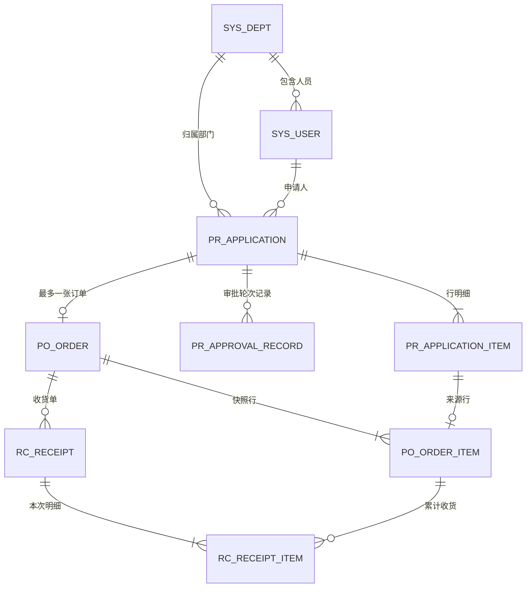
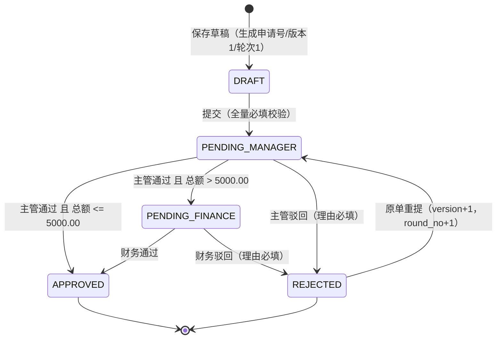
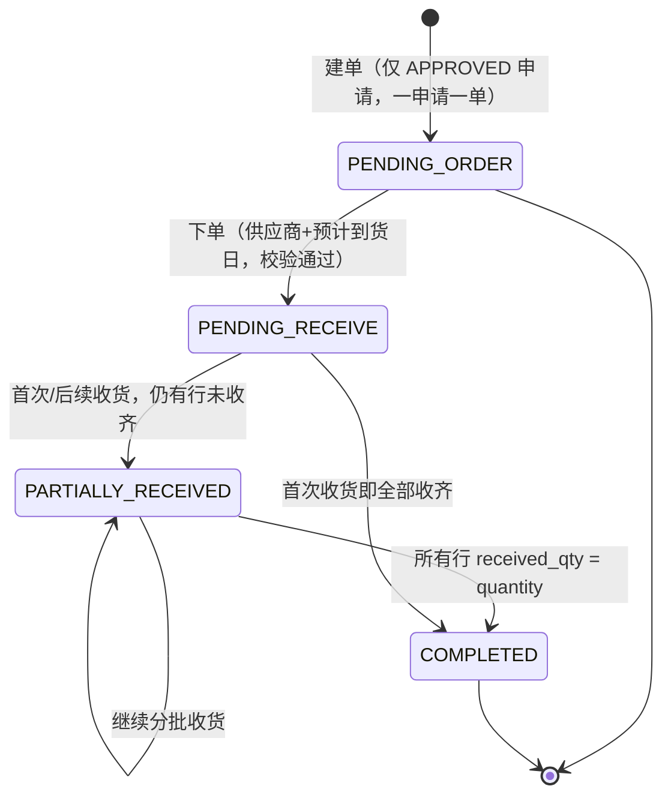
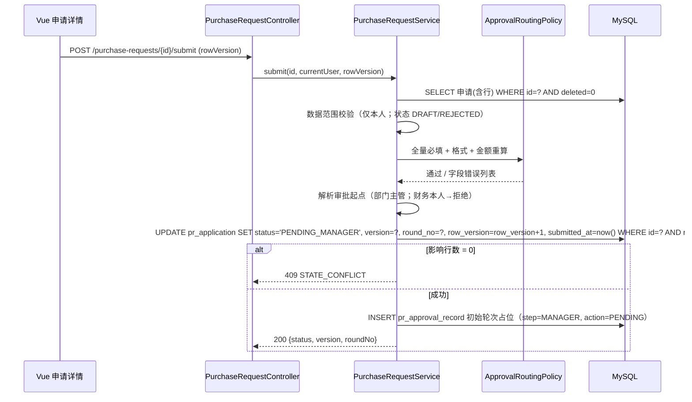

# 青岚工坊设备采购与审批系统 技术方案

> 基于人工校对V3当前稿，为采购申请、审批待办、采购订单、收货登记四模块生成 Java 21/Spring MVC/MySQL 8.4/Vue 3 单体技术方案。共 9 张表（7 张业务表 + 2 张预置基础表）与 13 个端点（12 个业务 + 1 个会话）。方案明确：草稿允许缺必填、提交执行全量校验并重算分金额；审批 500000 分（5000.00 元）单级、超出进入财务复核；一申请最多一单由唯一索引强制；收货空/0 行不落库、全 0 返回 422、超收由累计量条件更新返回 409；财务访问订单与收货一律 403 且申请详情不含订单段；并发依靠行版本条件更新与唯一约束，不引入消息队列、分布式锁、自动重试或独立幂等设施。本包为待开发设计，不代表已实现或已验收。

## 交付说明

本文档由 PRD 工作台技术方案结果组装，供前后端、DBA 直接按方案实施。

- **架构设计**：选型、分层、模块依赖、关键流转与协作约定（含 Mermaid）。
- **数据模型**：表、字段、可空性、索引与约束。
- **API 契约**：方法、路径、摘要、请求/响应样例、错误码。
- **模块补充**：若结果含 `modules/*.md`，一并附在架构之后。

## 方案指标概览

| 指标 | 数值 |
| :--- | :--- |
| 数据表 | 9 张 |
| API 端点 | 13 个 |

---

# 设备采购与审批系统 — 总体技术方案

> 基线：《设备采购与审批：人工校对 V3 运行基线》（生成稿 run_e30eafa2e88449158078）。
> 本文件描述**待开发的正式系统设计**，不代表任何功能已实现或已验收。原型阶段的内存静态页面只用于确认交互口径，其刷新还原种子数据的行为**不属于**本方案。
> 范围：采购申请 → 审批待办 → 采购订单 → 收货登记四个一级模块。不做付款、税额拆分、库存、资产折旧、退货、撤销收货、撤回审批、取消订单、供应商主数据、消息通知集成。

---

## 1. 技术选型

| 层次 | 选型 | 约束与理由 |
| --- | --- | --- |
| 语言/运行时 | Java 21（LTS） | 使用 record 承载 DTO、switch 模式匹配处理状态分支 |
| Web 框架 | Spring Boot 3.3.x + Spring MVC（Servlet 栈） | 明确不使用 WebFlux；同步阻塞模型足够，事务边界清晰 |
| 持久层 | MyBatis 3.5 + XML Mapper | 收货、审批需要手写条件更新 SQL（`received_qty + ? <= quantity`），ORM 自动脏检查不适用 |
| 校验 | Jakarta Bean Validation + 领域策略类 | 草稿"允许缺必填、已填必须合法"无法只用注解表达，需分组校验 + 策略二次校验 |
| 数据库 | MySQL 8.4，InnoDB，`utf8mb4_0900_ai_ci`，默认 REPEATABLE READ | 金额用整数分存储；并发用行级条件更新，不引入分布式锁 |
| 前端 | Vue 3.4 + TypeScript + Vite 5 + vue-router 4 + Pinia + axios | 组件库（Element Plus）以本地 npm 依赖引入，不使用 CDN |
| 登录态 | 服务端签发的无状态会话串 + Spring MVC `LoginInterceptor` | 单体部署，不引 Session 集群；会话串随自定义请求头提交，服务端验签得到用户与角色 |
| 明确不引入 | 消息队列、Redis、分布式锁、自动重试框架、独立幂等表/幂等键组件、微服务拆分 | 与基线一致；重复请求由唯一约束与状态条件更新返回 409，交用户手动重试 |

部署形态：单个 Spring Boot jar 提供 `/api/**`；前端 `dist` 由 Nginx 或 Spring 静态资源托管，`/api` 反向代理到同进程。开发期 Vite 代理 `/api` 到 8080。

---

## 2. 分层结构与职责

```
com.qinglan.purchase
├─ web/            controller、request/response DTO、GlobalExceptionHandler、LoginInterceptor
├─ application/    用例服务（事务边界 @Transactional）、DTO 组装、数据范围判定调用
├─ domain/         entity、枚举、策略（ApprovalRoutingPolicy、AmountCalculator、ReceiptPolicy）、领域异常
└─ infrastructure/ mapper 接口与 XML、编号生成器、当前用户上下文
```

| 层 | 可以做 | 禁止做 |
| --- | --- | --- |
| web | 参数绑定、Bean Validation 分组、HTTP 状态码映射、角色注解声明 | 写业务判断、直接调 Mapper、拼接金额 |
| application | 编排用例、开启事务、加载聚合、校验状态机前置条件、组装响应 | 内联复杂金额/路由规则（应下沉 domain） |
| domain | 状态流转合法性、审批路由、收货数量规则、金额分计算 | 依赖 Spring Web、访问数据库 |
| infrastructure | SQL、唯一约束冲突翻译、会话串验签 | 决定业务分支 |

**规则落点约定**：可被数据库表达的（唯一单号、一申请一订单、行号唯一、非空、金额非负）一律加约束兜底；跨行/跨表规则（全 0 拦截、超收、审批路由）在 application + domain 校验，并以条件更新作为并发下的最终防线。二者不可只留其一。

---

## 3. 模块边界与依赖

| 模块 | 职责 | 允许依赖 | 不负责 |
| --- | --- | --- | --- |
| purchase-request | 申请聚合的建立、编辑、提交、重提、详情聚合读 | domain 公共内核 | 审批决策、建单、收货 |
| approval-todo | 待办查询、通过/驳回、轮次推进、审批留痕 | purchase-request 的状态与金额（只读）、pr_approval_record | 修改申请行、改金额、改部门 |
| purchase-order | 建单、快照复制、下单、订单查询 | purchase-request（校验 APPROVED 并读行） | 改申请、登记收货 |
| receiving | 收货登记、累计量推进、订单状态推进 | purchase-order（读订单与行、条件更新累计量） | 建单、下单、撤销收货 |
| 公共内核 | 金额（分）、状态枚举、单号、数据范围、错误码 | — | 任何页面逻辑 |

依赖是单向的：`receiving → purchase-order → purchase-request`，`approval-todo → purchase-request`。禁止 purchase-request 反向调用审批或订单服务；申请详情中的订单/收货进度由**读模型**在同一请求内查询订单与收货表，不形成写依赖。

**跨模块共享数据只有一处写入口**：申请状态只由 `PurchaseRequestService`（提交/重提）与 `ApprovalService`（决策）修改；订单状态只由 `PurchaseOrderService`（下单）与 `ReceiptService`（收货）修改。其他代码只读。

---

## 4. 实体关系



关键基数：一个申请 1..N 行、0..1 订单；一个订单 1..N 行、0..N 收货单（分批）；订单行与申请行 1:1 快照对应；收货明细只记录**本次实际收货行**（未参与行不落库）。订单行上的 `received_qty` 是累计冗余列，用于并发校验与进度展示，权威明细仍在 `rc_receipt_item`，二者在同一事务内更新。

---

## 5. 状态机

### 5.1 采购申请



- 申请**没有**"已完成"状态：订单与收货进度是关联展示，不反写申请状态（基线明确要求）。
- 无可提交审批人时（财务方宁本人申请、或部门无主管）：**停留在 DRAFT**，返回 422 `NO_ELIGIBLE_APPROVER` 与提示文案，不产生待办。这是案例的保守临时决定。
- 草稿与已驳回可编辑；待主管审批/待财务复核只读；已批准永久只读。

### 5.2 采购订单



`PENDING_ORDER` 与 `COMPLETED` 没有收货入口。已下单订单不可编辑、不可取消；收货记录不可改、不可撤销。

---

## 6. 关键流程

### 6.1 提交审批



提交时**重算**行金额与总额（数量 × 单价，分），不信任前端总额；行金额 `quantity * unit_price_cents` 为整数运算，无浮点误差，审批路由只读这个整数。

### 6.2 审批决策与金额路由

```
decision(applicationId, action, reason, rowVersion):
  1. 加载申请；校验 status ∈ {PENDING_MANAGER, PENDING_FINANCE}
  2. 校验当前用户的待办归属：
     - step=MANAGER：user.dept == application.dept 且 role=MANAGER，或命中代审授权（周禾↔许原 本人申请）
     - step=FINANCE：role=FINANCE（跨部门）
  3. approver == applicant → 403 SELF_APPROVAL_FORBIDDEN
  4. action=REJECT 且 reason 为空/超 200 字 → 400 字段错误，状态不变
  5. action=APPROVE:
       total <= 5_000_00 分  → next = APPROVED
       total >  5_000_00 分  → 当前 step=MANAGER ? PENDING_FINANCE : APPROVED
  6. UPDATE pr_application SET status=next, row_version=row_version+1
       WHERE id=? AND row_version=? AND status=<读取时状态>
     影响 0 行 → 409（他人已处理或版本过期）
  7. INSERT pr_approval_record(action, is_delegate, reason, decided_at, application_version=version)
```

- 阈值唯一口径：`total_amount_cents <= 500000` 单级；`500001` 与 `860000` 两级。不设 10,000 元口径。
- 一轮内每 step 只允许一条终态记录；唯一键 `(application_id, round_no, step)` 防止重复决策落两条。
- 代审必须写 `is_delegate=1` 与 `delegate_of_user_id`，并在时间线标注"代审"。

### 6.3 建单与下单

建单：校验申请 `APPROVED`、当前用户 role=BUYER、该申请无订单（`uk_application_id` 兜底）→ 复制行快照（名称/规格/单位/数量/单价/行金额）→ 订单 `PENDING_ORDER`。申请保持 `APPROVED` 不变。
下单：校验 `PENDING_ORDER`、供应商 1–100 字、预计到货日 ≥ 当天 → `PENDING_RECEIVE` 并写 `ordered_at`。已下单不可重复下单（条件更新，影响 0 行 → 409）。

### 6.4 收货事务（核心）

单个本地事务，无跨库、无外部调用：

```sql
-- 步骤 2：逐行条件累加，超收即失败（不做先查后改的竞态判断）
UPDATE po_order_item
   SET received_qty = received_qty + #{qty}, row_version = row_version + 1
 WHERE id = #{itemId}
   AND order_id = #{orderId}
   AND received_qty + #{qty} <= quantity;
```

1. 校验订单状态 ∈ {`PENDING_RECEIVE`, `PARTIALLY_RECEIVED`}、当前用户 role=WAREHOUSE。
2. 组装**有效行**：`qty != null && qty > 0` 的明细；`null` 与 `0` 直接丢弃、不写 `rc_receipt_item`。
3. 有效行为空 → 422 `EMPTY_RECEIPT_LINES`（全 0/全空拦截），事务不开启写操作。
4. 每行数量必须是正整数（前端整数控件 + 服务端 `Integer` 类型，拒绝小数与负数）。
5. 按上表逐行执行条件更新，任一行影响 0 行 → 抛 `OVER_RECEIPT`，整事务回滚（此前已加的行也回滚），返回 409 并回传该行 `orderedQty/receivedQty/pendingQty` 供前端刷新。
6. 汇总本次有效数量，判定：全部订单行 `received_qty == quantity` → `COMPLETED`，否则 `PARTIALLY_RECEIVED`。
7. `UPDATE po_order SET status=?, row_version=row_version+1 WHERE id=? AND status IN (...)`；影响 0 行 → 409。
8. `INSERT rc_receipt` + 批量 `INSERT rc_receipt_item`（每行一条，`received_qty` = 本次数量）。

并发语义：两个仓管同时提交同一行时，第二条的条件更新必然失败（`received_qty` 已被抬升），返回 409 而不是超收；不需要分布式锁或 SELECT FOR UPDATE。所有校验都在同一事务内，失败不留半条记录。

---

## 7. 登录态与数据范围

- 登录成功后服务端签发会话串：内含 `userId`、`roleCode`、`deptId` 与 8 小时有效期，服务端验签即可还原身份，不查会话表。前端存内存 + `sessionStorage`，每次请求在自定义请求头 `X-Login-Session` 中携带。
- `LoginInterceptor` 验签后写入 `UserContext`（ThreadLocal，请求结束清理）；缺失/过期 → 401 `UNAUTHENTICATED`。
- 控制器方法标注 `@RequireRoles({BUYER})`；更细的"仅本人""仅本部门"由 `DataScopeService` 在服务层判断，**不依赖前端隐藏按钮**。
- 越权语义：角色不允许 → 403 `FORBIDDEN_ROLE`；角色允许但数据不在范围 → 403 `OUT_OF_DATA_SCOPE`；记录不存在 → 404。财务访问订单/收货接口一律 403，不返回"无数据"的空列表（避免被误读为无记录）。

| 端点 | APPLICANT | MANAGER | FINANCE | BUYER | WAREHOUSE |
| --- | --- | --- | --- | --- | --- |
| 申请列表/详情 | 本人 | 本部门（含待办） | 待财务复核及历史（**不含**订单/收货段） | 已批准只读 | 已建单申请必要字段 |
| 建/改草稿、提交 | 本人 | 本人 | 仅草稿，**不可提交** | 403 | 403 |
| 审批决策 | 403 | 本部门且非本人 / 授权代审 | 非本人 | 403 | 403 |
| 建单/下单 | 403 | 403 | 403 | 允许 | 403 |
| 订单/收货查询 | 只读本人关联 | 只读本部门关联 | **403** | 全部 | 待收货/部分收货及历史 |
| 收货登记 | 403 | 403 | 403 | 403 | 允许 |

财务角色的申请详情响应中，`orderProgress` 字段整体省略（`null`），不返回订单号、供应商、收货数量。

---

## 8. 接口与错误约定

统一响应体：

```json
{ "code": "OK", "message": "success", "data": {}, "traceId": "b7c1e0f2" }
```

- 分页：`page` 从 1 开始，`size` 固定默认 10（允许 10/20/50），`sort=createdAt,desc` 为唯一默认排序，不接受任意字段排序。响应 `data = { list, page, size, total, pages }`。
- 搜索：`keyword` 对单号与标题做 `LIKE '%kw%'`（前缀索引无法覆盖，数据量小可接受；超 10 万单再评估全文索引）。`status` 精确匹配，多值用逗号分隔。
- 空结果返回 `list: []`，前端渲染"暂无匹配单据"。
- 金额出参：同时给 `amountCents`（整数，权威）与 `amount`（字符串两位小数），前端只展示字符串、只回传分。
- 日期：`yyyy-MM-dd`（到货日），时间戳 `yyyy-MM-dd HH:mm:ss`（东八区，服务端统一）。

错误码（HTTP + 业务码双维度）：

| HTTP | 业务码 | 场景 |
| --- | --- | --- |
| 400 | `VALIDATION_FAILED` | 字段格式/长度/范围错误，附 `fieldErrors[]` |
| 400 | `REASON_REQUIRED` | 驳回未填理由 |
| 401 | `UNAUTHENTICATED` | 未登录或登录态过期 |
| 403 | `FORBIDDEN_ROLE` / `OUT_OF_DATA_SCOPE` / `SELF_APPROVAL_FORBIDDEN` | 角色、范围、自审 |
| 404 | `NOT_FOUND` | 单据不存在 |
| 409 | `STATE_CONFLICT` | 状态已变化（已被他人审批/下单/收货） |
| 409 | `VERSION_CONFLICT` | `rowVersion` 过期 |
| 409 | `DUPLICATE_ORDER` | 该申请已有订单 |
| 409 | `DUPLICATE_NO` | 单号唯一冲突（用户手动重试） |
| 409 | `OVER_RECEIPT` | 本次数量导致累计超订购量 |
| 422 | `EMPTY_RECEIPT_LINES` | 全部行空或 0 |
| 422 | `NO_ELIGIBLE_APPROVER` | 财务本人申请 / 部门无主管 |
| 422 | `INVALID_STATUS_TRANSITION` | 非法流转（如草稿直接建单） |
| 500 | `INTERNAL_ERROR` | 未预期异常，隐藏堆栈 |

409 一律**不自动重试**，前端提示"数据已被更新，请刷新后重试"并重新拉取详情。500 仅记录 traceId，不回显 SQL。

---

## 9. 金额、编号与校验口径

- 行金额 = `quantity × unit_price_cents`，`long` 运算；总额 = 各行之和。入库 `BIGINT`，出参转 `BigDecimal.movePointLeft(2).setScale(2)`。
- 单价入参：`BigDecimal`，`scale ≤ 2`，范围 `0.00–999999.99`，0 元合法；服务端 `setScale(2, UNNECESSARY)` 后 ×100 转分，避免 `0.1+0.2` 类误差。
- 数量：`1–999` 整数，`Integer` 类型直接拒绝 `1.5`。
- 单号：`SQ`/`DD`/`SH` + `yyyyMMdd` + 8 位（时间戳后 6 位 + 随机 2 位）；唯一索引兜底，冲突返回 409 由用户重试。**不使用缓存自增、不使用重试循环**。
- 草稿：允许标题/用途/到货日/明细缺失；已填字段仍须格式合法（日期可解析、数量在 1–999、单价两位小数）。提交才做全量必填。
- 期望到货日：提交时不得早于当天；历史记录保留原值（已存日期不因时间推移而变成非法）。
- 部门：从 `sys_user.dept_id` 取，请求体中的 `deptId` 一律忽略（防止越权改部门）。

---

## 10. 前端结构与约定

```
src/
├─ api/            request.ts（axios 实例、401 跳登录、409 统一提示）、purchase.ts、approval.ts、order.ts、receipt.ts
├─ stores/         session.ts（用户/角色/权限）、dict.ts（状态枚举与中文标签）
├─ router/         index.ts（createWebHistory，路由守卫按角色过滤）
├─ views/          request/List.vue、request/Detail.vue、request/Form.vue
│                  approval/Todo.vue、approval/Detail.vue
│                  order/List.vue、order/Detail.vue、order/Create.vue
│                  receiving/Detail.vue（收货表单内嵌订单详情）
└─ components/     StatusTag.vue、MoneyText.vue、Timeline.vue、EmptyState.vue、ConfirmDialog.vue
```

- 列表页统一：顶部单号/标题搜索 + 状态筛选，表头按创建时间倒序，底部分页 10 条，空态文案"暂无匹配单据"。
- 状态标签与颜色集中在一处映射，禁止各页面自行硬编码中文。
- 页面上所有动作按钮的可见性只是体验优化；服务端 403/409 是唯一权威。按钮点击后禁用直至响应返回，防止重复提交。
- 详情页时间线由后端一次性返回（`timeline: [{time, actor, action, detail}]`），前端只渲染，不拼接。
- 刷新页面必须从接口重新取数（正式系统持久化），不得沿用原型的内存种子数据逻辑。

---

## 11. 与基线的差异与遗留假设

| 项 | 本方案选择 | 状态 |
| --- | --- | --- |
| 财务本人申请 | 仅可存草稿，提交返回 422 并给出联系管理员文案 | 基线临时决定，需业务确认 |
| 单号格式 | 前缀 + 日期 + 8 位随机，唯一索引兜底 | 仅要求唯一，格式需确认 |
| 主管历史查询范围 | 不新增独立历史入口，仅本部门列表 | 基线 Q3 未确认 |
| 预计到货日上限 | 不设上限，仅要求 ≥ 当天 | 需业务确认 |
| 重提审批人 | 按角色池先到先审，仍禁止自审 | 需业务确认 |
| 长期未收齐 | 不提醒、不自动关闭 | 需业务确认 |
| 审批撤回 | 不支持 | 明确不做 |
| 权限模型 | 单角色（`sys_user.role_code`），不做多角色与角色管理页 | 基线"预置角色，不增加角色管理" |

并发、权限、金额路由这三类结论必须由独立测试验证；本方案不宣称已通过验收。

## 分模块设计补充

### 文件 `modules/approval-todo.md`

# 模块二：审批待办（approval-todo）

## 1. 职责边界

主管与财务共用一个待办模块，按当前角色决定列表内容与可执行动作。负责：待办查询、通过/驳回、轮次推进、审批留痕、代审判定。**不修改申请金额与行明细**，也不创建订单。待办不落表，是 `pr_application` 上状态的实时投影。

## 2. 页面与接口对照

| 页面 | 路由 | 动作 | 接口 |
| --- | --- | --- | --- |
| 审批待办 | `/approvals` | 列表、筛选、进入审批 | `GET /api/v1/approvals/todo` |
| 审批详情 | `/approvals/:applicationId` | 查看申请/用途/金额/轮次/历史，通过或驳回 | `GET /api/v1/purchase-requests/{id}`、`POST /api/v1/approvals/{applicationId}/decision` |

详情页复用申请详情的读模型，但隐藏编辑与提交动作，并把"通过/驳回"按钮放在底部固定区。驳回弹窗中理由为必填，取消不提交。通过/驳回都必须二次确认，确认文案要写明金额与下一步（"通过后将进入财务复核"）。

## 3. 待办查询规则

```
主管：WHERE status='PENDING_MANAGER'
        AND dept_id = :myDeptId
        AND applicant_id <> :myUserId
        AND 存在在职主管身份
财务：WHERE status='PENDING_FINANCE'
        AND applicant_id <> :myUserId
```

- 待办按 `submitted_at ASC`（先到先审）还是 `created_at DESC`？列表 UI 与基线"按创建时间倒序"一致，取 `created_at DESC`；不引入优先级与超时升级。
- `needFinance = total_amount_cents > 500000`，仅作列表标签（"需财务复核"），不参与路由计算，路由以决策时的实际金额为准。
- `isSelfApplication` 兜底标记：正常情况下本人申请已被 `applicant_id <> myUserId` 排除；若因代审授权查看他人单据，该字段为 false。
- 代审授权：`sys_user.can_delegate_approve=1` 的主管，可对**指定的对方本人**申请决策。实现用 `ApprovalScopeService` 判定：`applicant_id` 必须是授权对偶人（周禾↔许原），而不是"任意跨部门"。授权关系在 `sys_user` 上以布尔 + 固定映射维护，不引入授权表（案例范围）。

## 4. 决策流程与状态推进

```
输入：applicationId, action(APPROVE|REJECT), reason, roundNo, rowVersion, step
1. 加载申请；不存在 → 404
2. 校验当前角色与 step 匹配：
   step=MANAGER 需 MANAGER 且（同部门 或 命中代审）；step=FINANCE 需 FINANCE
3. 校验 applicant_id ≠ 当前用户，否则 403 SELF_APPROVAL_FORBIDDEN
4. 校验 status 与 step 一致（PENDING_MANAGER / PENDING_FINANCE），否则 422
5. 校验 roundNo == application.round_no，否则 409 VERSION_CONFLICT（旧轮次页面）
6. REJECT：reason 去空格后 1–200 字，否则 400 REASON_REQUIRED / VALIDATION_FAILED
7. 计算目标状态：
   APPROVE + total<=500000            → APPROVED
   APPROVE + total>500000 + step=MGR  → PENDING_FINANCE
   APPROVE + step=FINANCE             → APPROVED
   REJECT（任一 step）                 → REJECTED，写 last_reject_reason
8. UPDATE ... WHERE id=? AND status=<旧状态> AND row_version=?
9. INSERT pr_approval_record（唯一键 uk_app_round_step 防重复）
```

**金额路由唯一口径**：`total_amount_cents <= 500000` 单级（5,000.00 元整走单级）；`500001`（5,000.01）与 `860000`（8,600.00）两级。判断使用整数分，禁止用 `double` 或格式化后的字符串比较。

**通过后的下一步提示**：`needFinance=true` 时返回 `toStatus=PENDING_FINANCE, nextStep=FINANCE`，前端提示"已提交财务复核"；单级通过返回 `toStatus=APPROVED, nextStep=null`。

## 5. 并发与一致性

- 采用**单一条件更新**：`WHERE id=? AND status=? AND row_version=?`。影响 0 行即视为被他人抢先处理，返回 409 `STATE_CONFLICT`，前端刷新详情。不加重试循环、不加重试队列。
- `uk_app_round_step (application_id, round_no, step)` 保证同一轮同一环节只有一条终态；即使条件更新意外通过，第二条插入也会失败并回滚。
- 审批与申请状态在同一 `@Transactional` 内：更新主表 + 插入记录，任一失败全回滚。审批记录只增不改，不提供修改/删除接口。
- 主管通过与财务复核是两次独立事务（两个不同用户、不同时间），中间状态 `PENDING_FINANCE` 是可见的持久状态，不放在一个长事务里。

## 6. 权限边界

| 角色 | 待办可见 | 可决策 | 拒绝原因 |
| --- | --- | --- | --- |
| 主管 | 本部门 `PENDING_MANAGER` | 本部门且非本人；授权对偶人本人申请可代审 | 跨部门 → 403 `OUT_OF_DATA_SCOPE`；本人 → 403 `SELF_APPROVAL_FORBIDDEN` |
| 财务 | 跨部门 `PENDING_FINANCE` | 非本人 | 本人 → 403 `SELF_APPROVAL_FORBIDDEN` |
| 申请人/采购/仓管 | 无 | 无 | 403 `FORBIDDEN_ROLE` |

前端不显示"审批"菜单给无关角色，但这不是安全边界；每个决策请求都在服务端重新判定部门、角色、代审授权与自审。

## 7. 异常清单

| 场景 | HTTP | 业务码 |
| --- | --- | --- |
| 驳回未填理由 / 理由超 200 字 | 400 | `REASON_REQUIRED` / `VALIDATION_FAILED` |
| 审批人即申请人 | 403 | `SELF_APPROVAL_FORBIDDEN` |
| 跨部门主管审批 | 403 | `OUT_OF_DATA_SCOPE` |
| 非审批角色调用 | 403 | `FORBIDDEN_ROLE` |
| 单据已被他人处理 | 409 | `STATE_CONFLICT` |
| 页面停留旧轮次 / rowVersion 过期 | 409 | `VERSION_CONFLICT` |
| 对已批准/已驳回单决策 | 422 | `INVALID_STATUS_TRANSITION` |

## 8. 时间线展示口径

审批详情的时间线必须区分"审核通过""审核驳回""代审通过"，并展示理由（通过时可为空显示"—"）。历史轮次整体置灰并标注"第 N 轮（已结束）"，不可再操作。代审记录展示"许原（代 周禾 审批）"，数据来自 `is_delegate` 与 `delegate_of_user_id`。

### 文件 `modules/purchase-order.md`

# 模块三：采购订单（purchase-order）

## 1. 职责边界

负责：在**已批准**申请上建单、复制批准版本快照、下单（填供应商与预计到货日）、订单列表与详情查询。不修改申请、不修改快照金额与数量、不登记收货、不取消订单、不做付款。

## 2. 页面与接口对照

| 页面 | 路由 | 动作 | 接口 |
| --- | --- | --- | --- |
| 订单列表 | `/orders` | 关键词/状态筛选、分页、进入详情 | `GET /api/v1/purchase-orders` |
| 建单页 | `/orders/new?applicationId=` | 预览批准行快照、创建订单 | `POST /api/v1/purchase-orders` |
| 订单详情 | `/orders/:id` | 查看快照行、收货进度、收货历史；待下单时填供应商/到货日下单；仓管进入收货表单 | `GET /api/v1/purchase-orders/{id}`、`POST /api/v1/purchase-orders/{id}/place` |

建单入口在采购的"已批准申请"列表与申请详情中；若该申请已有订单，入口直接跳转已有订单详情，并提示"该申请已建单"。

## 3. 建单规则

1. 前置：申请 `status='APPROVED'`；当前用户 `role_code='BUYER'`。
2. 唯一性：`uk_application_id` 保证一申请一单。应用层先查一次给出友好提示，数据库唯一键作为并发最终防线；捕获 `DuplicateKeyException` 后查已有订单，返回 409 `DUPLICATE_ORDER` 并带 `existingOrderNo`。
3. 快照内容：`item_name / spec / unit / quantity / unit_price_cents / line_amount_cents` 全部从 `pr_application_item` 复制，`application_item_id` 保留追溯；快照列与申请行**解耦**，后续申请（已批准不可改）不会影响订单。
4. 订单号 `DD + yyyyMMdd + 8位`，唯一索引兜底，冲突 409 由用户重试。
5. 初始状态 `PENDING_ORDER`，`supplier_name`、`expected_arrival_date` 为空，`ordered_at` 为空。
6. 申请状态保持 `APPROVED`，**不**写"已完成"或"已下单"状态；申请详情通过 `orderProgress` 关联展示。

## 4. 下单规则

| 校验 | 规则 | 失败 |
| --- | --- | --- |
| 状态 | 必须 `PENDING_ORDER` | 422 `INVALID_STATUS_TRANSITION` / 409 `STATE_CONFLICT` |
| 供应商 | 必填，去空格后 1–100 字，自由文本 | 400 `VALIDATION_FAILED` |
| 预计到货日 | 必填，`>= 下单当天`（Asia/Shanghai） | 400 `VALIDATION_FAILED` |
| 并发 | `WHERE status='PENDING_ORDER' AND row_version=?` | 影响 0 行 → 409 |

成功后 `status='PENDING_RECEIVE'`、`ordered_at=now()`、`row_version+1`。已下单订单不提供任何编辑接口；供应商/日期不可改（基线未要求修改，按不可变实现，避免与收货进度口径冲突）。不提供取消。

## 5. 列表与详情口径

- 列表默认 `created_at DESC`，10 条/页。字段：订单号、关联申请号/标题、供应商、金额、状态、创建时间、收货进度。
- 收货进度 `progress = Σreceived_qty / Σquantity`，实时由 `po_order_item` 聚合，不存汇总列，避免与明细不一致。
- 详情行必须同时给出 `quantity / receivedQty / pendingQty`，其中 `pendingQty = quantity - receivedQty`（`CHECK` 约束保证非负）。
- 详情时间线：创建订单 → 下单（含供应商）→ 每次收货（含记录号与登记人），只读。
- `canReceive` 由服务端按"状态 + 角色"计算，前端仅用于显隐；即使被篡改，收货接口仍独立校验。

## 6. 状态与可见性

| 订单状态 | 含义 | 仓管可见 | 收货入口 | 采购可操作 |
| --- | --- | --- | --- | --- |
| `PENDING_ORDER` | 已建单未下单 | 否（列表默认过滤） | 无 | 可下单 |
| `PENDING_RECEIVE` | 已下单待收货 | 是 | 有 | 只读 |
| `PARTIALLY_RECEIVED` | 已有收货但未收齐 | 是 | 有 | 只读 |
| `COMPLETED` | 全部行收齐 | 是（历史） | 无 | 只读 |

仓管列表默认只查 `PENDING_RECEIVE, PARTIALLY_RECEIVED`，可通过状态筛选看历史（`COMPLETED`）。财务对订单与收货接口一律 403，不返回空列表。

## 7. 异常清单

| 场景 | HTTP | 业务码 |
| --- | --- | --- |
| 非采购员建单/下单 | 403 | `FORBIDDEN_ROLE` |
| 申请不存在或不可见 | 404 | `NOT_FOUND` |
| 申请非已批准 | 422 | `INVALID_STATUS_TRANSITION` |
| 重复建单 | 409 | `DUPLICATE_ORDER` |
| 订单已下单后再下单 | 409 | `STATE_CONFLICT` |
| 供应商/日期非法 | 400 | `VALIDATION_FAILED` |
| 财务读取订单 | 403 | `FORBIDDEN_ROLE` |
| 申请人读非关联订单 | 403 | `OUT_OF_DATA_SCOPE` |

## 8. 数据一致性

- 建单在一个事务内：插入 `po_order` → 批量插入 `po_order_item`。任一失败回滚，不产生"无行订单"。
- 订单总额以快照行求和落库，同时与申请总额做一次比对；不一致说明数据异常，直接 500 并记录 traceId（正常流程不可能出现）。
- `po_order_item.received_qty` 初始 0，只允许收货事务通过条件更新递增，任何编辑接口都不得直接赋值。
- 订单与申请之间无级联删除；两张表都不做物理删除。

### 文件 `modules/purchase-request.md`

# 模块一：采购申请（purchase-request）

## 1. 职责边界

负责申请聚合的**建立、草稿编辑、提交、被驳回后重提、详情聚合读**。不负责审批决策（approval-todo）、不建订单（purchase-order）、不登记收货（receiving）。申请状态只由本模块的提交/重提与审批模块的决策两处修改。

## 2. 页面与接口对照

| 页面 | 路由 | 主要动作 | 接口 |
| --- | --- | --- | --- |
| 申请列表 | `/requests` | 关键词/状态筛选、分页、进入详情、新建 | `GET /api/v1/purchase-requests`、`POST /api/v1/purchase-requests` |
| 申请详情 | `/requests/:id` | 查看行明细/审批轮次/时间线/订单进度；草稿或驳回单进入编辑或提交 | `GET /api/v1/purchase-requests/{id}`、`POST /api/v1/purchase-requests/{id}/submit` |
| 申请表单 | `/requests/new`、`/requests/:id/edit` | 保存草稿、整组编辑明细 | `POST /api/v1/purchase-requests`、`PUT /api/v1/purchase-requests/{id}` |

前端表单为单页三段：基本信息（标题/用途/部门只读/期望到货日）、明细表格（可增删行，行号前端生成后由服务端重排）、底部合计。合计必须用整数分计算，与后端一致，避免 4500.00 与 4499.99 的显示分歧。

## 3. 字段与校验落地

| 字段 | 草稿 | 提交 | 校验位置 | 失败反馈 |
| --- | --- | --- | --- | --- |
| 标题 | 可空 | 必填 1–100 字 | `@Size` + `DraftValidationGroup` 跳过 `@NotBlank` | 字段级红字 |
| 用途 | 可空 | 必填 1–500 字 | 同上 | 字段级红字 |
| 部门 | 只读，取登录人 `dept_id` | 同左 | 服务端覆盖，忽略请求体 | — |
| 期望到货日 | 可空 | 必填，且 ≥ 提交当天 | `SubmitValidation` + `LocalDate.now(ZoneId.of("Asia/Shanghai"))` | "期望到货日不能早于今天" |
| 明细行 | 可空 | ≥1 行 | 提交时 `items.isEmpty()` → 字段错误 | "请至少添加一行物品" |
| 物品名称 | 可空 | 1–100 字 | 行级校验 | 行内提示 |
| 规格 | 可空 | ≤100 字 | 行级校验 | 行内提示 |
| 单位 | 可空 | 台/个/件 | 枚举校验 | 行内提示 |
| 数量 | 可空 | 1–999 整数 | `Integer` 类型 + `@Min/@Max` | "数量须为 1–999 的整数" |
| 单价 | 可空 | 0–999999.99，≤2 位小数 | `BigDecimal` + `setScale(2, UNNECESSARY)` | "单价最多两位小数" |

**两段式校验**是核心：草稿走 `Draft` 分组，只做"已填即合法"；提交走 `Submit` 分组并再执行 `PurchaseRequestPolicy.validateForSubmit()`（含明细非空、日期、总额重算）。不允许用一个 `@Valid` 兼顾两种语义。

## 4. 关键规则落地

1. **建草稿生成单号**：`SQ + yyyyMMdd + 8位`，`uk_apply_no` 兜底；`DuplicateKeyException` → 409 `DUPLICATE_NO`，**不重试生成**。
2. **版本与轮次**：创建时 `version=1, round_no=1`；重提时 `version=version+1, round_no=round_no+1`，单号不变。二者必须同一事务内一起递增，禁止只加其一。
3. **草稿整组替换**：`PUT` 先 `DELETE FROM pr_application_item WHERE application_id=?` 再批量插入（草稿行无历史价值），必须在同一事务内；已提交行永不删除。
4. **提交即锁单**：成功后状态 `PENDING_MANAGER`，申请人不可编辑、不可撤回（基线不做撤回）。前端把详情页切为只读并隐藏提交按钮，服务端仍以状态条件更新拒绝二次提交。
5. **重提不继承结果**：新轮次从主管重新开始，旧轮审批记录保留且不可改；`pr_approval_record` 以 `round_no` 区分，详情页按轮次分组展示。
6. **金额重算**：提交时对每行 `line_amount_cents = quantity * unit_price_cents`（`long`），总额求和后落库；前端传入的任何总额字段被忽略。审批阈值判断只读该整数。
7. **提交路由**：申请人部门取在职主管（`role_code='MANAGER'` 且 `dept_id` 相同、`status=1`）；财务角色本人申请、或部门无主管 → 422 `NO_ELIGIBLE_APPROVER`，状态保持 `DRAFT`，不写审批记录、不产生待办。
8. **详情聚合读**：一次请求内组装主表、行、`pr_approval_record`（全部轮次）、时间线、订单进度。时间线不落表，按 `created_at / submitted_at / approval.decided_at / order.ordered_at / receipt.received_at` 合并后按时间正序，标注操作人。
9. **订单进度**：仅当存在订单时返回 `orderProgress`，含订单号、状态、行级 `orderedQty/receivedQty/pendingQty`。申请人只能看本人申请关联的，主管只能看本部门。**财务返回 null**。
10. **已批准永久只读**：无任何编辑入口，`PUT` 对 `APPROVED` 返回 422 `INVALID_STATUS_TRANSITION`。

## 5. 数据范围

| 角色 | 可见范围 | 可写 | 禁止 |
| --- | --- | --- | --- |
| 申请人 | `applicant_id = 当前用户` | 建草稿、改草稿/驳回单、提交 | 审批、看他人单据 |
| 主管 | `dept_id = 本人部门`（含本人申请） | 建本人申请、改本人草稿、提交 | 审批本人申请（转代审）、跨部门 |
| 财务 | `status ∈ {PENDING_FINANCE, APPROVED, REJECTED}` 的跨部门单据，**不含订单/收货段** | 本人草稿（不可提交） | 看订单、收货、代采购动作 |
| 采购 | `status = APPROVED` 且未有订单的申请（履行需要） | 无 | 新建/修改/提交/审批 |
| 仓管 | 已建单申请的必要字段 | 无 | 编辑任何申请 |

列表 SQL 的数据范围必须拼在 `WHERE` 中，不允许"查全量再过滤"。分页总数按过滤后的条件统计。

## 6. 异常与 HTTP 映射

| 场景 | HTTP | 业务码 | 前端处理 |
| --- | --- | --- | --- |
| 草稿字段格式非法（日期/数量/单价） | 400 | `VALIDATION_FAILED` | 定位行与字段 |
| 提交缺标题/用途/到货日/明细 | 400 | `VALIDATION_FAILED` + `fieldErrors` | 高亮缺失项，停留详情页 |
| 改他人单据 | 403 | `OUT_OF_DATA_SCOPE` | 提示无权限并返回列表 |
| 采购/仓管调用写接口 | 403 | `FORBIDDEN_ROLE` | 隐藏入口（服务端仍拒绝） |
| 编辑非草稿/非驳回单 | 409 | `STATE_CONFLICT` | 提示刷新 |
| `rowVersion` 过期 | 409 | `VERSION_CONFLICT` | 重新拉详情，用户重填 |
| 单号冲突 | 409 | `DUPLICATE_NO` | "请稍后重试"，不自动重试 |
| 无可用审批人 | 422 | `NO_ELIGIBLE_APPROVER` | 展示基线文案，保留草稿 |

## 7. 索引与查询注意

- 列表主查询走 `(applicant_id, status, created_at)` 或 `(dept_id, status, created_at)`，`ORDER BY created_at DESC` 可避免 filesort（前缀列等值）。
- `keyword` 为 `apply_no LIKE ? OR title LIKE ?`，两列 OR 无法走单索引；数据量小可接受，若超 10 万单再引入前缀匹配或独立搜索。
- 详情按 `id` 主键取，行明细走 `idx_application`，审批记录走 `idx_app_round`。

### 文件 `modules/receiving.md`

# 模块四：收货登记（receiving）

## 1. 职责边界

仓管对**待收货/部分收货**订单登记本次到货量，系统累加行级已收数量、写收货记录、推进订单状态。不提供退货、撤销收货、修改历史记录；不建单、不下单、不修改订单金额与订购数量。

## 2. 页面与接口对照

| 页面 | 路由 | 动作 | 接口 |
| --- | --- | --- | --- |
| 待收货列表 | `/receiving` | 只看待收货/部分收货订单，进入登记 | `GET /api/v1/purchase-orders?status=PENDING_RECEIVE,PARTIALLY_RECEIVED` |
| 收货登记 | `/receiving/:orderId` | 查看订购/已收/待收，按行填本次数，提交 | `GET /api/v1/purchase-orders/{id}`、`POST /api/v1/purchase-orders/{id}/receipts` |

登记页表格列：行号、物品、规格、单位、订购数、累计已收、待收、**本次数量**（唯一可编辑列）。待收为 0 的行输入框禁用。底部显示本次合计件数与备注框。

## 3. 数量规则（本模块核心）

| 输入 | 处理 |
| --- | --- |
| 空（`null`） | 视为未参与，不写明细、不累加 |
| `0` | 同空，不写明细（前端允许保留 0，后端归一为"未参与"） |
| 正整数且 `<= 待收` | 有效行，写 `rc_receipt_item`，条件累加 |
| 负数 / 小数 / 非数字 | 400 `VALIDATION_FAILED`，整单不提交 |
| 大于待收 | 409 `OVER_RECEIPT`，整单回滚，返回该行 `pendingQty` |
| 全部行空或 0 | 422 `EMPTY_RECEIPT_LINES`，不写记录、不改累计 |

DTO 中 `receivedQty` 必须是 `Integer`；`1.5` 在反序列化阶段即失败，不进入业务逻辑。前端使用整数步进控件（`step=1`、`precision=0`），并在失焦时把空串归一为 `null`。

## 4. 事务步骤（逐条对应实现）

```java
@Transactional(rollbackFor = Exception.class)
public ReceiptResult receive(Long orderId, ReceiptCommand cmd, UserContext user) {
    // 1. 角色与订单状态
    requireRole(user, WAREHOUSE);
    PoOrder order = orderMapper.selectById(orderId);          // 不存在 → 404
    if (!RECEIVABLE.contains(order.getStatus())) throw new BizException(INVALID_STATUS_TRANSITION);
    if (!order.getRowVersion().equals(cmd.getRowVersion())) throw new BizException(VERSION_CONFLICT);

    // 2. 过滤有效行：null 与 0 丢弃
    List<Line> effective = cmd.getItems().stream()
        .filter(i -> i.getReceivedQty() != null && i.getReceivedQty() > 0)
        .toList();
    // 3. 全 0 / 全空拦截，写操作尚未发生
    if (effective.isEmpty()) throw new BizException(EMPTY_RECEIPT_LINES);

    // 4. 逐行条件累加，超收即抛异常回滚
    for (Line l : effective) {
        int affected = orderItemMapper.addReceived(l.getItemId(), orderId, l.getReceivedQty());
        if (affected == 0) throw new BizException(OVER_RECEIPT, pendingQtyOf(l.getItemId()));
    }

    // 5. 判定是否全部收齐
    boolean allDone = orderItemMapper.countUnfinished(orderId) == 0;
    String next = allDone ? COMPLETED : PARTIALLY_RECEIVED;

    // 6. 订单状态条件更新（防并发推进）
    int updated = orderMapper.advance(orderId, order.getStatus(), cmd.getRowVersion(), next);
    if (updated == 0) throw new BizException(STATE_CONFLICT);

    // 7. 写收货头 + 明细（仅有效行）
    RcReceipt receipt = insertReceipt(orderId, user, effective, cmd.getRemark());
    insertReceiptItems(receipt.getId(), effective);
    return buildResult(receipt, next);
}
```

关键 SQL：

```sql
UPDATE po_order_item
   SET received_qty = received_qty + #{qty}, row_version = row_version + 1, updated_at = NOW()
 WHERE id = #{itemId} AND order_id = #{orderId} AND received_qty + #{qty} <= quantity;

UPDATE po_order
   SET status = #{next}, row_version = row_version + 1,
       completed_at = IF(#{next} = 'COMPLETED', NOW(), completed_at), updated_at = NOW()
 WHERE id = #{orderId} AND status = #{expectedStatus} AND row_version = #{rowVersion};
```

## 5. 状态推进

```
PENDING_RECEIVE    --首次收货，未收齐--> PARTIALLY_RECEIVED
PARTIALLY_RECEIVED --继续收货，未收齐--> PARTIALLY_RECEIVED
PENDING_RECEIVE    --首次收货即全收齐--> COMPLETED
PARTIALLY_RECEIVED --补齐--> COMPLETED
```

判定标准：**所有订单行** `received_qty = quantity`（不是"本次有效行都收满"）。用 `SELECT COUNT(*) FROM po_order_item WHERE order_id=? AND received_qty < quantity` 是否为 0 判定，避免在 Java 侧用可能过期的缓存列表计算。

`COMPLETED` 与 `PENDING_ORDER` 不提供收货入口；服务端收到请求返回 422，不依赖前端隐藏。

## 6. 权限与数据边界

| 角色 | 待收货列表 | 收货登记 | 说明 |
| --- | --- | --- | --- |
| 仓管 | 可见 | 允许 | 唯一可写角色 |
| 采购 | 可见 | 403 | 可看订单与收货记录，不登记 |
| 申请人/主管 | 关联订单只读 | 403 | 仅本人/本部门关联 |
| 财务 | 403 | 403 | **不得读取订单与收货记录**，不返回空列表 |

## 7. 异常清单

| 场景 | HTTP | 业务码 | 附带数据 |
| --- | --- | --- | --- |
| 非仓管调用 | 403 | `FORBIDDEN_ROLE` | — |
| 订单不存在 | 404 | `NOT_FOUND` | — |
| 订单已完成/未下单 | 422 | `INVALID_STATUS_TRANSITION` | 当前状态 |
| 全部行空或 0 | 422 | `EMPTY_RECEIPT_LINES` | — |
| 某行超收 | 409 | `OVER_RECEIPT` | `lineNo/pendingQty` |
| 并发导致累计变化 | 409 | `OVER_RECEIPT` 或 `STATE_CONFLICT` | 建议前端刷新 |
| 订单 `rowVersion` 过期 | 409 | `VERSION_CONFLICT` | 最新 `rowVersion` |
| 数量为负/小数 | 400 | `VALIDATION_FAILED` | 字段定位 |

## 8. 不可变与追溯

- `rc_receipt` 与 `rc_receipt_item` 只插入，不更新、不删除；无"撤销收货"接口。
- 每次登记生成独立记录号 `SH+yyyyMMdd+8位`，详情可核对登记人、时间、各行本次数量与备注。
- 行级累计量 `po_order_item.received_qty` 必须能由 `Σ rc_receipt_item.received_qty` 复算相等；建议提供只读核对 SQL 作为运维手段，不开放给业务页面。
- 并发下不需要分布式锁或重试：条件更新即冲突检测，冲突一律 409 交用户刷新后重试。

## 数据模型设计（Database Tables）

共 9 张表。字段、索引与约束如下，可直接作为 DDL 设计依据。

### `sys_dept` — 部门（预置基础表，无管理界面）

| 字段名 | 类型 | 可空 | 说明 |
| :--- | :--- | :--- | :--- |
| `id` | BIGINT UNSIGNED | NO | 主键 |
| `dept_code` | VARCHAR(32) | NO | 部门编码，如 DESIGN/RD |
| `dept_name` | VARCHAR(50) | NO | 部门名称，如 设计部 |
| `status` | TINYINT | NO | 1 启用 0 停用，默认 1 |
| `created_at` | DATETIME | NO | 创建时间 |

**索引与约束**：

- `{"name":"PRIMARY","unique":true,"columns":["id"],"comment":"主键"}`
- `{"name":"uk_dept_code","unique":true,"columns":["dept_code"],"comment":"部门编码唯一"}`

### `sys_user` — 人员与角色（预置基础表，单角色模型）

| 字段名 | 类型 | 可空 | 说明 |
| :--- | :--- | :--- | :--- |
| `id` | BIGINT UNSIGNED | NO | 主键 |
| `username` | VARCHAR(50) | NO | 登录名，唯一 |
| `display_name` | VARCHAR(50) | NO | 显示名，如 林沐 |
| `credential_digest` | VARCHAR(100) | NO | 登录凭据强哈希摘要，禁止明文存储与接口回显 |
| `dept_id` | BIGINT UNSIGNED | NO | 所属部门，FK sys_dept.id；申请部门的唯一来源 |
| `role_code` | VARCHAR(20) | NO | APPLICANT/MANAGER/FINANCE/BUYER/WAREHOUSE，单角色 |
| `can_delegate_approve` | TINYINT | NO | 1 表示允许代审指定对象本人申请，默认 0；仅周禾/许原为 1 |
| `status` | TINYINT | NO | 1 启用 0 停用，默认 1；停用后不可登录，历史单据保留 |
| `created_at` | DATETIME | NO | 创建时间 |

**索引与约束**：

- `{"name":"PRIMARY","unique":true,"columns":["id"],"comment":"主键"}`
- `{"name":"uk_username","unique":true,"columns":["username"],"comment":"登录名唯一"}`
- `{"name":"idx_dept_role","unique":false,"columns":["dept_id","role_code"],"comment":"按部门找主管/统计人员"}`

### `pr_application` — 采购申请主表（草稿/审批/批准的唯一状态载体）

| 字段名 | 类型 | 可空 | 说明 |
| :--- | :--- | :--- | :--- |
| `id` | BIGINT UNSIGNED | NO | 主键 |
| `apply_no` | VARCHAR(20) | NO | 申请号 SQ+yyyyMMdd+8位；首次保存生成，重提不变 |
| `title` | VARCHAR(100) | YES | 标题，提交必填 1–100 字；草稿可空 |
| `purpose` | VARCHAR(500) | YES | 用途，提交必填 1–500 字；草稿可空 |
| `dept_id` | BIGINT UNSIGNED | NO | 申请部门，创建时取申请人 dept_id，此后不可改 |
| `applicant_id` | BIGINT UNSIGNED | NO | 申请人，FK sys_user.id |
| `expected_arrival_date` | DATE | YES | 期望到货日，提交必填且不早于提交当天；历史值不改 |
| `total_amount_cents` | BIGINT | NO | 总额（分），默认 0；提交时由行重算，审批路由唯一依据 |
| `status` | VARCHAR(20) | NO | DRAFT/PENDING_MANAGER/PENDING_FINANCE/APPROVED/REJECTED，默认 DRAFT |
| `version` | INT | NO | 单据版本，初始 1，每次重提 +1；用于快照与留痕 |
| `round_no` | INT | NO | 审批轮次，初始 1，每次重提 +1；与 version 同步递增 |
| `last_reject_reason` | VARCHAR(200) | YES | 最近一次驳回理由，便于列表提示；权威记录在审批表 |
| `submitted_at` | DATETIME | YES | 最近一次提交时间 |
| `decided_at` | DATETIME | YES | 本单最终批准/驳回时间 |
| `row_version` | INT | NO | 乐观锁版本，默认 1，每次状态变更 +1 |
| `created_at` | DATETIME | NO | 创建时间，列表默认倒序 |
| `updated_at` | DATETIME | NO | 更新时间 |

**索引与约束**：

- `{"name":"PRIMARY","unique":true,"columns":["id"],"comment":"主键"}`
- `{"name":"uk_apply_no","unique":true,"columns":["apply_no"],"comment":"申请号唯一，重复插入即单号冲突 409"}`
- `{"name":"idx_applicant_status_created","unique":false,"columns":["applicant_id","status","created_at"],"comment":"申请人列表：我的申请 + 状态筛选 + 倒序"}`
- `{"name":"idx_dept_status_created","unique":false,"columns":["dept_id","status","created_at"],"comment":"主管待办/本部门列表"}`
- `{"name":"idx_status_created","unique":false,"columns":["status","created_at"],"comment":"财务跨部门待办"}`
- `{"name":"idx_created_at","unique":false,"columns":["created_at"],"comment":"默认全量倒序兜底"}`

### `pr_application_item` — 采购申请行明细（草稿期可改，提交后随单只读）

| 字段名 | 类型 | 可空 | 说明 |
| :--- | :--- | :--- | :--- |
| `id` | BIGINT UNSIGNED | NO | 主键 |
| `application_id` | BIGINT UNSIGNED | NO | 所属申请，FK pr_application.id |
| `line_no` | INT | NO | 行号，从 1 连续；重排后需保证唯一 |
| `item_name` | VARCHAR(100) | YES | 物品名称，提交必填 1–100 字 |
| `spec` | VARCHAR(100) | YES | 规格，可空，最多 100 字 |
| `unit` | VARCHAR(4) | YES | 单位，台/个/件 三选一；草稿可空 |
| `quantity` | INT | YES | 数量 1–999 整数；草稿可空，已填必须合法 |
| `unit_price_cents` | INT | YES | 单价（分）0–99999999，0 元合法；草稿可空 |
| `line_amount_cents` | BIGINT | YES | 行金额（分）= quantity × unit_price_cents，服务端计算 |
| `created_at` | DATETIME | NO | 创建时间 |
| `updated_at` | DATETIME | NO | 更新时间 |

**索引与约束**：

- `{"name":"PRIMARY","unique":true,"columns":["id"],"comment":"主键"}`
- `{"name":"uk_app_line","unique":true,"columns":["application_id","line_no"],"comment":"同一申请行号唯一"}`
- `{"name":"idx_application","unique":false,"columns":["application_id"],"comment":"详情按行号取明细"}`

### `pr_approval_record` — 审批记录（按轮次+环节唯一，只增不改，时间线数据源）

| 字段名 | 类型 | 可空 | 说明 |
| :--- | :--- | :--- | :--- |
| `id` | BIGINT UNSIGNED | NO | 主键 |
| `application_id` | BIGINT UNSIGNED | NO | 所属申请 |
| `round_no` | INT | NO | 审批轮次，对应申请当时的 round_no |
| `step` | VARCHAR(10) | NO | 环节 MANAGER/FINANCE |
| `action` | VARCHAR(10) | NO | APPROVE/REJECT；通过或驳回后写入，不预置待办行 |
| `approver_id` | BIGINT UNSIGNED | NO | 实际审批人，FK sys_user.id |
| `is_delegate` | TINYINT | NO | 1 代审，默认 0；代审必须在时间线标注 |
| `delegate_of_user_id` | BIGINT UNSIGNED | YES | 被代审人（申请归属主管），非代审为空 |
| `reason` | VARCHAR(200) | YES | 意见/驳回理由；驳回必填 1–200 字，通过可空 |
| `application_version` | INT | NO | 审批时所针对的申请版本，用于识别旧轮次 |
| `decided_at` | DATETIME | NO | 决策时间，时间线排序依据 |
| `created_at` | DATETIME | NO | 写入时间 |

**索引与约束**：

- `{"name":"PRIMARY","unique":true,"columns":["id"],"comment":"主键"}`
- `{"name":"uk_app_round_step","unique":true,"columns":["application_id","round_no","step"],"comment":"一轮一环节只允许一条终态，防重复决策"}`
- `{"name":"idx_app_round","unique":false,"columns":["application_id","round_no","decided_at"],"comment":"详情页按轮次展示全部历史"}`
- `{"name":"idx_approver_decided","unique":false,"columns":["approver_id","decided_at"],"comment":"审批人操作历史（预留）"}`

### `po_order` — 采购订单（一申请最多一单，快照来源为批准版本）

| 字段名 | 类型 | 可空 | 说明 |
| :--- | :--- | :--- | :--- |
| `id` | BIGINT UNSIGNED | NO | 主键 |
| `order_no` | VARCHAR(20) | NO | 订单号 DD+yyyyMMdd+8位，唯一 |
| `application_id` | BIGINT UNSIGNED | NO | 来源申请，唯一约束保证一申请一单 |
| `application_version` | INT | NO | 建单时引用的申请版本，用于核对快照来源 |
| `supplier_name` | VARCHAR(100) | YES | 供应商自由文本 1–100 字；建单时可空，下单必填 |
| `expected_arrival_date` | DATE | YES | 预计到货日；建单时可空，下单必填且不早于下单日 |
| `total_amount_cents` | BIGINT | NO | 订单总额（分），= 快照行之和，建单后不可改 |
| `status` | VARCHAR(20) | NO | PENDING_ORDER/PENDING_RECEIVE/PARTIALLY_RECEIVED/COMPLETED，默认 PENDING_ORDER |
| `created_by` | BIGINT UNSIGNED | NO | 建单采购员，FK sys_user.id |
| `ordered_at` | DATETIME | YES | 下单时间；为空表示未下单 |
| `completed_at` | DATETIME | YES | 全部收齐时间 |
| `row_version` | INT | NO | 乐观锁版本，默认 1 |
| `created_at` | DATETIME | NO | 建单时间，列表倒序 |
| `updated_at` | DATETIME | NO | 更新时间 |

**索引与约束**：

- `{"name":"PRIMARY","unique":true,"columns":["id"],"comment":"主键"}`
- `{"name":"uk_order_no","unique":true,"columns":["order_no"],"comment":"订单号唯一"}`
- `{"name":"uk_application_id","unique":true,"columns":["application_id"],"comment":"一个申请只能建一张订单，重复建单插入失败→409 DUPLICATE_ORDER"}`
- `{"name":"idx_status_created","unique":false,"columns":["status","created_at"],"comment":"仓管待收货列表、采购列表状态筛选"}`
- `{"name":"idx_created_at","unique":false,"columns":["created_at"],"comment":"默认倒序"}`

### `po_order_item` — 订单行快照 + 累计收货量（并发校验核心表）

| 字段名 | 类型 | 可空 | 说明 |
| :--- | :--- | :--- | :--- |
| `id` | BIGINT UNSIGNED | NO | 主键 |
| `order_id` | BIGINT UNSIGNED | NO | 所属订单 |
| `application_item_id` | BIGINT UNSIGNED | NO | 来源申请行，FK pr_application_item.id；仅追溯，不回读改值 |
| `line_no` | INT | NO | 行号，与申请行一致 |
| `item_name` | VARCHAR(100) | NO | 快照：物品名称 |
| `spec` | VARCHAR(100) | YES | 快照：规格 |
| `unit` | VARCHAR(4) | NO | 快照：单位 |
| `quantity` | INT | NO | 订购数量，快照，1–999，下单后不可改 |
| `unit_price_cents` | INT | NO | 单价（分）快照 |
| `line_amount_cents` | BIGINT | NO | 行金额（分）快照 |
| `received_qty` | INT | NO | 累计已收数量，默认 0；由收货事务条件累加，禁止直接赋值 |
| `row_version` | INT | NO | 乐观锁版本，默认 1，每次收货 +1 |
| `created_at` | DATETIME | NO | 创建时间 |
| `updated_at` | DATETIME | NO | 更新时间 |

**索引与约束**：

- `{"name":"PRIMARY","unique":true,"columns":["id"],"comment":"主键"}`
- `{"name":"uk_order_line","unique":true,"columns":["order_id","line_no"],"comment":"订单内行号唯一"}`
- `{"name":"idx_order","unique":false,"columns":["order_id"],"comment":"详情/收货按订单取行"}`
- `{"name":"idx_application_item","unique":false,"columns":["application_item_id"],"comment":"申请→订单行追溯"}`

### `rc_receipt` — 收货记录头（每次登记一条，只增不改）

| 字段名 | 类型 | 可空 | 说明 |
| :--- | :--- | :--- | :--- |
| `id` | BIGINT UNSIGNED | NO | 主键 |
| `receipt_no` | VARCHAR(20) | NO | 收货记录号 SH+yyyyMMdd+8位，唯一 |
| `order_id` | BIGINT UNSIGNED | NO | 所属订单 |
| `total_qty` | INT | NO | 本次收货总件数（有效行数量之和），>0 |
| `received_by` | BIGINT UNSIGNED | NO | 登记人（仓管），FK sys_user.id |
| `remark` | VARCHAR(200) | YES | 备注，可空，最多 200 字 |
| `received_at` | DATETIME | NO | 收货登记时间，详情展示与倒序依据 |
| `created_at` | DATETIME | NO | 创建时间 |

**索引与约束**：

- `{"name":"PRIMARY","unique":true,"columns":["id"],"comment":"主键"}`
- `{"name":"uk_receipt_no","unique":true,"columns":["receipt_no"],"comment":"收货记录号唯一"}`
- `{"name":"idx_order_received_at","unique":false,"columns":["order_id","received_at"],"comment":"订单详情按时间倒序展示收货历史"}`
- `{"name":"idx_receiver_received","unique":false,"columns":["received_by","received_at"],"comment":"仓管历史记录（预留）"}`

### `rc_receipt_item` — 收货明细（只记录本次实际收货行，空/0 行不落库）

| 字段名 | 类型 | 可空 | 说明 |
| :--- | :--- | :--- | :--- |
| `id` | BIGINT UNSIGNED | NO | 主键 |
| `receipt_id` | BIGINT UNSIGNED | NO | 所属收货记录 |
| `order_item_id` | BIGINT UNSIGNED | NO | 订单行，FK po_order_item.id |
| `line_no` | INT | NO | 行号冗余，便于展示排序 |
| `received_qty` | INT | NO | 本次收货数量，正整数且 <= 该行待收量（事务内校验） |
| `created_at` | DATETIME | NO | 创建时间 |

**索引与约束**：

- `{"name":"PRIMARY","unique":true,"columns":["id"],"comment":"主键"}`
- `{"name":"uk_receipt_item","unique":true,"columns":["receipt_id","order_item_id"],"comment":"一次收货同一行只能出现一次"}`
- `{"name":"idx_order_item","unique":false,"columns":["order_item_id"],"comment":"按订单行核对累计明细"}`

## API 接口契约

共 13 个端点。请求/响应样例为紧凑 JSON 字符串原文。

### 1. `GET /api/v1/purchase-requests` — 采购申请分页列表；按角色确定数据范围（申请人=本人，主管=本部门，财务=待复核及历史且不含订单信息，采购=已批准，仓管=已建单）

**Request**

```json
query: page=1&size=10&keyword=SQ20261019&status=DRAFT,PENDING_MANAGER（keyword 模糊匹配 apply_no/title；status 逗号分隔；两者皆可空）
```

**Response**

```json
{
  "code" : "OK",
  "message" : "success",
  "data" : {
    "list" : [ {
      "id" : 1001,
      "applyNo" : "SQ20261019000001",
      "title" : "设计部显示器采购",
      "applicantName" : "林沐",
      "deptName" : "设计部",
      "totalAmountCents" : 450000,
      "amount" : "4500.00",
      "status" : "PENDING_MANAGER",
      "statusLabel" : "待主管审批",
      "createdAt" : "2026-10-19 09:12:30"
    } ],
    "page" : 1,
    "size" : 10,
    "total" : 1,
    "pages" : 1
  },
  "traceId" : "a1b2c3d4"
}
```

**Error codes**

401 UNAUTHENTICATED；400 VALIDATION_FAILED（status 含非法枚举值）

### 2. `POST /api/v1/purchase-requests` — 新建申请草稿；草稿允许必填缺失，但已填字段格式必须合法；服务端生成申请号、version=1、round_no=1

**Request**

```json
{
  "title" : "设计部显示器采购",
  "purpose" : "替换老旧显示器",
  "expectedArrivalDate" : "2026-11-05",
  "items" : [ {
    "lineNo" : 1,
    "itemName" : "显示器",
    "spec" : "27寸 4K",
    "unit" : "台",
    "quantity" : 2,
    "unitPriceCents" : 180000
  }, {
    "lineNo" : 2,
    "itemName" : "扩展坞",
    "spec" : "USB-C",
    "unit" : "个",
    "quantity" : 2,
    "unitPriceCents" : 45000
  } ]
}
```

**Response**

```json
{
  "code" : "OK",
  "message" : "success",
  "data" : {
    "id" : 1001,
    "applyNo" : "SQ20261019000001",
    "status" : "DRAFT",
    "version" : 1,
    "roundNo" : 1,
    "totalAmountCents" : 450000,
    "amount" : "4500.00",
    "createdAt" : "2026-10-19 09:12:30"
  },
  "traceId" : "a1b2c3d4"
}
```

**Error codes**

400 VALIDATION_FAILED（标题>100/用途>500/日期不可解析/数量非1–999整数/单价>999999.99或小数超2位/单位非台个件/行号重复）；403 FORBIDDEN_ROLE（BUYER/WAREHOUSE）；409 DUPLICATE_NO（申请号冲突，用户手动重试）

### 3. `GET /api/v1/purchase-requests/{id}` — 申请详情聚合读：主表、行明细、全部审批轮次、只读时间线、订单与累计收货进度（财务角色整体省略订单段）

**Request**

```json
path: id=1001
```

**Response**

```json
{
  "code" : "OK",
  "data" : {
    "id" : 1001,
    "applyNo" : "SQ20261019000001",
    "title" : "设计部显示器采购",
    "purpose" : "替换老旧显示器",
    "deptName" : "设计部",
    "applicantName" : "林沐",
    "expectedArrivalDate" : "2026-11-05",
    "totalAmountCents" : 450000,
    "amount" : "4500.00",
    "status" : "PENDING_FINANCE",
    "statusLabel" : "待财务复核",
    "version" : 1,
    "roundNo" : 1,
    "rowVersion" : 3,
    "editable" : false,
    "items" : [ {
      "lineNo" : 1,
      "itemName" : "显示器",
      "spec" : "27寸 4K",
      "unit" : "台",
      "quantity" : 2,
      "unitPriceCents" : 180000,
      "lineAmountCents" : 360000,
      "receivedQty" : 0
    } ],
    "approvals" : [ {
      "roundNo" : 1,
      "step" : "MANAGER",
      "action" : "APPROVE",
      "approverName" : "周禾",
      "isDelegate" : false,
      "reason" : "预算内",
      "decidedAt" : "2026-10-19 10:02:11"
    } ],
    "timeline" : [ {
      "time" : "2026-10-19 09:12:30",
      "actor" : "林沐",
      "action" : "创建草稿",
      "detail" : "版本1"
    }, {
      "time" : "2026-10-19 09:20:02",
      "actor" : "林沐",
      "action" : "提交审批",
      "detail" : "第1轮"
    } ],
    "orderProgress" : {
      "orderId" : 9001,
      "orderNo" : "DD20261019000001",
      "status" : "PARTIALLY_RECEIVED",
      "statusLabel" : "部分收货",
      "receivedQty" : 2,
      "orderedQty" : 3,
      "lines" : [ {
        "lineNo" : 1,
        "quantity" : 2,
        "receivedQty" : 2,
        "pendingQty" : 0
      } ]
    }
  },
  "traceId" : "a1b2c3d4"
}
```

**Error codes**

403 OUT_OF_DATA_SCOPE（跨申请人/跨部门且无履职关系）；404 NOT_FOUND

### 4. `PUT /api/v1/purchase-requests/{id}` — 编辑草稿或已驳回单；整组替换行明细；单号、版本、轮次不变

**Request**

```json
{
  "rowVersion" : 3,
  "title" : "设计部显示器采购（调整）",
  "purpose" : "替换老旧显示器",
  "expectedArrivalDate" : "2026-11-10",
  "items" : [ {
    "lineNo" : 1,
    "itemName" : "显示器",
    "spec" : "27寸 4K",
    "unit" : "台",
    "quantity" : 3,
    "unitPriceCents" : 180000
  } ]
}
```

**Response**

```json
{
  "code" : "OK",
  "data" : {
    "id" : 1001,
    "applyNo" : "SQ20261019000001",
    "status" : "DRAFT",
    "version" : 1,
    "roundNo" : 1,
    "rowVersion" : 4,
    "totalAmountCents" : 540000,
    "amount" : "5400.00"
  },
  "traceId" : "a1b2c3d4"
}
```

**Error codes**

400 VALIDATION_FAILED（字段格式，规则同创建）；403 OUT_OF_DATA_SCOPE（非本人）；403 FORBIDDEN_ROLE（BUYER/WAREHOUSE）；409 STATE_CONFLICT（状态非 DRAFT/REJECTED）；409 VERSION_CONFLICT（rowVersion 过期）

### 5. `POST /api/v1/purchase-requests/{id}/submit` — 提交审批：全量必填校验 + 金额重算 + 路由到主管待办；被驳回单重提沿用单号，version 与 round_no 各 +1

**Request**

```json
{
  "rowVersion" : 4
}
```

**Response**

```json
{
  "code" : "OK",
  "data" : {
    "id" : 1001,
    "applyNo" : "SQ20261019000001",
    "status" : "PENDING_MANAGER",
    "statusLabel" : "待主管审批",
    "version" : 2,
    "roundNo" : 2,
    "rowVersion" : 5,
    "totalAmountCents" : 540000,
    "nextStep" : "MANAGER",
    "expectedApprover" : "周禾"
  },
  "traceId" : "a1b2c3d4"
}
```

**Error codes**

400 VALIDATION_FAILED（缺标题/用途/到货日/无明细/行字段缺失）；403 OUT_OF_DATA_SCOPE；409 STATE_CONFLICT（已提交或已被处理）；422 NO_ELIGIBLE_APPROVER（FINANCE 本人申请，或部门无在职主管）；422 INVALID_STATUS_TRANSITION（APPROVED 再次提交）

### 6. `GET /api/v1/approvals/todo` — 审批待办分页列表；主管看本部门 PENDING_MANAGER（排除本人申请），财务看跨部门 PENDING_FINANCE（排除本人申请），同一模块按角色返回

**Request**

```json
query: page=1&size=10&keyword=&status=PENDING_MANAGER（财务使用 PENDING_FINANCE）
```

**Response**

```json
{
  "code" : "OK",
  "data" : {
    "list" : [ {
      "applicationId" : 1001,
      "applyNo" : "SQ20261019000001",
      "title" : "研发部工作站采购",
      "applicantName" : "陈星",
      "deptName" : "研发部",
      "totalAmountCents" : 860000,
      "amount" : "8600.00",
      "status" : "PENDING_MANAGER",
      "step" : "MANAGER",
      "version" : 1,
      "roundNo" : 1,
      "submittedAt" : "2026-10-19 09:20:02",
      "isSelfApplication" : false,
      "needFinance" : true
    } ],
    "page" : 1,
    "size" : 10,
    "total" : 1,
    "pages" : 1
  },
  "traceId" : "a1b2c3d4"
}
```

**Error codes**

401 UNAUTHENTICATED；403 FORBIDDEN_ROLE（其他角色调用）

### 7. `POST /api/v1/approvals/{applicationId}/decision` — 审批决策（通过/驳回）；事务内校验归属性、自审、理由，条件更新状态并写审批记录；≤5000.00 元主管通过即批准，>5000.00 元进入财务复核

**Request**

```json
{
  "action" : "APPROVE",
  "reason" : "预算内",
  "rowVersion" : 5,
  "roundNo" : 1,
  "step" : "MANAGER"
}
```

**Response**

```json
{
  "code" : "OK",
  "data" : {
    "applicationId" : 1001,
    "action" : "APPROVE",
    "fromStatus" : "PENDING_MANAGER",
    "toStatus" : "PENDING_FINANCE",
    "nextStep" : "FINANCE",
    "version" : 1,
    "roundNo" : 1,
    "rowVersion" : 6,
    "decidedAt" : "2026-10-19 10:02:11",
    "needFinance" : true
  },
  "traceId" : "a1b2c3d4"
}
```

**Error codes**

400 REASON_REQUIRED（驳回未填理由）；400 VALIDATION_FAILED（理由>200字/action 非法）；403 SELF_APPROVAL_FORBIDDEN（审批人=申请人）；403 OUT_OF_DATA_SCOPE（跨部门主管/非财务角色）；409 STATE_CONFLICT（已被他人处理）；409 VERSION_CONFLICT（rowVersion 或 roundNo 不匹配）；422 INVALID_STATUS_TRANSITION（当前状态非待审批）

### 8. `GET /api/v1/purchase-orders` — 订单分页列表；采购看全部，仓管只看待收货/部分收货，申请人/主管只看本人或本部门申请关联订单，财务 403

**Request**

```json
query: page=1&size=10&keyword=DD20261019&status=PENDING_RECEIVE,PARTIALLY_RECEIVED（status 可多值逗号分隔；keyword 匹配 order_no 或关联申请号/标题）
```

**Response**

```json
{
  "code" : "OK",
  "message" : "success",
  "data" : {
    "list" : [ {
      "id" : 9001,
      "orderNo" : "DD20261019000001",
      "applicationId" : 1001,
      "applyNo" : "SQ20261019000001",
      "title" : "研发部工作站采购",
      "supplierName" : "青岚数码",
      "totalAmountCents" : 860000,
      "amount" : "8600.00",
      "status" : "PARTIALLY_RECEIVED",
      "statusLabel" : "部分收货",
      "orderedQty" : 3,
      "receivedQty" : 2,
      "progress" : "2/3",
      "createdAt" : "2026-10-19 11:00:00"
    } ],
    "page" : 1,
    "size" : 10,
    "total" : 1,
    "pages" : 1
  },
  "traceId" : "a1b2c3d4"
}
```

**Error codes**

401 UNAUTHENTICATED；403 FORBIDDEN_ROLE（FINANCE 角色一律 403，不返回空列表）；400 VALIDATION_FAILED（非法 status 枚举）

### 9. `POST /api/v1/purchase-orders` — 在已批准申请上创建订单：校验状态与唯一性，复制批准版本行快照，状态 PENDING_ORDER，不修改申请状态

**Request**

```json
{
  "applicationId" : 1001
}
```

**Response**

```json
{
  "code" : "OK",
  "data" : {
    "id" : 9001,
    "orderNo" : "DD20261019000001",
    "applicationId" : 1001,
    "applyNo" : "SQ20261019000001",
    "applicationVersion" : 2,
    "status" : "PENDING_ORDER",
    "statusLabel" : "待下单",
    "totalAmountCents" : 860000,
    "amount" : "8600.00",
    "supplierName" : null,
    "expectedArrivalDate" : null,
    "items" : [ {
      "lineNo" : 1,
      "itemName" : "工作站",
      "spec" : "32G/1T",
      "unit" : "台",
      "quantity" : 1,
      "unitPriceCents" : 860000,
      "lineAmountCents" : 860000,
      "receivedQty" : 0
    } ],
    "createdAt" : "2026-10-19 11:00:00"
  },
  "traceId" : "a1b2c3d4"
}
```

**Error codes**

403 FORBIDDEN_ROLE（非采购员）；404 NOT_FOUND（申请不存在或不可见）；409 DUPLICATE_ORDER（该申请已有订单，返回已有 orderNo）；409 STATE_CONFLICT（申请非 APPROVED）；422 INVALID_STATUS_TRANSITION（草稿/待审批/已驳回申请建单）

### 10. `GET /api/v1/purchase-orders/{id}` — 订单详情：快照行（订购数/累计已收/待收）、只读时间线、收货历史与本次可收数量；收货表单数据由本接口提供

**Request**

```json
path: id=9001
```

**Response**

```json
{
  "code" : "OK",
  "data" : {
    "id" : 9001,
    "orderNo" : "DD20261019000001",
    "applyNo" : "SQ20261019000001",
    "applicationId" : 1001,
    "supplierName" : "青岚数码",
    "expectedArrivalDate" : "2026-10-25",
    "orderedAt" : "2026-10-19 11:30:00",
    "status" : "PARTIALLY_RECEIVED",
    "statusLabel" : "部分收货",
    "totalAmountCents" : 860000,
    "amount" : "8600.00",
    "rowVersion" : 4,
    "canReceive" : true,
    "items" : [ {
      "id" : 9101,
      "lineNo" : 1,
      "itemName" : "工作站",
      "spec" : "32G/1T",
      "unit" : "台",
      "quantity" : 1,
      "unitPriceCents" : 860000,
      "lineAmountCents" : 860000,
      "receivedQty" : 1,
      "pendingQty" : 0
    }, {
      "id" : 9102,
      "lineNo" : 2,
      "itemName" : "扩展坞",
      "spec" : "USB-C",
      "unit" : "个",
      "quantity" : 2,
      "unitPriceCents" : 45000,
      "lineAmountCents" : 90000,
      "receivedQty" : 1,
      "pendingQty" : 1
    } ],
    "receipts" : [ {
      "id" : 7001,
      "receiptNo" : "SH20261019000001",
      "receivedByName" : "白舟",
      "receivedAt" : "2026-10-20 14:05:00",
      "remark" : "首批到货",
      "totalQty" : 2,
      "lines" : [ {
        "lineNo" : 1,
        "receivedQty" : 1
      }, {
        "lineNo" : 2,
        "receivedQty" : 1
      } ]
    } ],
    "timeline" : [ {
      "time" : "2026-10-19 11:00:00",
      "actor" : "苏青",
      "action" : "创建订单"
    }, {
      "time" : "2026-10-19 11:30:00",
      "actor" : "苏青",
      "action" : "下单",
      "detail" : "供应商 青岚数码"
    } ]
  },
  "traceId" : "a1b2c3d4"
}
```

**Error codes**

403 FORBIDDEN_ROLE（FINANCE 一律 403）；403 OUT_OF_DATA_SCOPE（非关联申请人/跨部门主管）；404 NOT_FOUND

### 11. `POST /api/v1/purchase-orders/{id}/place` — 下单：填供应商与预计到货日，校验后状态 PENDING_ORDER → PENDING_RECEIVE，写 ordered_at

**Request**

```json
{
  "supplierName" : "青岚数码",
  "expectedArrivalDate" : "2026-10-25",
  "rowVersion" : 1
}
```

**Response**

```json
{
  "code" : "OK",
  "data" : {
    "id" : 9001,
    "orderNo" : "DD20261019000001",
    "status" : "PENDING_RECEIVE",
    "statusLabel" : "待收货",
    "supplierName" : "青岚数码",
    "expectedArrivalDate" : "2026-10-25",
    "orderedAt" : "2026-10-19 11:30:00",
    "rowVersion" : 2
  },
  "traceId" : "a1b2c3d4"
}
```

**Error codes**

400 VALIDATION_FAILED（供应商缺失/超100字；预计到货日缺失或早于当天）；403 FORBIDDEN_ROLE；409 STATE_CONFLICT（已下单，影响行数 0）；409 VERSION_CONFLICT；422 INVALID_STATUS_TRANSITION（订单已完成或状态为 PENDING_RECEIVE 以外）

### 12. `POST /api/v1/purchase-orders/{id}/receipts` — 收货登记：按行提交本次到货量，空/0 行忽略，全 0 拦截，逐行条件累加防超收，同一事务写收货头/明细并推进订单状态

**Request**

```json
{
  "rowVersion" : 4,
  "remark" : "首批到货",
  "items" : [ {
    "orderItemId" : 9101,
    "receivedQty" : 1
  }, {
    "orderItemId" : 9102,
    "receivedQty" : null
  } ]
}
```

**Response**

```json
{
  "code" : "OK",
  "data" : {
    "receiptId" : 7001,
    "receiptNo" : "SH20261019000001",
    "orderId" : 9001,
    "orderStatus" : "PARTIALLY_RECEIVED",
    "orderStatusLabel" : "部分收货",
    "totalQty" : 1,
    "receivedAt" : "2026-10-20 14:05:00",
    "rowVersion" : 5,
    "items" : [ {
      "orderItemId" : 9101,
      "lineNo" : 1,
      "receivedQty" : 1,
      "receivedTotal" : 1,
      "pendingQty" : 0
    } ]
  },
  "traceId" : "a1b2c3d4"
}
```

**Error codes**

400 VALIDATION_FAILED（receivedQty 为负数/小数/非整数，orderItemId 不属于该订单）；403 FORBIDDEN_ROLE（非仓管）；403 OUT_OF_DATA_SCOPE；409 STATE_CONFLICT（订单已完成或已被并发推进）；409 VERSION_CONFLICT（订单 rowVersion 过期）；409 OVER_RECEIPT（某行累计超订购量，回传 pendingQty）；422 EMPTY_RECEIPT_LINES（全部行空或 0，不写记录）

### 13. `GET /api/v1/session/me` — 当前会话：返回用户、角色、部门与前端可用的能力开关（仅用于界面渲染，服务端仍独立鉴权）

**Request**

```json
无请求体；携带登录态请求头 X-Login-Session
```

**Response**

```json
{
  "code" : "OK",
  "data" : {
    "userId" : 11,
    "displayName" : "白舟",
    "roleCode" : "WAREHOUSE",
    "roleLabel" : "仓管",
    "deptId" : 3,
    "deptName" : "仓储组",
    "capabilities" : {
      "canCreateRequest" : false,
      "canApprove" : false,
      "canCreateOrder" : false,
      "canReceive" : true,
      "canViewOrder" : true,
      "canViewFinanceSection" : false
    }
  },
  "traceId" : "a1b2c3d4"
}
```

**Error codes**

401 UNAUTHENTICATED（未登录、登录态过期或用户停用）；500 INTERNAL_ERROR
