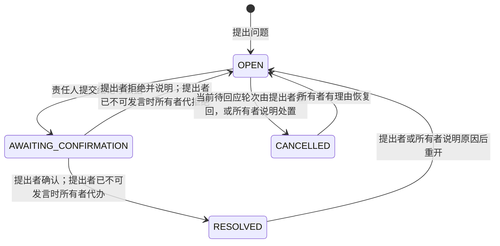

# 线上需求评审模块需求文档

版本：提案 v1.1；日期：2026-10-21；状态：已按独立评审决议修订，尚未实现。本方案扩展当前版本不包含协作的范围，不应解读为现有发布版能力。关联：[开源调研](research.md)、[技术方案](technical-design.md)、[核验记录](verification.md)。

## 1. 产品目标

为每份需求建立一个长期可追溯的人工评审空间：开发、测试等人员能对具体文字或整篇需求提问；产品逐项正式回应；提出者确认解决；涉及需求变化时，能查看修改前后内容、修改人、时间、原因和关联问题。后加入成员可从需求、讨论和修订记录接续工作。

本模块命名为“协作评审”，现有 Agent REVIEW 保持“AI 评审”。两者入口、数据、状态与操作独立。协作评审不依赖模型，不自动总结、回应、修正或决定问题是否解决。

| 当前痛点 | 目标行为 | 可观察结果 |
| --- | --- | --- |
| 会上或群里提出问题后遗忘 | 人工补录会议/群聊/开发中发现的问题，明确责任人与期限 | 可筛选待回应、逾期、未解决问题 |
| 产品回复了但问题未真正消除 | 正式答复与最终解决分开 | 能区分已答复、待确认、已解决 |
| 单点沟通导致文档与共识脱节 | 结论关联实际文档修订或注明无需修改的理由 | 从问题打开修订，从修订反查问题 |
| 人员交接缺少背景 | 新成员查看历史版本、原始引用、全部讨论和结论 | 无需依靠原参与者口述即可回看依据 |

## 2. 范围与信息边界

首期包含本地账号成员协作、Markdown 评审文档、选区/整篇问题、回复与正式答复、责任人和期限、解决确认、重开/撤销、历史查询、文档修订与对比、评审轮次、站内通知和导出交接包。

文档可直接粘贴 UTF-8 Markdown，或在浏览器中选择本地 `.md` 文件由页面读取后提交正文；**没有 Agent 运行也能使用**。服务端不接收独立附件上传。任务所有者也可从已有 AI 当前稿显式复制一次作为评审初稿；复制页面列明来源运行、当前稿时间和“独立评审副本”。评审文档保存后就是协作空间内的文档正文，不与 AI 工作区双向同步。

工作台同时标明“AI 工作区当前稿”和“协作评审文档”，进入评审默认展示后者当前版本。AI 再生成不替换评审文档；评审修改不覆盖原始 Agent 结果或旧当前稿。本期回交 AI 工作区通过所有者导出后自行选择材料完成，不提供自动回写和自动模型读取。

首期不包含实时共同编辑、Word/DOCX 原位审阅、逐字插入删除的接受/拒绝建议模式、音视频转写、外部群消息抓取、Jira 双向同步、邮件/IM 推送、SSO、访客匿名分享和多租户。修改记录首期采用“每次保存的版本 + 差异对比”，不是 Office 修订模式。

## 3. 用户与权限

复用现有本地账号。任务所有者是评审空间所有者；另外添加当前需求的成员，权限仅作用于协作评审，不扩大原始上传材料、Agent 结果或模型配置的访问范围。系统 ADMIN 不因管理员身份获得任意需求的评审内容或接口；须作为该需求所有者或显式成员。

| 操作 | 所有者 | 编辑者 EDITOR | 评审者 REVIEWER | 阅读者 VIEWER |
| --- | --- | --- | --- | --- |
| 查看评审文档、历史、问题及交接包 | 是 | 是 | 是 | 是 |
| 提问、讨论、关注问题 | 是 | 是 | 是 | 否 |
| 创建评审文档、从本地粘贴/读取 Markdown | 是 | 否 | 否 | 否 |
| 从 AI 当前稿复制初稿 | 是 | 否 | 否 | 否 |
| 编辑正文、保存修订、关联问题 | 是 | 是 | 否 | 否 |
| 担任问题责任人 | 是 | 是 | 否 | 否 |
| 正式答复与提出解决方案 | 是 | 作为该问题责任人时 | 否 | 否 |
| 确认解决 / 拒绝确认 | 本人提出；提出者已不可发言时有理由代办 | 本人提出 | 本人提出 | 否 |
| 管理成员、轮次、归档与恢复文档 | 是 | 否 | 否 | 否 |
| 查看原始 AI 工作区、运行/调用模型 | 按现有所有者权限 | 否 | 否 | 否 |

可发言成员 = 所有者、EDITOR、REVIEWER。VIEWER 不可提问、讨论、关注或确认。

所有者通过准确账号名添加已注册用户，不提供全站用户通讯录。增加/移除/更改角色均留痕。新增成员可看该需求全部评审历史；移除后下一次请求即失去权限，旧发言保留作者标识和当时显示名。

责任人被移除或降为不能负责的角色前，必须将其未终结问题转给另一位编辑者或所有者，且新责任人不能是该问题提出者。所有者不在本期转移；现有账号系统也不新增删除用户能力。

## 4. 核心对象

| 对象 | 含义与规则 |
| --- | --- |
| 需求空间 | 现有 task 下的协作评审范围；成员共享该空间全部评审文档 |
| 评审文档 | 一份独立 Markdown 文档，有当前版本及不可覆盖的保存历史；一个需求可有多份文档；仅所有者可创建 |
| 修订 | 一次成功保存的完整正文、版本号、修改人、时间、说明、来源与关联问题；首个版本记为 v1 |
| 标题变更 | 单独的文档元数据更新并留痕；不占用正文版本号；历史页可查标题修改人、时间和原因 |
| 评审轮次 | 对一个文档某个固定版本发起的正式评审；开放、已结束、已取消；同一文档最多一个开放轮次 |
| 问题 | 属于某个文档；系统标识与显示编号并存；可关联轮次，也可在开发测试阶段独立提出 |
| 发言 | 原问题后的讨论、正式答复或追问；记录作者、时间和回应对象 |
| 定位引用 | 提出问题时所见文档版本及选中文字；正文更改后仍能回原版本查看 |

问题字段：系统标识、显示编号、标题、正文、类型（疑问/缺漏/歧义/变更建议）、来源（在线/会议补录/群聊补录/开发/测试）、影响标记（阻塞/普通）、提出人和时间、责任人、回应期限、状态、回复数、正式答复情况、原始版本与引用、关联修订、最终结论、确认人和时间。优先级和影响由人填写，系统不判断业务重要性。

显示编号在同一文档内从 1 起递增，界面与筛选使用 `#` 加该数字；系统标识为内部不可复用 ID。编号一经分配不因撤销或删除空隙而重排。

会议或群聊补录可填写“原始提出人说明”和“原始发生时间”；提交账号与系统记录时间仍作为权威操作人和操作时间，不能冒充其他账号发言。首期无附件上传，可写文字或普通链接，系统不抓取外部链接内容。

## 5. 页面与主要流程

### 5.1 入口与工作台

全局增加“协作评审”入口，路由独立于原工作台，展示自己有权限的需求、我负责、我提出、待我确认、待代确认、站内通知。原有任务列表继续按所有者展示，不通过放开旧接口实现协作。协作页只请求评审接口，不调用旧任务详情、上传材料或运行接口。需求内增加“协作评审”页，展示成员、文档、轮次与问题概览。

桌面文档页为目录、正文、问题侧栏；窄屏以文档/问题/历史切换，保持可选版本和问题编号。文档页提供始终可见的“对本版本提问”，不依赖鼠标选区，供键盘操作创建整篇问题。

问题深链接形状为 `/reviews/{taskId}/documents/{documentId}?issue={issueId}`。未登录访问时保留完整路径，登录成功后回到该地址并重新校验权限。登录后换了账号或没有权限时按对象不存在处理并清空评审缓存。深链接不把成员送进原工作台首页，也不通过 URL 直接开放文档。

### 5.2 创建与开始评审

1. 所有者创建需求、添加成员；仅所有者粘贴 Markdown、在浏览器读取本地 `.md` 或明确选择一次 AI 当前稿快照以创建评审文档。
2. 保存 v1，填写标题。后续每次更改正文必须填写修改说明；可选择关联一个或多个问题。仅改标题走元数据更新，须填写原因，生成标题变更记录。
3. 所有者可发起轮次，选择固定基线版本、参与说明和可选结束时间，向当前成员发送站内通知。
4. 轮次期间仍可保存新版本，基线不变；页面同时显示轮次基线和当前文档版本。结束后可针对新版本开下一轮。

轮次归属：

- 归入开放轮次的问题必须针对该轮基线版本提出。
- 针对当前新版本、中间历史版本的问题作为轮次外问题，`round_id` 为空，不倒改该轮范围。
- 文档存在开放轮次且提问所选版本等于基线时，创建界面默认挂入该轮；用户可改为轮次外。
- 所选版本不是基线时，界面只允许记为轮次外，不能挂入该轮。
- 可对本文档任意已保存版本提问；未保存的本地正文不能作为批注版本。

### 5.3 选区提问与补录

在某个已保存版本选中文字，点击“提出问题”，展示引用和版本，填写标题/正文。责任人必须是所有者或 EDITOR，且不能是提出者本人。提出者不是所有者时，默认责任人为所有者。所有者本人提问时必须选择另一位 EDITOR；空间内没有另一位可负责的编辑者时拒绝创建，并提示先添加 EDITOR。仅有所有者和 REVIEWER 的空间可以讨论，不能形成“自提自答”闭环。

无法合理选区的图片、Mermaid 图和复杂跨块内容，允许针对章节描述或整篇提问；“对本版本提问”走同一整篇路径。提交成功后展示该文档内的显示编号并进入列表；失败时保留输入，用户手动再次提交。网络结果不确定时先刷新确认是否已经保存，不能自动重试造成重复问题。

### 5.4 逐项回应和解决确认

普通回复任何可发言成员都可添加。所有者或当前责任人可选择“正式答复”，答复人不能是提出者；提出者自己的补充只能作为讨论或追问。正式答复只表示已回应，不表示问题已经解决。

责任人填写明确结论并点击“请求确认”：

- 需要修改正文：先保存新修订并关联此问题，再选择该修订及修改位置说明。
- 无需修改正文：必须说明现有规则依据或处理决定。

提出者仍为可发言成员时，只有提出者本人选择“确认解决”或“仍有问题”。仍有问题要求填写原因，回到待处理并要求责任人重新回应。

提出者被移除或降为 VIEWER、已不可发言时，所有者填写代办理由后可代确认或代拒绝；页面明确显示代办人，不能伪装成提出者确认。提出者仍在职且可发言时，所有者不能代办。

撤销是独立终态，不计为解决。重复问题应填写被关联问题的显示编号或系统标识；不采纳应填写理由。提出者仅能撤回自己提出、状态为待处理、且当前待回应轮次尚无对应正式答复的问题。曾经正式答复后重开或拒绝确认回到待处理的，提出者在新的待回应轮次仍可撤回。其他撤销由所有者执行。待确认问题需要先退回待处理再撤销。任何关闭、撤销、恢复操作都不删除原讨论。

创建问题成功后自动关注提出者；转派成功后自动关注新责任人。可发言成员可手动关注或取消关注。降为 VIEWER 或移出空间时删除其关注关系，发言历史保留。

### 5.5 修改正文与查看历史

编辑者从当前已保存版本编辑，提交前填写修改说明、选择关联问题并查看差异。保存成功后生成新版本，不改变旧版本、原始引用和讨论；同时更新文档当前指针。归档文档不可提问、发言、修订或开轮次。

历史支持按版本、修改人、日期查询，任意两个正文版本比较新增、删除和替换内容；标题变更在同一历史页按时间列出。从问题进入关联修订，从修订进入原因问题。恢复旧内容也必须保存成一个新版本，填写恢复原因，不能抹去中间历史。

每个问题永远提供“查看提出时原文”。当前版本无法定位原引用时显示“原文已变化/无法定位”，仍展示原始引用；任何手动重新定位都保留原始位置和定位操作记录。不能因为文字相似而静默把问题挂到另一条规则上。

### 5.6 结束评审与持续跟踪

所有者结束轮次时填写结论：通过、带遗留项通过、暂不通过。系统只校验记录完整性，结论由人作出。

结束时按本文档计算：

| 集合 | 定义 |
| --- | --- |
| 本轮问题 | `round_id` 等于本轮的全部问题 |
| 文档未解决问题 | 本文档状态为待处理或待确认的全部问题，含本轮、轮次外（`round_id` 为空）以及其他轮次仍未终结的问题 |

- **通过**：文档未解决问题为空。本轮问题均已解决或已撤销。
- **带遗留项通过** 或 **暂不通过**：文档未解决问题非空；请求必须为其中每一项填写遗留说明。不得选择通过。

结束轮次保存当时的本轮问题数量、文档未解决清单、结论和遗留说明快照，不批量标为解决。已有问题仍可后续回应/重开，轮次页面分别展示“结束时快照”和“当前处理状态”。开发阶段新增问题可以不归入旧轮次，不能倒改已结束轮次的评审范围。取消轮次不改变问题状态，也不把问题改挂到其他轮次。

文档归档后仅可查看和导出；开放轮次须先结束/取消。存在未解决问题时归档必须展示遗留清单并填写理由。所有者可恢复文档再继续处理，归档不等于解决。归档与恢复向当前成员发站内通知。

## 6. 状态、统计与查询规则

问题业务状态只有 `OPEN`（待处理）、`AWAITING_CONFIRMATION`（待确认）、`RESOLVED`（已解决）、`CANCELLED`（已撤销）。这些与 Agent 的四种运行状态无关。

| 指标/标签 | 明确定义 |
| --- | --- |
| 回复数 | 问题创建后的发言数，不含初始正文及纯操作事件；作者自己的补充也可计入 |
| 从未正式回应 | 该问题历史上尚无任何一次有效正式答复 |
| 待责任人回应 | 状态为待处理，且当前待回应轮次尚无对应正式答复；待确认及终态不计入 |
| 我负责 | 当前用户是责任人，且状态为待处理或待确认 |
| 我提出 | 当前用户是提出者；含各状态，工作台默认看未解决，可切到全部 |
| 待我确认 | 问题处于待确认，当前用户是提出者且仍为可发言成员 |
| 待代确认 | 问题处于待确认，提出者已不可发言，当前用户是所有者 |
| 逾期未回应 | 有回应期限且期限已过，同时仍待责任人回应 |
| 未解决 | 待处理或待确认；撤销单列 |
| 解决率 | 已解决 /（总问题数 − 已撤销数）；分母为零显示“暂无可统计问题” |

全局和需求内问题列表支持组合筛选：关键词（标题/问题正文/回复正文）、显示编号、系统标识、需求、文档、轮次、原始版本、提出人、责任人、状态、是否回复、是否正式回应、待回应、逾期、来源、影响标记、提出日期。日期筛选以系统提出时间为准；所有时间传输 UTC，界面按浏览器时区显示并注明该时区，账号不另存时区字段。

默认按最近活动降序，可切换提出时间或期限；使用固定次序和分页，不一次加载全部。筛选结果只来自当前有权限的需求。已解决问题默认可通过“全部/历史”看到，不进行自动清理。

## 7. 站内通知与交接

按事件发送，收件人取当时有效对象并排除发起人；同一事件对同一用户只插入一条。不把空间全部成员并入每一次通知。

| 事件 | 收件人 |
| --- | --- |
| 提问、转派 | 新责任人 |
| 正式答复 | 提出者及当时关注者 |
| 请求确认 | 提出者；提出者已不可发言时改送所有者 |
| 重开、追问 | 当前责任人 |
| 新修订 | 该需求当前全部评审成员 |
| 成员被添加 | 被添加的用户 |
| 发起、结束、取消轮次 | 该需求当前全部评审成员 |
| 归档、恢复文档 | 该需求当前全部评审成员 |

站内通知记录已读/未读并链接到对象；浏览对象不自动等同于确认解决。逾期通过列表和计数突出显示，本期没有后台催办调度。登录后首次加载、前台可见时的定时读取或手动刷新获取变化；失败提示并停止轮询，用户手动恢复。

交接包支持导出 Markdown 文档版本、问题清单 CSV、讨论及操作历史 JSON、版本与问题关联清单。导出注明选择版本、导出时间、问题状态截止时间及数据范围；单次导出在一致性快照下读取。CSV 做公式注入防护，JSON/Markdown 保留准确原文。导出仅包含评审数据，不包含原始上传件、模型凭据和私有 Agent 响应。

## 8. 输入、异常和非功能要求

| 项目 | 首期规则 |
| --- | --- |
| 文档正文 | UTF-8 Markdown，非空，最多 500000 Unicode 码点且 UTF-8 不超过 2 MiB |
| 文档/问题标题 | 非空，最多 200 Unicode 码点 |
| 问题/回复 | 非空，最多 10000 Unicode 码点；修改说明/结论/操作理由最多 2000 |
| 引用 | 最多 2000 UTF-16 单元，前后文各最多 128；超过则缩小选区或按整篇提问 |
| 正文写入请求 | 最多 3 MiB；其他写请求最多 128 KiB；超限返回明确错误 |
| 人员和分页 | 每需求最多 100 名显式成员；每页默认 20、最多 100 |
| 保存竞争 | 版本冲突展示双方版本，保留本地输入；不覆盖、不自动合并、不自动重试 |
| 发言更正 | 已发表内容不覆盖/硬删；追加更正并注明原发言，保留时间线 |
| 失败与权限 | 未登录保留原路径转登录；越权不泄露评审对象存在性；失权停止读取并清空评审缓存 |
| 可访问性 | 状态同时有文字与颜色；键盘可打开“对本版本提问”、打开问题及确认；窄屏无不可操作按钮 |

码点上限按 Unicode 码点计数；引用长度按 UTF-16 单元计数。前后端使用同一计数规则。

不保证阻止用户离线保存、复制或已获得的导出。日志仅记标识、操作和错误码，文档/讨论/引用正文属于业务数据，不进入运行日志、截图报告或浏览器遥测。

性能目标（待实测）：单实例、每需求 20 份文档/10000 个问题、每问题 1000 条发言的合成数据下，分页列表与普通写请求 P95 小于 1 秒，单份 200000 字 Markdown 首屏小于 3 秒；测试设备、并发和网络另行记录，不能将目标当作结果。导出同步执行，上限 20 MiB 或 30 秒，超限提示缩小文档/时间范围。

## 9. 需求与验收追踪

| 需求 ID | 需求 | 验收 ID 与关键结果 |
| --- | --- | --- |
| ORR-01 | 独立人工入口及无 AI 使用 | ORR-T01：模型不可用且无 Agent 运行时仍能建文档、提问、回复、修订；不创建运行/模型请求 |
| ORR-02 | 成员权限与交接 | ORR-T02：新增成员可看评审历史；不能看上传件或 Agent 结果；移除/降权后直接 URL/API/导出均失权；ADMIN 未加入则看不到；仅所有者可建文档；EDITOR 创建文档被拒绝 |
| ORR-03 | 选区/整篇提问及补录 | ORR-T03：中文/emoji/表格/重复引用与整篇问题可保存、刷新还原；补录不冒用别人身份；无选区时键盘“对本版本提问”可提交 |
| ORR-04 | 逐项正式回应 | ORR-T04：自回复和普通讨论不清除待回应；正式答复后仍未解决；追问和转派重新要求回应；所有者自提且无第二 EDITOR 时创建失败；责任人不能等于提出者 |
| ORR-05 | 确认、重开和撤销 | ORR-T05：结论/修订关联必填；提出者在职时所有者不能确认；提出者失权后所有者代办可识别；重开后提出者可在新的待回应轮次撤回；撤销与已解决分开 |
| ORR-06 | 修订历史与对比 | ORR-T06：每次有效保存有作者/时间/原因/差异；恢复形成新版本；正文原样保留；改标题有独立留痕且不增加正文版本号 |
| ORR-07 | 双向问题修订关联 | ORR-T07：从问题查看具体修订，从修订查看问题；跨需求/跨文档关联拒绝 |
| ORR-08 | 旧版本与锚点 | ORR-T08：改字/删段/重复段落后仍能回原文；不能错误高亮；手动重定位保留原始位置 |
| ORR-09 | 问题查询与统计 | ORR-T09：组合筛选包含回复正文、显示编号和历史问题；分页无越权；全部撤销时解决率不除零；我负责/待我确认/待代确认集合符合定义 |
| ORR-10 | 轮次与开发期延续 | ORR-T10：固定基线，结束快照不可倒改；结束不清除未解决问题；针对新版本的问题不计入本轮；文档仍有未解决问题时不能选择通过；后续仍能回应或另提问题 |
| ORR-11 | 通知和待办 | ORR-T11：收件人按事件表，不向无关成员广播提问；已读可持久化；移除后不再读取；数据库故障无业务半成功；未登录深链接登录后回到原问题 |
| ORR-12 | 交接导出 | ORR-T12：数据范围准确，状态有截止时间，CSV 无公式执行；不含 AI 私有数据 |
| ORR-13 | 一致性、安全及故障 | ORR-T13：并发保存/回复/确认与移除成员竞态正确；错误保留输入；超限/XSS/CSRF/原型 HTML 隔离回归 |
| ORR-14 | 桌面和移动体验 | ORR-T14：390/1366/1440/1920 宽度真实浏览器点击成功、空态、校验、失败、刷新和手动重试 |

完整验收走查采用虚构中文采购需求：开发提出“8600 元是否需要财务审批”，测试追问“恰好 10000 元怎么处理”；产品正式答复并修订边界规则，开发确认、测试拒绝一次再确认；新增测试成员回看全程。另验证提出者离开后代确认、仅所有者加 REVIEWER 时所有者自提被拒绝、未答复逾期、模型停用、轮次结束后开发追问、文档有轮次外未解决问题时不能点通过、重复文字定位失效、未登录深链接回跳及并发冲突。

## 10. 交付顺序与已决议取舍

开发顺序：组件验证与正式契约 → 成员/文档版本底座 → 问题和解决闭环 → 查询通知及导出 → 真实集成与浏览器验收。全部为首期必要能力，不用前端演示替代持久化实现。组件验证失败时记录原因并重新选型，不能把选区提问降级成仅整篇提问而不改需求。

本提案已决议：所有评审成员共享空间全部评审历史；关闭问题需要提出者确认，提出者失权后由所有者代办；通过要求文档当时没有未解决问题，否则只能带遗留项通过或暂不通过；仅所有者创建评审文档；责任人不得为提出者；首期不原位编辑 DOCX、不自动同步 AI 当前稿。修改这些决议时同步调整权限、流程、契约与验收项。
