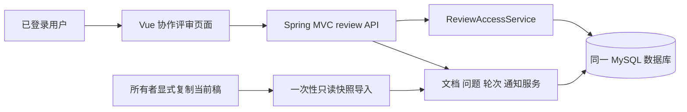

# 线上需求评审模块技术方案

版本：提案 v1.1；日期：2026-10-21。**全部新增模型、接口和文件名均为待实现设计**。本次没有修改正式 OpenAPI、执行 Flyway、接入组件或改动业务行为。对应：[需求文档](requirements.md)、[开源复用](research.md)、[核验记录](verification.md)。已按独立评审决议与需求 v1.1 对齐。

## 1. 已核实的现状与集成位置

代码基线：`main`，HEAD `2b9f373e84f3969e5401093992d8a604a2f09755`；发布版本 `0.4.0-beta.2`。冻结版本以 [versions.env](../../../config/versions.env) 为准：JDK 21、Maven 3.9.16、Spring Boot 3.5.16/MVC、MyBatis-Plus 3.5.7、MySQL 8.4.11、Vue 3.5.43、Vite 6.4.4、TypeScript 5.9.3、Node 22.23.1、pnpm 11.9.0、Hermes 0.16.0、Python 3.11.15。

| 位置 | 现有事实 | 设计影响 |
| --- | --- | --- |
| [TaskService](../../../apps/backend/src/main/java/org/hermesprd/workbench/task/TaskService.java) | `requireOwned` 仅允许所有者；旧任务列表最多取本人 50 条 | 不能将其整体替换为成员可访问；新增独立协作权限和分页入口 |
| [TaskController](../../../apps/backend/src/main/java/org/hermesprd/workbench/task/TaskController.java) | 草稿保存路径为 `/tasks/{taskId}/draft-sources/{sourceId}` | 不把新批注接到 AI 原始结果或旧草稿更新路径上 |
| [SourceRoles](../../../apps/backend/src/main/java/org/hermesprd/workbench/task/SourceRoles.java) | 现有草稿通过保留名称关联成功 GENERATE 运行，并进入后续 Agent 材料筛选 | 评审文档/讨论不能新增为 `prd_source` 后被默认送给模型 |
| [ReviewFeedbackService](../../../apps/backend/src/main/java/org/hermesprd/workbench/task/ReviewFeedbackService.java) | AI 评审决策按 run 保存为 JSON，后续 REVIEW 会读取历史决策 | 新模块不复用这份 JSON，不把讨论追加到模型历史上下文 |
| [TaskMutationGate](../../../apps/backend/src/main/java/org/hermesprd/workbench/task/TaskMutationGate.java) / `requireNoActiveRun` | 现有任务上下文写入在运行期间受保护 | 人工评审写入独立数据，在 Agent 运行时仍可使用；显式复制 AI 当前稿只读一次 |
| [SessionAuthInterceptor](../../../apps/backend/src/main/java/org/hermesprd/workbench/auth/SessionAuthInterceptor.java) | 会话读取 Bearer/X-Session-Token，清理 CurrentUser | 复用会话；所有新对象由服务端认证用户授权，拒收客户端伪造作者/时间 |
| [markdown.ts](../../../apps/web/src/markdown.ts) | 使用 marked、DOMPurify，另有严格 Mermaid 渲染 | 继续复用净化与图形安全策略，只在可信产品界面内渲染安全 Markdown |
| [迁移目录](../../../apps/backend/src/main/resources/db/migration) | 已有 V001–V013，8 张业务表 | 新增迁移从实际下一可用版本开始；暂建议 V014，实施前核查不能占用他人版本 |

现有回归入口包括 `TaskServiceTest`、`ReviewFeedbackServiceTest`、`TaskMutationGateTest`、`RunServiceThinSliceTest`、前端 `draftEditing.test.ts`、`session.test.ts`、`markdown.test.ts`、`mermaidSecurity.test.ts` 和 `tests/test_contracts.py`。新功能实现时新增独立 ORR 测试，不改变旧用例的所有者和不可变结果语义。

## 2. 架构与模块划分



单个后端进程内新增 `org.hermesprd.workbench.review` 包。建议职责：

| 类/组件（拟新增） | 职责 |
| --- | --- |
| ReviewAccessService | 查任务所有者/成员，验证动作权限和对象完整归属；ADMIN 身份不构成评审授权 |
| ReviewMemberService | 添加/降权/移除成员及责任人交接 |
| ReviewDocumentService | 创建、导入、保存新修订、对比、归档/恢复 |
| ReviewIssueService | 提问、发言、正式答复、状态动作、定位及关联 |
| ReviewRoundService | 固定基线、开启/结束/取消轮次与结束快照 |
| ReviewQueryService | 权限限定的组合查询、统计、待办与分页 |
| ReviewNotificationService | 在业务事务内生成站内通知，读取/标记已读 |
| ReviewExportService | 一致性快照下同步导出评审交接包 |
| ReviewController / ReviewModels | 请求响应、大小和字段验证；不承担业务结论判断 |
| ReviewDocumentView.vue / ReviewIssueDrawer.vue | 文档阅读/编辑、问题侧栏和移动页面 |
| ReviewHistoryView.vue / ReviewInboxView.vue | 修订对比、问题历史与通知待办 |
| reviewAnnotationAdapter.ts | Recogito 实例生命周期、选区与业务锚点格式转换 |

不新增微服务、队列、Redis、MinIO、搜索集群、第二模型、自动重试或恢复任务。不新增 Hermes 工具和模式。**Nacos：不适用：当前冻结基线不接入 Nacos。**

## 3. 数据所有权与现有 AI 工作区

协作评审文档的唯一当前内容来自 `prd_review_document.head_revision_id` 所指修订；不另存第二份可编辑正文。历史修订是同一对象的不可变版本，不是另一个系统的双写副本。

从 AI 当前稿导入仅允许任务所有者执行：验证 task/source/run 的真实归属及成功 GENERATE 状态，读取数据库当前内容与 `updated_at`，在同一事务内生成一个独立评审文档 v1；请求必须提供所见 `expectedUpdatedAt`，不一致返回冲突。来源字段只存 runId/sourceId/时间等本地标识，源材料后来删除不级联删除评审历史。导入后的新文档通过显著来源说明与旧稿区分。

评审表不参与 `SourceRoles` 和 Agent 材料查询。任务成员无权借来源标识调用旧 API。协作前端只使用 `/api/v1/review`；成员请求旧 `/api/v1/tasks/{taskId}`、source、run 接口时继续按 `requireOwned` 返回不存在。`GET /api/v1/review/tasks` 的 DTO 为 `ReviewTaskSummary`：`taskId`、`title`、当前用户角色（`OWNER` 或成员角色）、待办计数（我负责、待我确认、待代确认、未读通知），不含 sources、run 或上传材料。导出或人为选择材料进入 AI 属于所有者后续显式操作；本期不添加自动回写、模型读取、跨模块状态联动。

`ReviewAccessService` 判定可读：`prd_task.user_id = currentUser` 或存在 `prd_review_member` 行。系统 `ADMIN` 角色不进入该判定。添加成员按现有用户名规范化（trim、小写）精确匹配已注册账号；账号不存在返回 404 `RESOURCE_NOT_FOUND`；已是成员或把所有者再加一遍返回 409 `REVIEW_STATE_CONFLICT`。非所有者查询他人评审对象一律 404，不泄露存在性。

## 4. 数据模型与约束设计

以下为逻辑设计，不包含可执行的另一套 SQL。正式 DDL 只允许写入 Flyway 目录，所有字段与外键名称以实施时新增迁移为准。

共用：ID 为 `VARCHAR(64)`，时间为 UTC `DATETIME(3)`，文字 `utf8mb4`。枚举使用 `VARCHAR` + CHECK；JSON 只用于有界结构快照和事件元数据。文档、问题等对象均携带 `task_id`，通过组合外键与服务校验防跨需求拼接。

| 拟新增表 | 主要字段 | 关键唯一性/索引/约束 |
| --- | --- | --- |
| `prd_review_member` | task_id, user_id, role, revision, created_by, created_at | PK(task_id,user_id)；索引(user_id,task_id)；FK task/user；role 仅 EDITOR/REVIEWER/VIEWER；所有者不重复插入 |
| `prd_review_document` | id, task_id, title, head_revision_id, revision, next_issue_no, archived_at, created_by, created_at, updated_at | PK(id)，UK(task_id,id)；索引(task_id,updated_at,id)；revision 为数值并发令牌；head 必须指向本文档修订；next_issue_no 从 1 起在同一事务内分配显示编号 |
| `prd_review_revision` | id, task_id, document_id, version_no, parent_revision_id, content, content_hash, summary, change_type, created_by, author_name_snapshot, created_at, origin_kind, origin_ref | UK(document_id,version_no)，UK(task_id,document_id,id)；正文 LONGTEXT；content_hash 为原始 UTF-8 SHA-256；change_type 为 INITIAL/EDIT/RESTORE；origin_ref 为有界 JSON |
| `prd_review_round` | id, task_id, document_id, baseline_revision_id, status, revision, due_at, conclusion, close_snapshot, created_by, closed_by, created_at, closed_at | 索引(task_id,document_id,created_at,id)；组合 FK 基线属于同文档；生成列 OPEN 时取 document_id 否则 NULL，唯一索引确保一份文档最多一个开放轮次 |
| `prd_review_issue` | id, task_id, document_id, display_no, round_id, origin_revision_id, title, body, type, source, impact, reporter_id, reporter_name_snapshot, reported_at_note, reporter_note, assignee_id, response_due_at, status, revision, last_question_seq, last_answer_seq, first_answer_at, proposed_resolution, resolved_by, resolved_at, created_at, updated_at | UK(document_id,display_no)；索引(task_id,status,updated_at,id)、(assignee_id,status,response_due_at,id)、(reporter_id,created_at,id)、(document_id,created_at,id)、(round_id,status)；组合 FK 校验文档/轮次归属；初始 body 不覆盖；display_no 一经写入不重排 |
| `prd_review_post` | id, task_id, issue_id, issue_seq, kind, body, reply_to_post_id, corrects_post_id, author_id, author_name_snapshot, created_at | UK(issue_id,issue_seq)；索引(issue_id,created_at,id)；kind 为 DISCUSSION/ANSWER/FOLLOW_UP/CORRECTION；引用发言必须属于同 issue；追加后不可覆盖 |
| `prd_review_anchor` | id, task_id, document_id, issue_id, revision_id, kind, selector_version, renderer_fingerprint, rendered_text_hash, exact_quote, prefix_text, suffix_text, start_offset, end_offset, created_by, created_at | 索引(issue_id,revision_id,created_at,id)；kind 为 ORIGINAL/RELOCATED；带选区问题创建时恰好一个 ORIGINAL，整篇问题为零个；组合 FK 保证 issue/revision 属于同文档；定位记录只追加 |
| `prd_review_revision_issue` | task_id, document_id, revision_id, issue_id, change_note | PK(revision_id,issue_id)；索引(issue_id,revision_id)；组合 FK 同 task、同 document；链接随修订创建，不事后篡改 |
| `prd_review_event` | id, task_id, document_id, issue_id, issue_seq, event_type, object_id, actor_id, actor_name_snapshot, from_state, to_state, metadata, created_at | 索引(task_id,created_at,id)、(issue_id,issue_seq,id)；问题事件的 issue_seq 使用同一问题操作序列，其他事件可空；只追加；metadata 白名单且最多 16 KiB；不复制正文 |
| `prd_review_notification` | id, task_id, recipient_id, event_id, document_id, issue_id, created_at, read_at | UK(recipient_id,event_id)；索引(recipient_id,read_at,created_at,id)；只存对象链接，不复制文档/回复正文 |

`prd_review_issue.revision` 同时是问题内操作序列；每次发言、转派或状态动作都递增，写发言时 `issue_seq` 使用新序列。创建问题 revision/last_question_seq=1、last_answer_seq=0。可用序列直接区分追问与答复顺序，避免仅凭毫秒时间比较失真。

所有带 task_id 的子表均有对应父组合唯一键；例如 issue 的 `(task_id,document_id,id)`、round 的 `(task_id,document_id,id)`、post 的 `(task_id,issue_id,id)` 应在 DDL 中显式建立，以供组合 FK 引用。可空 round_id 不影响开发阶段独立问题。

head 指针与 revision 形成双向引用：先插入 head=NULL 的文档，插入 v1，再设置 head；全在一个事务中完成，不能提交无 head 的文档。组合 FK `(task_id,id,head_revision_id)` 指向 revision `(task_id,document_id,id)`，防止跨文档 head。父修订同样校验同一文档；恢复旧内容的新修订仍以当前 head 为 parent，另在 origin_ref 记录恢复来源。

历史表不设置删除用户/源材料导致的级联清理。评审子表对 `prd_task` 和 `prd_user` 一律 `ON DELETE RESTRICT`，禁止误用现有 `prd_task.user_id ON DELETE CASCADE` 的策略。现有 task 没有删除接口，本期也不新增删除用户接口；若未来删除用户，须先处理评审引用。首期仅提供文档归档。数据库账号不得被当作防篡改审计系统，本设计不宣称具备法务签名或管理员无法修改数据库的能力。

标题修改写入 `prd_review_event`（`event_type=TITLE_CHANGED`，metadata 含 fromTitle/toTitle/reason），并 CAS 增加 `prd_review_document.revision`；不插入 `prd_review_revision`，不改变 `head_revision_id` 与 `version_no`。历史接口同时返回正文修订与标题变更。

## 5. 事务、并发和故障语义

写操作使用 Spring 事务、同一 MySQL 连接；异常整体回滚。先判定当前用户是否为 `prd_task.user_id` 所指所有者；是则按所有者权限继续，日常修订/提问/答复不锁任务行。否则 `SELECT … FOR UPDATE` 其 `prd_review_member` 行，按锁后角色鉴权，没有该行则 404。成员增删改由所有者执行：已存在则锁该成员行再转派、改角色或删除；插入新成员依赖主键冲突处理重复。文档/问题再按固定顺序锁 document → round → issue。不把协作写入长时间持有 `prd_task`。不引入分布式锁，不把 `TaskMutationGate` 当作跨请求授权。不引入重试设施。

| 操作 | 同一事务内完成 |
| --- | --- |
| 新修订 | 验证权限/归档状态 → 核对 document.expectedRevision 和 expectedHeadRevisionId → 插入不可变 revision/问题链接 → CAS 更新 head 与 revision → 操作事件/通知 |
| 发言/状态动作 | 验证当前成员、对象和轮次归属 → 核对 issue.expectedRevision → 插入 post 或更新结构状态 → CAS 增序列 → 操作事件/通知 |
| 移除/降权成员 | 验证 owner → 核对成员令牌 → 验证并执行未终结问题转派 → 改成员角色/删除成员关系 → 事件/通知；任一步失败整体回滚 |
| 开始/结束轮次 | 验证 owner/文档和基线 → 核对文档或轮次令牌 → 按 6.1 计算本轮问题与文档未解决问题 → 校验结论与遗留清单 → 写轮次与结束快照 → 事件/通知 |

正文相同但仅空白不同也按原样比较；相同字节的重复保存返回 409 `NO_CONTENT_CHANGE`，不制造修订。正文 version_no 按当前 head 的 version_no 加一分配，不使用可能因元数据更新而增加的文档并发令牌编号。标题修改使用单独文档元数据更新并留痕；不伪装成正文修订。不依赖时间戳作为新增模块的并发令牌。Unicode 码点上限用代码点计数（Java `codePointCount` / JS `[...str].length` 对 BMP 外字符），引用长度用 UTF-16 单元；契约与前后端共用同一规则。

客户端禁用重复提交按钮，但这不是幂等系统。断网/超时后不假定失败、不自动重放；提示“结果未确认，请刷新检查”，保留本地输入，用户确认后再手动提交。事务失败不允许出现正文成功但审计/通知失败的半完成状态。导出在一个只读一致性事务内获取所有选定数据及截止时间；响应发送中断也不后台续传。

读请求先检查权限；分页、明细、通知和导出均不能只凭前端隐藏按钮授权。长导出先结束数据快照事务并生成有界 ZIP 缓冲，再以新的事务/当前读重新验证会话及任务成员权限，不能在旧 RR 快照内复查权限。失权则丢弃缓冲并返回 404；通过后才发送正文。已发送或已经获得的数据无法追溯撤回。前端失权、退出或切换用户即卸载组件并清空数据，业务正文不放 localStorage 或遥测。

## 6. 问题状态与回应逻辑

服务层执行的是用户动作、权限、关联和状态转移校验，不判断问题是否有业务价值，不替用户判断答复是否正确。

辅助谓词：`canSpeak(user)` 为所有者、EDITOR 或 REVIEWER；`reporterCanSpeak` 为提出者当前仍满足 `canSpeak`；`awaitingResponse = status == OPEN && last_question_seq > last_answer_seq`；`neverAnswered = first_answer_at IS NULL`；`canOwnerProxy = 当前用户为所有者 && !reporterCanSpeak`。

创建问题：文档未归档；`originRevisionId` 属于本文档已保存修订；`assigneeId` 为所有者或 EDITOR，且 `assigneeId != reporterId`。所有者自提时 `assigneeId` 必填且必须是另一位 EDITOR；空间内不存在其他 EDITOR 时返回 409 `REVIEW_STATE_CONFLICT`。提出者不是所有者时 `assigneeId` 可省略，默认所有者。开放轮次存在且 origin 等于基线时，省略 `roundId` 或传入该轮 id 则挂入该轮；JSON `roundId` 为 null 记为轮次外。origin 不是基线时禁止带非空 `roundId`。归档文档上创建问题返回 409 `REVIEW_ARCHIVED`。文档创建时 `next_issue_no=1`；创建问题在同一事务读取该值写入 `display_no` 后加一，并为提出者插入 watch。

| 动作 | 条件 | 写入结果 |
| --- | --- | --- |
| 普通讨论 | 可发言成员；文档未归档；问题任意状态 | post=DISCUSSION；不清除待回应、不改状态 |
| 正式答复 | owner 或当前 assignee，且 author 不等于 reporter；问题 OPEN | post=ANSWER；last_answer_seq=新序列；首次则写 first_answer_at；状态仍 OPEN；自答复返回 REVIEW_ACTION_FORBIDDEN，界面提示改发讨论或转派另一编辑者 |
| 追问 | 可发言成员；问题 OPEN | post=FOLLOW_UP；last_question_seq=新序列；表示需要正式回应 |
| 请求确认 | owner/当前 assignee；OPEN；已有当前问题轮的正式答复 | 填结论与 DOC_CHANGED/NO_CHANGE；转 AWAITING_CONFIRMATION，保留 proposal 快照 |
| 拒绝确认 | AWAITING_CONFIRMATION；reporter 且 reporterCanSpeak，或 canOwnerProxy | 必填原因；代办时另填 proxyReason；OPEN；last_question_seq=新序列；历史 proposal 留在事件 |
| 确认解决 | AWAITING_CONFIRMATION；reporter 且 reporterCanSpeak，或 canOwnerProxy | RESOLVED；确认人/时间；代办原因单独展示；提出者仍可发言时 owner 代办返回 REVIEW_ACTION_FORBIDDEN |
| 重开 | 当前 reporter 且为可发言成员，或 owner；RESOLVED | 必填原因；OPEN；新 question_seq；不删除旧解决事件和修订链接；不清除 first_answer_at |
| 撤销 | 状态 OPEN；owner 始终可撤；提出者仅在 awaitingResponse 时可撤自己的问题 | 必填处置类型/原因；重复时提供同需求问题 ID 或 display_no；CANCELLED。提出者看当前轮 awaitingResponse，不看 neverAnswered |
| 恢复撤销 | owner；CANCELLED | 必填原因；OPEN；新 question_seq |
| 转派 | owner/当前 assignee；非终态；目标 owner/EDITOR 且不等于 reporter | assignee 更新；若待确认则回 OPEN、旧 proposal 转历史；新 question_seq，需要新责任人回应；为新责任人插入 watch |

DOC_CHANGED 要求 `revisionId` 属于当前文档且比 origin_revision 新，并已在该修订的 revision_issue 中关联本问题；附修改位置说明。NO_CHANGE 必须写原因。确认仅验证这些结构，不能用字符串匹配替代人工验收。所有状态动作和正式答复不允许通过通用 PATCH 任意写字段。

首次回应时间与全部答复永久保留，重开只形成新的回应需求；不要将“回复数大于零”当作已回应。FOLLOW_UP 在待确认/终态下返回动作错误，用户需选择“仍有问题”或“重开”。CORRECTION 只能引用作者自己的原发言，且不改原文或自动改变状态；更正涉及正式决定时必须另做正式答复/重开动作。

### 6.1 结束轮次校验

同一事务内读取本文档全部问题后计算：

- `roundIssues`：`round_id = 本轮`
- `unresolvedInDocument`：本文档 `status IN (OPEN, AWAITING_CONFIRMATION)`，含本轮、轮次外和其他轮次未终结项

| 结论 | 服务端规则 |
| --- | --- |
| PASS | `unresolvedInDocument` 为空，且 roundIssues 中每一项为 RESOLVED 或 CANCELLED |
| PASS_WITH_RESIDUAL 或 REJECT | `unresolvedInDocument` 非空；`unresolvedDispositions` 必须覆盖其中每一项 issueId，每项含非空说明 |
| 其他 | 400 `INVALID_REQUEST` |

快照写入 roundIssues 计数、unresolvedInDocument 清单、结论和遗留说明。取消轮次只改轮次状态，不改问题 `round_id` 或问题状态。创建问题与结束轮次并发时以行锁顺序 document → round 串行化。

## 7. 批注组件与跨版本定位

候选依赖为 `@recogito/text-annotator`，核验包清单版本 4.3.7；精确版本、registry 完整性和传递依赖仍需接入前验证。通过业务适配器使用 JavaScript 核心，不加载 React wrapper、不引入第三方服务，不使用 README 中打印完整 annotation 的日志示例。

只绑定安全 Markdown 阅读区域。文档内容先经过现有 marked/DOMPurify，图表继续采用现有 Mermaid 安全链。批注不注入原始 Markdown、不参与 Word 导出源内容，也不绑定 DEMO/POC 的 iframe。生成 HTML 始终保持 `sandbox="allow-scripts"` 且不含 allow-same-origin，包括新窗口包装。

锚点字段参考 [W3C TextQuoteSelector](https://www.w3.org/TR/annotation-model/#text-quote-selector) 的引用/前后文思想，但采用本地格式，不宣称直接兼容 W3C 或 Recogito 原始 JSON。

1. 固定 `revisionId`，保存 exactQuote、prefix、suffix、起止位置、rendererFingerprint 与 renderedTextHash。整篇问题可不含锚点。
2. 定义 `review-dom-text-v1`：对净化后的正文 DOM 按文档序遍历 Text 节点，排除标记为不支持批注的图形/SVG/控件与 aria-hidden 区域；每个块间插入一个 LF，文本内只把 CRLF/CR 转为 LF，不 trim、不折叠空白、不做 Unicode 归一化。位置使用 UTF-16 单元且左闭右开。批注浮层不能加入正文文本。具体块元素表作为适配器常量随版本冻结。
3. 浏览器使用上述相同算法构建 Text 节点位置映射，并将选区映射到文本；Recogito 自身选择器经适配器转换，不假定其偏移单位相同。跨越不支持区域的选区拒绝并提示改提整篇问题。
4. rendererFingerprint 包含文本算法、Markdown/净化配置版本；字体和 viewport 不进入指纹。renderedTextHash 是该算法文本 UTF-8 的 SHA-256。
5. 重新加载原版本时，只有指纹、文本 hash、范围和 exactQuote 均匹配才直接定位。组件升级导致不匹配则显示引用并提示无法定位，不能伪装恢复成功。
6. 新版本只可计算“候选位置”：完整引用和前后文有唯一匹配时向人展示候选；用户确认后追加 RELOCATED 锚点和事件。多解/零解均标记无法定位，不自动持久化迁移。
7. 同一版本反复手工调整也追加新定位记录；ORIGINAL 永远保留。整篇问题后续也可追加 RELOCATED 定位，但不补造 ORIGINAL，其原始类型仍是整篇问题。页面默认取所选版本最新一次明确定位，仍可查看原始位置。

后端验证归属、字段、长度、整数边界及 `0 <= start < end <= 2000000`，不执行 DOM 或生成 JS。引用和渲染指纹是用户提交的批注定位信息，不能作为服务器已认证的原文摘录；原始修订正文才是权威内容。前端重放必须再次比对，不匹配就不高亮。篡改引用不能改变原文、作者或解决状态。

## 8. API 设计草案

前缀 `/api/v1/review`，全部需要现有会话。表内路径省略前缀。正式实现必须先同步 [OpenAPI](../../../contracts/openapi.yaml) 的路径、DTO、枚举、大小和错误响应，再实现消费者与契约测试；本提案不是第二份可执行契约。

| 方法与路径 | 请求要点 | 响应/授权 |
| --- | --- | --- |
| GET `/tasks` | page/pageSize，所有可访问评审空间 | 200 分页 `ReviewTaskSummary`；新成员不依赖旧 owner 列表；不含 sources/run |
| GET `/tasks/{taskId}/members` | 无 | 200 成员；当前成员可读 |
| POST `/tasks/{taskId}/members` | username, role | 201；owner；账号不存在 404；已是成员或添加所有者 409 `REVIEW_STATE_CONFLICT` |
| PATCH `/tasks/{taskId}/members/{userId}` | role, expectedRevision, reassignment（按未终结问题提供新责任人） | 200；owner；不能修改隐式所有者；降为 VIEWER 时删除其 watch |
| POST `/tasks/{taskId}/members/{userId}/remove` | expectedRevision, reassignment, reason | 204；owner；责任人交接与移除同事务执行；删除其 watch |
| GET `/tasks/{taskId}/documents` | page/pageSize | 200；当前成员可列 |
| POST `/tasks/{taskId}/documents` | title, content | 201；仅 owner；EDITOR 返回 403 `REVIEW_ACTION_FORBIDDEN` |
| POST `/tasks/{taskId}/documents/import-draft` | sourceId, expectedUpdatedAt, title | 201；仅 owner；一次复制 |
| GET/PATCH `/documents/{documentId}` | PATCH title, expectedRevision, reason | 200；读/编辑权限，PATCH 不改正文；改标题必填 reason 并写 TITLE_CHANGED 事件 |
| POST `/documents/{documentId}/archive` | expectedRevision, reason | 200；owner，开放轮次须先结束/取消 |
| POST `/documents/{documentId}/unarchive` | expectedRevision, reason | 200；owner |
| GET `/documents/{documentId}/revisions` | page/pageSize, authorId, from, to | 200 按时间合并正文修订与 TITLE_CHANGED；不默认返回所有正文 |
| GET `/documents/{documentId}/revisions/{revisionId}` | 无 | 200 指定正文及关联问题 |
| POST `/documents/{documentId}/revisions` | expectedRevision, expectedHeadRevisionId, content, summary, relatedIssues | 201；owner/EDITOR；RESTORE 还传 restoredFromRevisionId |
| GET `/documents/{documentId}/diff` | fromRevisionId, toRevisionId | 200 两版本的行级增删/替换数据；仅展示差异 |
| POST `/documents/{documentId}/rounds` | baselineRevisionId, expectedDocumentRevision, instruction, dueAt | 201；owner；同时存在开放轮次 409 |
| GET `/documents/{documentId}/rounds` | 分页 | 200 含结束快照与当前统计 |
| POST `/rounds/{roundId}/close` | expectedRevision, conclusion（PASS / PASS_WITH_RESIDUAL / REJECT）, summary, unresolvedDispositions | 200；owner；按 6.1 校验；结束快照在事务内形成 |
| POST `/rounds/{roundId}/cancel` | expectedRevision, reason | 200；owner；不撤销问题 |
| GET/POST `/documents/{documentId}/issues` | GET 筛选；POST 问题字段、originRevisionId、assigneeId、可选 roundId/anchor | 200/201；可发言成员；文档未归档；origin 必须已保存；assignee 规则见第 6 节；round 默认/拒绝规则见第 6 节 |
| GET `/issues` | 需求、文档、轮次、版本、人、时间、状态、回应、display_no、关键词组合 | 200 权限限定分页与汇总；待办标签按第 9 节派生 |
| GET `/issues/{issueId}` | 无 | 200 问题、proposal、关联修订、定位元数据 |
| GET `/issues/{issueId}/timeline` | page/pageSize | 200 以 issue_seq 为序合并发言与操作事件；同次发言的审计事件合为一项而非重复显示；正文按页读取 |
| POST `/issues/{issueId}/posts` | expectedRevision, kind, body, replyToPostId/correctsPostId | 201；kind 权限按动作表 |
| PATCH `/issues/{issueId}` | expectedRevision, title/type/source/impact/responseDueAt | 200；owner/assignee；原始正文不覆盖，修改元数据留痕 |
| POST `/issues/{issueId}/assign` | expectedRevision, assigneeId, reason | 200；owner/assignee |
| POST `/issues/{issueId}/actions` | expectedRevision, action, reason, proxyReason, resolution/duplicateIssueId | 200；动作白名单 PROPOSE_RESOLUTION/CONFIRM/REJECT/REOPEN/CANCEL/RESTORE；代办必填 proxyReason |
| POST `/issues/{issueId}/anchors` | expectedRevision, revisionId, selector, reason | 201；owner/assignee/reporter 且可发言；只追加 |
| POST `/issues/{issueId}/watch`，DELETE 同路径 | 无 | 204；关注以成员独立记录实现，见下方说明 |
| GET `/notifications` | unreadOnly,page/pageSize | 200；当前用户且仍有 task 权限 |
| POST `/notifications/read` | notificationIds（最多 100） | 204；只允许本人记录 |
| GET `/tasks/{taskId}/export` | documentId, revisionId, from, to | 200 ZIP；当前成员；超范围/超限显式失败 |

关注关系采用新增 `prd_review_issue_watch(task_id,issue_id,user_id,created_at)`，PK(issue_id,user_id)，FK issue/user，索引(user_id,issue_id)。这是上表以外第 11 张新增表；不塞入通用成员字段或通知 JSON。提出者在创建时自动关注；新责任人在转派时自动关注，已存在则忽略。可发言成员可手动关注或取消；VIEWER 调用返回 403。成员移除或降为 VIEWER 时删其关注关系，保留发言历史。通知读取不等于关注。

创建问题示例（所有标识均为合成）：

```json
{
  "title": "8600 元采购需要财务审批吗？",
  "body": "规则只写了 10000 元以上，请明确边界和审批路径。",
  "type": "AMBIGUITY",
  "source": "DEVELOPMENT",
  "impact": "BLOCKING",
  "originRevisionId": "rrv_example_1",
  "assigneeId": "usr_example_product",
  "roundId": "rrd_example_1",
  "responseDueAt": "2026-10-23T09:00:00Z"
}
```

请求确认示例：

```json
{
  "expectedRevision": 6,
  "action": "PROPOSE_RESOLUTION",
  "resolution": {
    "kind": "DOC_CHANGED",
    "conclusion": "已补充小于及等于 10000 元的审批规则，请确认。",
    "revisionId": "rrv_example_2",
    "changeNote": "审批规则章节第 2 段"
  }
}
```

分页统一 `{items,total,page,pageSize,asOf}`，page 从 1 开始；`total` 和 items 在同一只读快照内计算。默认按 `(updated_at DESC,id DESC)`；固定排序可保证同一快照顺序，不承诺并发变化时跨多个分页请求无重复，界面以 ID 去重并可手动刷新。通知/历史排序字段在正式契约中分别列出。正文搜索按需要查询，不把全文内容写进请求日志。

错误复用现有 `{code,message,requestId}`：401 `AUTHENTICATION_REQUIRED`；无权或不存在均 404 `RESOURCE_NOT_FOUND`；已知可访问对象动作无权 403 `REVIEW_ACTION_FORBIDDEN`；400 `INVALID_REQUEST`；413 `PAYLOAD_TOO_LARGE`；409 包括 `REVIEW_CHANGED`、`REVIEW_STATE_CONFLICT`、`NO_CONTENT_CHANGE`、`REVIEW_ARCHIVED`、`ROUND_ALREADY_OPEN`、`SOURCE_CHANGED`；内部异常 500 `INTERNAL_ERROR`。错误消息不拼接正文、SQL、数据库连接和凭据。

## 9. 查询、通知与导出实现

全局查询必须先用 `task.user_id = currentUser OR EXISTS(member)` 限定，再组合其他条件；每个子查询也绑定同一 task。关键词通过转义后的参数化 `LIKE`，回复正文使用 EXISTS，不能 join 发言后导致问题重复或 total 膨胀。首期使用 MySQL，不新增搜索服务；中文检索性能不足时先记录实际 EXPLAIN 和规模，再评估索引，不先引入外部全文引擎。

站内通知是同步业务表记录，按事件白名单计算收件人，不把空间全部成员并入每一次通知。

| event_type | 收件人 |
| --- | --- |
| ISSUE_CREATED、ISSUE_ASSIGNED | 新责任人 |
| ISSUE_ANSWERED | 提出者（仍为该需求成员，含 VIEWER）及当时 watch 用户 |
| RESOLUTION_PROPOSED | 提出者仍可发言则送提出者，否则送所有者 |
| ISSUE_REOPENED、ISSUE_FOLLOW_UP | 当前责任人 |
| REVISION_CREATED | 该需求当前全部评审成员（所有者加显式成员） |
| MEMBER_ADDED | 被添加的用户 |
| ROUND_OPENED、ROUND_CLOSED、ROUND_CANCELLED | 该需求当前全部评审成员 |
| DOCUMENT_ARCHIVED、DOCUMENT_UNARCHIVED | 该需求当前全部评审成员 |

排除发起人和当时不可读对象，按 `(recipient_id,event_id)` 去重后与事件同事务插入。无需队列/调度/重投。逾期标签基于 `response_due_at < now AND awaitingResponse` 实时派生。通知列表过滤已失权对象，不能通过旧通知看到讨论摘要。待办计数：我负责 = `assignee_id=me AND status IN (OPEN,AWAITING_CONFIRMATION)`；待我确认 = `status=AWAITING_CONFIRMATION AND reporter_id=me AND reporterCanSpeak`；待代确认 = `status=AWAITING_CONFIRMATION AND currentUser 为所有者 AND !reporterCanSpeak`。

前端前台可见时每 30 秒读取通知摘要；退出、隐藏或首次失败时停止，失败后由用户手动刷新/恢复。这里的轮询是读取当前状态，不是失败重试。新数据到来不覆盖正在编辑的正文，只提示“有新版本”。

导出 ZIP 采用固定安全文件名、标识目录和清单，不用用户标题拼宿主路径；CSV 处理以 =/+/-/@、制表符或换行开头的公式风险单元格，CSV 展示转义不改库中原文。JSON 保留真实数据并注明包含敏感业务内容；服务日志与公开验收报告仅使用合成材料。不新增上传附件，也不抓取讨论中的外链。

## 10. 前端状态和安全边界

在 [router.ts](../../../apps/web/src/router.ts) 增加 `/reviews`、`/reviews/:taskId` 和 `/reviews/:taskId/documents/:documentId`，独立按需加载，query 支持 `issue`。新增 `reviewApi.ts`，不将复杂逻辑继续堆进 WorkbenchView。沿用现有会话、视觉组件及 CSS，评审菜单与 AI REVIEW 用词明显区分。

未登录访问协作路由时把完整 path+query 写入登录回跳（例如 `/login?redirect=` 加编码后的站内路径）；登录成功只接受以 `/reviews` 开头的相对路径，拒绝协议、主机和外链。现有 401 处理对协作路径同样保留 redirect，不再一律 `assign("/login")` 后落到工作台 `/`。登录后账号与深链接权限不符则展示对象不存在并清空评审内存。文档页固定提供“对本版本提问”。界面时间用 `Intl` 按浏览器时区格式化并标注时区名，不读写用户时区字段。

页面状态至少覆盖加载中、无文档、无问题、无权限、保存中、冲突、服务错误和导出超限。编辑器仅在内存保留未保存内容，导航有离开保护。服务异常不重置输入；失权后停止请求并清空内存。前端只能帮助交互，不能决定服务端权限。

评论、修改说明、显示名默认作为纯文本；若允许有限 Markdown，复用净化且禁 raw HTML/脚本/嵌入。差异视图使用文本节点，不能将 diff 原文直接 v-html。链接限制安全协议，不自动加载外站图片和资源，防内部文档阅读时对外泄露引用信息。

继续复用现有 Origin/CORS 规则；不扩展 allowlist，不把 token 放 URL。新增 API 对所有读、写、导出做对象级授权，并对正文请求实行应用层与代理层限制。遥测最多记录操作码/耗时/数量，不记录标题、引用、正文或搜索关键词。

## 11. 迁移、上线与回退

实施前显示并核验目标 MySQL 8.4.11、数据库名 `prd_workbench`、Flyway 当前已应用版本及待执行版本，建立项目数据备份和可恢复点。不能只凭本机 mysql 客户端版本推断服务器版本。

建议在下一迁移中创建上述 11 张表（含 `prd_review_issue_watch`），明确组合 FK、CHECK、索引和对 task/user 的 RESTRICT 策略；不修改 V001–V013 或已应用 checksum；不为评审子表设置 `ON DELETE CASCADE`。现有任务无需回填成员和协作文档：owner 隐式有权限，进入后主动创建文档。来源文档的 v1 作者是实际导入人，不能伪造为历史 AI 草稿的编辑者。

执行后真实检查 Flyway success/checksum、information_schema 表/列/索引/约束、中文写读、事务回滚与权限隔离。禁止 repair 掩盖迁移链。若上线后撤回应用能力，保留新增历史表且停止写入；旧应用不应访问新表。需要数据库整体恢复时在确认备份/目标后按项目恢复流程进行，不能用自动 DROP 作为回退。

本轮仅文档，不创建 V014、不执行 SQL、不操作 MySQL 实例和数据卷。

## 12. 开发与验收计划

| 工作包 | 产出及需求映射 | 新增回归建议 |
| --- | --- | --- |
| A 组件验证 | ORR-03/08/14；确定依赖和适配器数据格式 | annotation 中文/emoji/重复文本/卸载/升级指纹测试与真实浏览器 |
| B 成员与文档 | ORR-01/02/06/07；DDL、OpenAPI、会话授权、不可变修订 | ReviewAccessServiceTest、ReviewDocumentServiceTest、真实 MySQL FK/CAS/回滚 |
| C 问题闭环 | ORR-03/04/05/08/10；发言、正式答复、确认和轮次 | ReviewIssueServiceTest、ReviewRoundServiceTest；完整状态/操作者矩阵 |
| D 查询与交接 | ORR-09/11/12；筛选、待办、通知、关注、导出 | ReviewQueryTest、ReviewNotificationTest、ReviewExportTest；CSV 注入/一致快照 |
| E 集成验收 | ORR-01–14；完整调用链、旧 AI 回归 | OpenAPI/Python 契约、Vitest 交互、typecheck/build、Maven、独立全 diff 复核 |

必须额外覆盖：同一问题两人并发答复/确认；保存与成员移除竞争；轮次结束与提问竞争；重复点击/断网结果不确定；跨文档 revisionId/roundId/issueId；错误角色 ANSWER/CONFIRM；提出者在职时 owner CONFIRM 拒绝；提出者失权后 owner 代确认成功；重开后提出者 CANCEL 在 awaitingResponse 时成功；所有者自提且无第二 EDITOR 时创建失败；EDITOR POST 文档拒绝；文档存在轮次外未解决问题时 PASS 拒绝；未登录深链接登录后回到原 issue；读历史/通知/导出越权；导出数据快照开始后移除成员时末次新事务鉴权拒绝返回；自答复不算正式回应；重开后旧答复不清除待回应；正文/回复/引用边界与码点计数；恢复产生新修订；改标题不增加 version_no；原 Agent payload 和工具清单完全不变。

真实验收使用隔离 schema 和专用端口 18100/8643/5174，验证 SELECT 1/schema、Hermes detailed health/capabilities/22 项工具、正式 Vue，使用合成中文材料完成真实 Agent 提交和持久化回归；同时停止/禁用模型验证纯人工评审可用。浏览器按 ORR-T01–14 在 390/1366/1440/1920 宽度点击，记录成功、空态、校验、失败、刷新、手动重试和已有 Agent 失败手动重跑。截图不包含凭据或真实业务材料。

## 13. 开发前需保留的风险与取舍

- Recogito 尚未在冻结栈实测；先完成组件验证，不将官方 API 描述当作当前项目验收结果。验证失败须重新选型并改需求，不能把选区提问降级为仅整篇提问。
- 两类文档并存会带来误认：入口必须清楚标识协作正文与 AI 当前稿、来源和版本，不能用隐式同步消除差异。
- 成员变更与文档/问题行锁覆盖降权竞态；日常写入不锁 `prd_task`。单实例下可接受，必须测写延迟，不扩展分布式锁。
- 大规模 LIKE 和版本差异可能慢；先分页、限制导出、实测，不能预先引入队列或搜索服务。
- 评审记录不可覆盖不代表永不丢失；备份、恢复和数据库权限依旧必要，本期不增加合规认证承诺。
